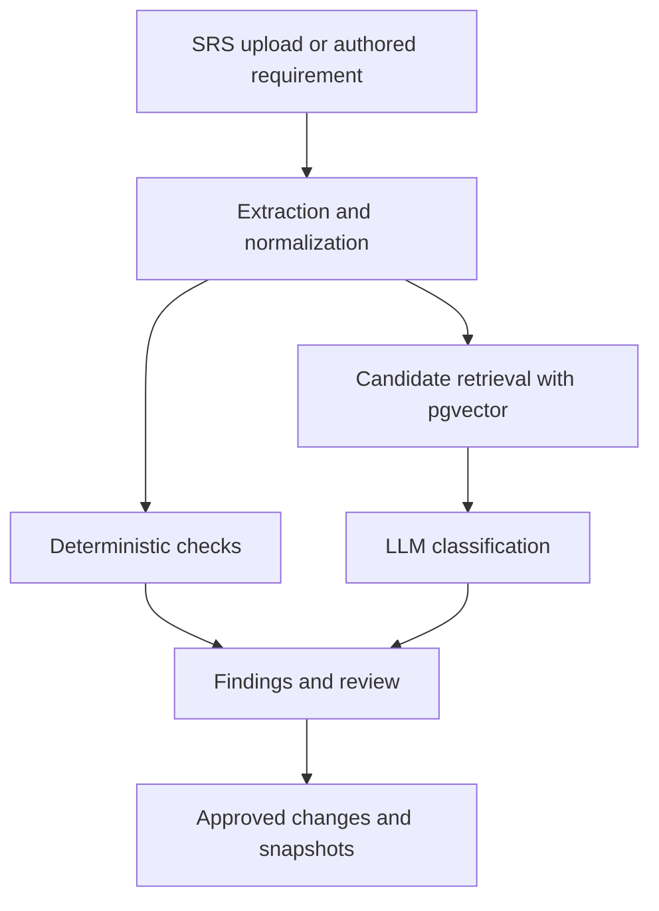

# AI Requirements Conflict Detector

A team project for IT314 Software Engineering at Dhirubhai Ambani University. It helps teams review a software requirements specification (SRS) before implementation. Import a PDF or DOCX, review extracted requirements, and track conflicts, duplicates, ambiguities, missing details, and dependencies through resolution.

## Run locally

Use Docker with Compose v2. GNU Make is optional.

```bash
git clone https://github.com/ParthAgrawal-07/AI-Requirements-Conflict-Dectector.git
cd AI-Requirements-Conflict-Dectector
cp .env.example .env
docker compose up --build -d
docker compose exec backend python -m app.cli seed-demo
```

- Dashboard at [localhost:5173](http://localhost:5173).
- FastAPI Swagger at [localhost:8000/docs](http://localhost:8000/docs).
- Backend readiness at [localhost:8000/health/ready](http://localhost:8000/health/ready).

Sign into the local demo as `owner@demo.local` with the password printed by the seed command. Open **Demo Workspace → Demo Project**. Set `GEMINI_API_KEY` in [`.env`](.env.example) before starting Compose to exercise LLM classification. An optional Groq key enables provider failover. See the [setup and configuration guide](docs/engineering/devops-guide.md) for creating the first administrator and configuring the stack.

## Walkthrough

1. Start in the active demo project and author a requirement, or upload a text-based PDF or DOCX to see how extraction preserves source references.
2. For an example conflict, use “The session shall expire after 30 minutes of inactivity” and “The session shall time out after 5 minutes.” [The Checkpoint 2 Playwright test](e2e/cp2_full_loop.spec.ts) exercises this pair and shows the roles and preconditions needed to surface the rule finding.
3. Inspect the finding and its evidence. In the full workflow, the owners review AI-generated options, an authorized reviewer accepts a proposed change, and the team compares requirement snapshots after the change is approved and merged.

The [labeled benchmark](sample_docs/planted_conflicts/) and [evaluation tools](eval/) show how the team tests candidate selection and classification behavior.

## Architecture

The React and TypeScript client talks to FastAPI. PostgreSQL stores requirements, findings, reviews, and snapshots. Celery and Redis move analysis work off the request thread.



Candidate retrieval (ADR-30) uses semantic similarity to decide which pairs warrant closer analysis. Deterministic checks can surface conflicts even when a pair falls below the similarity threshold. Gemini is the primary classifier and Groq is the fallback (ADR-31). Users retain approval authority over proposed changes (DR-04 and DR-05).

## Explore the code

| Topic | Where to start |
| --- | --- |
| API, auth, and orchestration | [FastAPI routes](backend/app/api/) · [API reference](docs/engineering/api-reference.md) |
| Persistence and migrations | [Alembic migrations](backend/alembic/versions/) · [Data model](docs/engineering/data-model.md) |
| Document ingestion and analysis | [Ingestion](backend/app/ingestion/) · [Conflict detection strategy](docs/engineering/conflict-detection-strategy.md) |
| Workspace permissions and review | [Permissions contract](docs/contracts/permissions.md) · [Frontend features](frontend/src/features/) |
| Design decisions and team ownership | [Decision log](docs/engineering/decision-log.md) · [CODEOWNERS](.github/CODEOWNERS) |
| Tests | [Backend](backend/tests/) · [End-to-end](e2e/) · [Test plan](docs/engineering/test-plan.md) |

With the Compose stack running, use `make check` for backend linting, type checking, and tests. With frontend dependencies installed, run `npm run test:run` from `frontend/` for frontend tests. The [engineering index](docs/engineering/INDEX.md) links the system design, project status, and planning documents.
