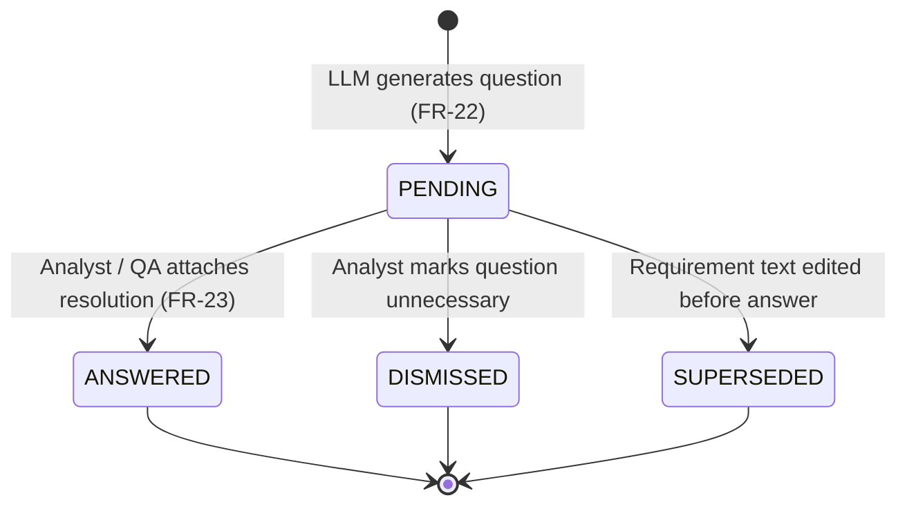
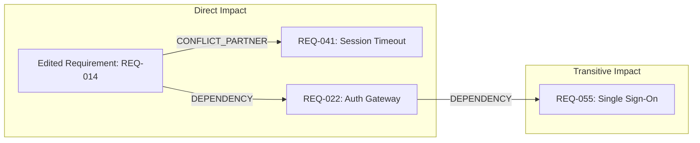

# Clarification Questions & Change-Impact Analysis Design Document (Sprint 0)

**Role 4 — Clarification & Impact Analysis**  
**Author:** Madhav Bhatt  
**Traces to:** US-09, US-11, US-12 · FR-22, FR-23, FR-24, FR-25, FR-26 · DR-04, DR-05, DR-08 · NFR-15, NFR-17  
**Status:** Sprint 0 Deliverable (Design & Data Modeling Specification)  

---

## 1. Executive Summary & Purpose

In the **AI Requirements Conflict Detector** platform, automated detection is only the first half of the value chain. Once potential ambiguities or contradictions are flagged, requirements engineers and QA teams must **resolve** them efficiently without endless cross-team meetings, and project managers must understand the **ripple effects** before any requirement text is modified.

This design document establishes the architectural foundation and data models for two core capabilities owned by Role 4:

1. **Clarification Question Workflow (US-09 / FR-22, FR-23)**:
   Automatically formulates precise, domain-grounded questions for findings classified as **Ambiguous** or **Conflicting**. Questions are framed so that a business analyst (BA) or QA engineer can review, answer, and attach resolution text directly within the platform.
2. **Change-Impact Analysis Engine (US-11 / FR-24, FR-25, FR-26)**:
   Analyzes the dependency and conflict graph whenever a requirement is edited or proposed for modification. It computes both direct and transitive impacts, distinguishes **potential** impacts (AI-inferred) from **confirmed** impacts (human-verified), handles cycles safely, and maintains an immutable version history for full traceability.

---

## 2. Requirements & Domain Context

### 2.1 Traceability Matrix

| Requirement ID | Type | Summary | Owning Task |
|---|---|---|---|
| **US-09** | User Story | QA Engineer wants clarification questions generated for Ambiguous or Conflicting findings to resolve issues without further discussion. | T25, T26 (Sprint 3) |
| **US-11** | User Story | Project Manager wants to see everything a requirement edit might affect before saving it to prevent introducing new conflicts. | T31, T32 (Sprint 3) |
| **US-12** | User Story | Software Architect wants version history maintained for every requirement edit. | T34 (Sprint 3) |
| **FR-22** | Functional | For every requirement flagged as Ambiguous or Conflicting, generate a clarification question sufficient for a QA engineer to resolve without further discussion. | T25 |
| **FR-23** | Functional | Allow a user to mark a clarification question as answered and attach the resolution text. | T26 |
| **FR-24** | Functional | Whenever a requirement is modified, perform change-impact analysis identifying all affected requirements, design elements, or test cases. | T31 |
| **FR-25** | Functional | Present the list of potentially impacted requirements before a proposed change is saved (pre-save preview). | T32 |
| **FR-26** | Functional | Maintain version history for every requirement (prior text, edits, resolution status) for change comparison and audit. | T34 |
| **DR-04** | Domain Rule | The system shall not silently delete, merge, or alter requirement text; human approval is strictly required. | Core Architecture |
| **DR-08** | Domain Rule | Maintain a full change history for every requirement consistent with software configuration management. | Data Layer |
| **NFR-15** | Non-Functional | Clarification questions and explanations must be understandable to QA/BA without requiring knowledge of the underlying AI model. | Prompt / LLM |

---

## 3. Clarification-Question Data Model (US-09)

### 3.1 Problem Analysis & Cardinality Decision

In the initial Sprint 0 schema ([`backend/app/models/analysis.py`](file:///C:/Users/madha/.gemini/antigravity/scratch/AI-Requirements-Conflict-Dectector/backend/app/models/analysis.py#L111-L127)), a baseline `Clarification` model was drafted with a unique foreign key:
```python
finding_id: Mapped[uuid.UUID] = mapped_column(ForeignKey("findings.id", ondelete="CASCADE"), unique=True)
```

#### Cardinality Trade-off: Strict 1:1 vs. 1:N
- **Strict 1:1 (`unique=True`)**:
  - *Limitation*: When a complex conflict involves conflicting parameters (e.g., Performance SLA vs. Battery Consumption), or when a requirement contains multiple ambiguous phrases (e.g., "fast response" AND "user-friendly navigation"), a single prompt-generated question is frequently insufficient.
- **Recommended 1:N Design (Finding $\rightarrow$ Clarifications)**:
  - By relaxing the `unique=True` constraint on `finding_id` and adding an `order_index` or question identifier, a finding can host **multiple targeted questions** where appropriate (e.g., Question 1 addressing threshold values, Question 2 addressing fallback modes).
  - For single questions, $N=1$ behaves identically to a 1:1 relation, making this design strictly superior and backwards-compatible.

### 3.2 Question Lifecycle & State Machine



- **`PENDING`**: Initial state upon generation. Awaiting stakeholder review.
- **`ANSWERED`**: Resolution text provided. Triggers optional requirement update draft.
- **`DISMISSED`**: Finding was deemed acceptable or false positive; question dismissed without altering requirement.
- **`SUPERSEDED`**: The parent requirement was modified elsewhere in the document, rendering this question obsolete.

### 3.3 Database Schema: `clarifications` Table

Extending the conventions established in [`backend/app/models/base.py`](file:///C:/Users/madha/.gemini/antigravity/scratch/AI-Requirements-Conflict-Dectector/backend/app/models/base.py):

```python
"""Proposed refinement to app.models.analysis.Clarification."""

import uuid
from datetime import datetime
from sqlalchemy import (
    DateTime,
    ForeignKey,
    Index,
    Integer,
    Text,
    func,
    text,
)
from sqlalchemy.dialects.postgresql import JSONB
from sqlalchemy.orm import Mapped, mapped_column, relationship

from app.models.base import Base, CreatedAtMixin, UUIDPrimaryKeyMixin, enum_column
from app.models.enums import StrEnum


class ClarificationStatus(StrEnum):
    """Lifecycle status of a clarification question."""
    PENDING = "pending"
    ANSWERED = "answered"
    DISMISSED = "dismissed"
    SUPERSEDED = "superseded"


class Clarification(UUIDPrimaryKeyMixin, CreatedAtMixin, Base):
    """A clarification question generated for a finding (FR-22, FR-23)."""

    __tablename__ = "clarifications"
    __table_args__ = (
        Index("ix_clarifications_finding_id", "finding_id"),
        Index("ix_clarifications_status", "status"),
    )

    finding_id: Mapped[uuid.UUID] = mapped_column(
        ForeignKey("findings.id", ondelete="CASCADE"), nullable=False
    )
    
    # 0-based sequence for multiple questions per finding
    order_index: Mapped[int] = mapped_column(Integer, default=0, server_default=text("0"))
    
    # The natural-language question generated for QA/BA (NFR-15)
    question: Mapped[str] = mapped_column(Text, nullable=False)
    
    # Optional structured choices / suggestions proposed by LLM to accelerate review
    suggested_options: Mapped[list[str] | None] = mapped_column(JSONB, nullable=True)
    
    # Lifecycle state
    status: Mapped[ClarificationStatus] = mapped_column(
        enum_column(ClarificationStatus, "clarification_status"),
        default=ClarificationStatus.PENDING,
        server_default=ClarificationStatus.PENDING.value,
        nullable=False,
    )
    
    # Human resolution text attached per FR-23
    resolution: Mapped[str | None] = mapped_column(Text, nullable=True)
    
    resolved_by: Mapped[uuid.UUID | None] = mapped_column(
        ForeignKey("users.id", ondelete="SET NULL"), nullable=True
    )
    resolved_at: Mapped[datetime | None] = mapped_column(DateTime(timezone=True), nullable=True)

    # Relationships
    finding: Mapped["Finding"] = relationship(back_populates="clarifications")
    resolver: Mapped["User | None"] = relationship(foreign_keys=[resolved_by])
```

### 3.4 Pydantic Schemas for Clarification API (Role 4 Contract)

These schemas will live in `backend/app/schemas/clarification.py`:

```python
from datetime import datetime
import uuid
from pydantic import BaseModel, Field


class ClarificationBase(BaseModel):
    question: str
    suggested_options: list[str] | None = None
    order_index: int = 0


class ClarificationCreate(ClarificationBase):
    finding_id: uuid.UUID


class ClarificationResolutionSubmit(BaseModel):
    """Payload when a QA/BA answers a clarification question (FR-23)."""
    resolution: str = Field(..., min_length=3, description="Resolution text to attach")


class ClarificationResponse(ClarificationBase):
    id: uuid.UUID
    finding_id: uuid.UUID
    status: str
    resolution: str | None = None
    resolved_by: uuid.UUID | None = None
    resolved_at: datetime | None = None
    created_at: datetime

    class Config:
        from_attributes = True


class FindingClarificationDetail(BaseModel):
    """Aggregate payload returned when inspecting a finding's clarifications."""
    finding_id: uuid.UUID
    category: str
    rationale: str
    involved_requirement_ids: list[str]
    clarifications: list[ClarificationResponse]
```

---

## 4. Change-Impact Analysis Data Model (US-11)

### 4.1 Relationship Semantics: Directed Impact Graph

Change-impact analysis evaluates: *"If Requirement $R_{source}$ is edited, which other requirements $R_{target}$ are affected, why, and how severely?"*

In requirements engineering, impact relationships are **directed** ($R_A \rightarrow R_B$):
- If $R_A$ depends on $R_B$ ("Payment processing requires Validated User Session"), modifying $R_B$ directly impacts $R_A$.
- If $R_A$ and $R_B$ are in conflict ("$R_A$: 2s timeout", "$R_B$: 10s timeout"), modifying $R_A$ impacts $R_B$'s conflict status.



### 4.2 Relationship Taxonomy & Classification

Impact links are categorized into distinct relationship types:

| Relationship Type | Description | Origin | Default Severity |
|---|---|---|---|
| `DIRECT_DEPENDENCY` | $R_{target}$ functionally depends on $R_{source}$ (`FR-17`, `FindingCategory.DEPENDENT`). | Finding or explicit link | High |
| `CONFLICT_PARTNER` | $R_{target}$ contradicts $R_{source}$ (`FindingCategory.CONFLICTING`). Editing one can resolve or worsen the conflict. | Finding | High |
| `SEMANTIC_SIMILARITY` | High cosine similarity via vector store (`pgvector`). Changes in terminology or scope may cause semantic drift. | CandidatePair / Vector pre-filter | Medium |
| `DUPLICATE_OVERLAP` | $R_{target}$ is an identified duplicate (`FindingCategory.DUPLICATE`). Changes must be mirrored or consolidated. | Finding | Medium |
| `SHARED_CONSTRAINT` | Requirements share regulatory/compliance constraints (e.g. HIPAA/GDPR `is_protected = True`). | Domain rule `DR-05` | Critical |

### 4.3 Distinguishing Potential vs. Confirmed Impacts

To build trust (NFR-17, NFR-21), the system must never conflate AI guesses with confirmed facts:
1. **`POTENTIAL` (Inferred Impact)**:
   - Derived from unreviewed AI findings or raw vector similarity above threshold.
   - Tagged as *"Potential impact — based on embedding similarity (score: 0.82)"* or *"Potential impact — unreviewed conflict finding"*.
2. **`CONFIRMED` (Verified Impact)**:
   - Derived from human-confirmed findings (`FindingStatus.CONFIRMED`), explicit dependencies, or compliance tags.
   - High-confidence flag alerting the project manager to mandatory review.

### 4.4 Data Model Options: Persisted Table vs. Dynamic Inferred Graph

Role 4 evaluates two architectural implementation options:

#### Option A: Dedicated Persisted Table (`requirement_impact_links`)
Stores explicit graph edges in PostgreSQL.
- **Pros**: Direct SQL queries, easy to index, enables manual analyst-defined dependency links.
- **Cons**: Requires additional synchronization when findings or embeddings change.

#### Option B: Dynamic Graph Query over Existing Tables (`CandidatePair` + `Finding`)
Computes the impact graph dynamically on-demand from existing records.
- **Pros**: Zero data duplication. No synchronization lag. Reuses Parth and Keval's existing tables directly.
- **Cons**: Graph traversal executed in Python memory or recursive Common Table Expressions (CTE).

#### Recommendation: Hybrid Strategy
- **Sprint 0 / Sprint 3 MVP**: Implement **Option B** (Dynamic Graph Engine in `impact_analysis.py`) exposed via Pydantic response models.
- **Sprint 4+ Extension**: Introduce the `requirement_impact_links` table (detailed below) if explicit manual dependency linking (FR-17) is requested.

### 4.5 Schema: `requirement_impact_links` (for Persisted Option)

```python
"""Proposed schema for explicit impact links."""

import uuid
from datetime import datetime
from sqlalchemy import (
    CheckConstraint,
    DateTime,
    Float,
    ForeignKey,
    Index,
    String,
    Text,
    UniqueConstraint,
    func,
)
from sqlalchemy.orm import Mapped, mapped_column, relationship

from app.models.base import Base, CreatedAtMixin, UUIDPrimaryKeyMixin, enum_column
from app.models.enums import StrEnum


class ImpactType(StrEnum):
    DIRECT_DEPENDENCY = "direct_dependency"
    CONFLICT_PARTNER = "conflict_partner"
    SEMANTIC_SIMILARITY = "semantic_similarity"
    DUPLICATE_OVERLAP = "duplicate_overlap"
    SHARED_CONSTRAINT = "shared_constraint"


class ImpactStatus(StrEnum):
    POTENTIAL = "potential"      # Heuristic / AI predicted
    CONFIRMED = "confirmed"      # Human verified / domain confirmed


class ImpactSeverity(StrEnum):
    LOW = "low"
    MEDIUM = "medium"
    HIGH = "high"
    CRITICAL = "critical"


class RequirementImpactLink(UUIDPrimaryKeyMixin, CreatedAtMixin, Base):
    """A directed impact link between two requirements (FR-24, FR-25)."""

    __tablename__ = "requirement_impact_links"
    __table_args__ = (
        # Prevent duplicate identical links between the same pair
        UniqueConstraint(
            "source_requirement_id", "target_requirement_id", "link_type",
            name="uq_impact_link_source_target_type"
        ),
        # Self-loops prohibited: a requirement cannot impact itself directly
        CheckConstraint(
            "source_requirement_id != target_requirement_id",
            name="ck_impact_no_self_loop"
        ),
        CheckConstraint("confidence BETWEEN 0 AND 1", name="ck_impact_confidence_range"),
        Index("ix_impact_source_req", "source_requirement_id"),
        Index("ix_impact_target_req", "target_requirement_id"),
    )

    source_requirement_id: Mapped[uuid.UUID] = mapped_column(
        ForeignKey("requirements.id", ondelete="CASCADE"), nullable=False
    )
    target_requirement_id: Mapped[uuid.UUID] = mapped_column(
        ForeignKey("requirements.id", ondelete="CASCADE"), nullable=False
    )
    
    link_type: Mapped[ImpactType] = mapped_column(
        enum_column(ImpactType, "impact_link_type"), nullable=False
    )
    status: Mapped[ImpactStatus] = mapped_column(
        enum_column(ImpactStatus, "impact_link_status"),
        default=ImpactStatus.POTENTIAL,
        server_default=ImpactStatus.POTENTIAL.value,
        nullable=False,
    )
    severity: Mapped[ImpactSeverity] = mapped_column(
        enum_column(ImpactSeverity, "impact_severity"),
        default=ImpactSeverity.MEDIUM,
        server_default=ImpactSeverity.MEDIUM.value,
        nullable=False,
    )
    
    confidence: Mapped[float] = mapped_column(Float, default=1.0)
    reason: Mapped[str] = mapped_column(Text, nullable=False)
    
    # Optional link back to the finding or candidate pair that triggered this link
    finding_id: Mapped[uuid.UUID | None] = mapped_column(
        ForeignKey("findings.id", ondelete="SET NULL"), nullable=True
    )
    
    verified_by: Mapped[uuid.UUID | None] = mapped_column(
        ForeignKey("users.id", ondelete="SET NULL"), nullable=True
    )
    verified_at: Mapped[datetime | None] = mapped_column(DateTime(timezone=True), nullable=True)

    # Relationships
    source_requirement: Mapped["Requirement"] = relationship(
        foreign_keys=[source_requirement_id]
    )
    target_requirement: Mapped["Requirement"] = relationship(
        foreign_keys=[target_requirement_id]
    )
```

### 4.6 Handling Duplicate Links & Cyclic Relationships

1. **Duplicate Links**:
   - Guarded at the database level by `UniqueConstraint("source_requirement_id", "target_requirement_id", "link_type")`.
   - In dynamic traversal, edges are deduplicated via a Python set key: `(source_id, target_id, link_type)`.
2. **Cyclic Relationships**:
   - In real SRS documents, circular dependencies are common (e.g., $A$ depends on $B$, $B$ depends on $C$, $C$ depends on $A$).
   - Without protection, an impact analysis traversal algorithm would enter an infinite loop.
   - **Protection Algorithm**:
     - Depth-bounded Breadth-First Search (BFS) / Depth-First Search (DFS) with a strict `max_depth = 3`.
     - Explicit `visited` tracking set: if a requirement has already been evaluated on the current traversal branch, traversal stops and a `has_cycle = True` metadata flag is attached to the analysis report.
     - Detecting cycles serves a double purpose: it protects our backend performance **and** provides an actionable architectural finding to the user ("Circular dependency detected between REQ-A, REQ-B, REQ-C").

### 4.7 Integration with Requirement Versioning (FR-26)

When an analyst modifies a requirement after reviewing its impact:
1. `GET /api/v1/requirements/{id}/impact`: Analyst inspects impacted requirements.
2. `PATCH /api/v1/requirements/{id}`: Analyst confirms and submits updated text.
3. The backend:
   - Increments `Requirement.current_version`.
   - Inserts a new record into [`requirement_versions`](file:///C:/Users/madha/.gemini/antigravity/scratch/AI-Requirements-Conflict-Dectector/backend/app/models/requirement.py#L64-L85) capturing the snapshot, `changed_by`, `changed_at`, and rationale.
   - Invalidates or re-evaluates linked `POTENTIAL` impact links.

### 4.8 Pydantic Schemas for Impact Analysis API

These schemas will live in `backend/app/schemas/impact.py`:

```python
from datetime import datetime
import uuid
from pydantic import BaseModel, Field


class ImpactItem(BaseModel):
    requirement_id: uuid.UUID
    source_req_id: str | None = None
    body_preview: str
    location: str | None = None
    relationship_type: str
    status: str  # "potential" or "confirmed"
    severity: str  # "low", "medium", "high", "critical"
    reason: str
    depth: int = 1  # 1 = direct impact, 2+ = transitive impact
    is_protected: bool = False


class ImpactAnalysisResult(BaseModel):
    """Response returned by GET /api/v1/requirements/{id}/impact."""
    source_requirement_id: uuid.UUID
    source_req_id: str | None = None
    source_version: int
    analyzed_at: datetime
    total_impacted_count: int
    has_circular_dependency: bool = False
    critical_impacts_count: int
    impacted_requirements: list[ImpactItem]
```

---

## 5. Concrete Record Examples

### 5.1 Clarification Record Example

```json
{
  "id": "7b8d4f6c-8e9a-4c2d-9b1e-3f5a7c9d1e2f",
  "finding_id": "c1a2b3c4-d5e6-4f7a-8b9c-0d1e2f3a4b5c",
  "order_index": 0,
  "question": "REQ-014 requires transaction timeout within 2 seconds, but REQ-041 states batch processing allows up to 10 seconds. Under what operational load should the 2-second timeout take precedence?",
  "suggested_options": [
    "Strict 2s timeout for interactive user sessions only; 10s for scheduled background batches.",
    "Global 2s timeout applies to all operations (REQ-041 to be revised).",
    "Configurable timeout per tenant."
  ],
  "status": "pending",
  "resolution": null,
  "resolved_by": null,
  "resolved_at": null,
  "created_at": "2026-10-12T16:30:00Z"
}
```

### 5.2 Impact Analysis Response Example

```json
{
  "source_requirement_id": "9a8b7c6d-5e4f-3a2b-1c0d-9e8f7a6b5c4d",
  "source_req_id": "REQ-014",
  "source_version": 2,
  "analyzed_at": "2026-10-12T16:35:00Z",
  "total_impacted_count": 2,
  "has_circular_dependency": false,
  "critical_impacts_count": 1,
  "impacted_requirements": [
    {
      "requirement_id": "1a2b3c4d-5e6f-7a8b-9c0d-1e2f3a4b5c6d",
      "source_req_id": "REQ-041",
      "body_preview": "The system shall complete batch transaction processing within 10 seconds...",
      "location": "Page 14, Section 3.2",
      "relationship_type": "conflict_partner",
      "status": "confirmed",
      "severity": "high",
      "reason": "Direct timing conflict flagged in Finding #c1a2b3c4. Modifying REQ-014 timeout will alter this conflict status.",
      "depth": 1,
      "is_protected": false
    },
    {
      "requirement_id": "5f6e7d8c-9b0a-1c2d-3e4f-5a6b7c8d9e0f",
      "source_req_id": "REQ-098",
      "body_preview": "Audit logs for all patient health data transactions must be preserved in compliance with HIPAA...",
      "location": "Page 28, Section 5.1",
      "relationship_type": "shared_constraint",
      "status": "confirmed",
      "severity": "critical",
      "reason": "Compliance-critical requirement linked to transaction logging pipeline. Requires manual sign-off per DR-05.",
      "depth": 2,
      "is_protected": true
    }
  ]
}
```

---

## 6. Integration Requirements & Interfaces

| Partner Role / Component | Integration Point | Direction | Interface Contract |
|---|---|---|---|
| **Role 1 (Ingestion — Bansil)** | Requirements extraction | Upstream $\rightarrow$ Role 4 | `Requirement` table (`body`, `source_req_id`, `location`). |
| **Role 2 (Embeddings — Keval)** | Similarity retrieval | Upstream $\rightarrow$ Role 4 | Querying `CandidatePair` similarity scores for potential impact links. |
| **Role 3 (Classification — Heet)** | Classification results | Upstream $\rightarrow$ Role 4 | Ingesting `Finding` records where category is `Ambiguous` or `Conflicting`. |
| **Role 5 (Backend / DB — Parth)** | API Routes & Database | Bidirectional | `GET /findings/{id}/clarification` in `backend/app/api/findings.py`; `GET /requirements/{id}/impact` in `backend/app/api/requirements.py`. |
| **Role 6 & 7 (Frontend UI)** | Dashboard & React Flow | Role 4 $\rightarrow$ Downstream | Findings panel renders clarification Q&A; Pre-save modal renders impact warning graph. |

---

## 7. Decisions for Team Alignment (Parth, Keval, Heet)

The following design decisions are documented for team review prior to Sprint 3 development:

| # | Item | Options | Proposed Recommendation | Team Stakeholder |
|---|---|---|---|---|
| **D1** | **Clarification Cardinality** | (A) Strict 1:1 (`unique=True` on `finding_id`)<br>(B) 1:N (`unique` removed, `order_index` added) | **Option B (1:N)**: Enables generating multiple targeted questions for multi-clause conflicts. | **Parth** (Role 5 Lead) |
| **D2** | **Impact Link Storage** | (A) In-memory traversal of `CandidatePair` + `Finding`<br>(B) Explicit `requirement_impact_links` table | **Option A for Sprint 3 MVP**, with Option B as a documented schema upgrade if manual dependency editing is needed. | **Parth** (DB schema) |
| **D3** | **Clarification Status Enum** | (A) Infer from `resolution IS NOT NULL`<br>(B) Explicit `ClarificationStatus` enum (`pending`, `answered`, `dismissed`) | **Option B**: Provides clean database indexing and filtering for dashboard metrics (FR-27). | **Parth** (Enums) |
| **D4** | **Impact Pre-filter Threshold** | (A) Use default `SIMILARITY_THRESHOLD_DEFAULT` (0.75)<br>(B) Use relaxed threshold (e.g. 0.65) for transitive impacts | **Option B**: Allows catching subtle indirect dependencies that stricter conflict detection ignores. | **Keval** (Role 2) |
| **D5** | **Structured Clarification Output** | (A) Raw string from LLM<br>(B) JSON schema with `question` + `suggested_options` | **Option B**: Enables interactive radio/dropdown options in UI to accelerate human review. | **Heet** (Role 3 prompts) |
| **D6** | **Impact Graph Edge Styling** | (A) Generic edges in React Flow<br>(B) Color-coded edges by `severity` and dashed for `potential` | **Option B**: Visually distinguishes AI predictions from human-confirmed links. | **Heet / Parth** (Role 7 graph) |

---

## 8. Remaining Work & Sprint 3 Outlook

With the data models and schemas formalized in this document:
- **Sprint 0 Deliverable**: Completed (requirements review, data model design, and architecture documentation).
- **Sprint 1 & 2 Dependencies**: Wait for Role 1 (Ingestion pipeline) and Role 2/3 (Embeddings and LLM Classification pipeline) to populate real requirements and findings.
- **Sprint 3 Implementation Roadmap**:
  - `T25`: Design the LLM prompt for generating clarification questions (`backend/app/clarification/question_gen.py`).
  - `T26`: Implement clarification endpoint and answer submission logic (`backend/app/api/findings.py`).
  - `T31`: Build the change-impact analysis graph traversal engine (`backend/app/clarification/impact_analysis.py`).
  - `T32`: Expose the impacted-requirements API (`GET /requirements/{id}/impact`).
  - `T34`: Implement requirement version history tracking during updates (`RequirementVersion`).
