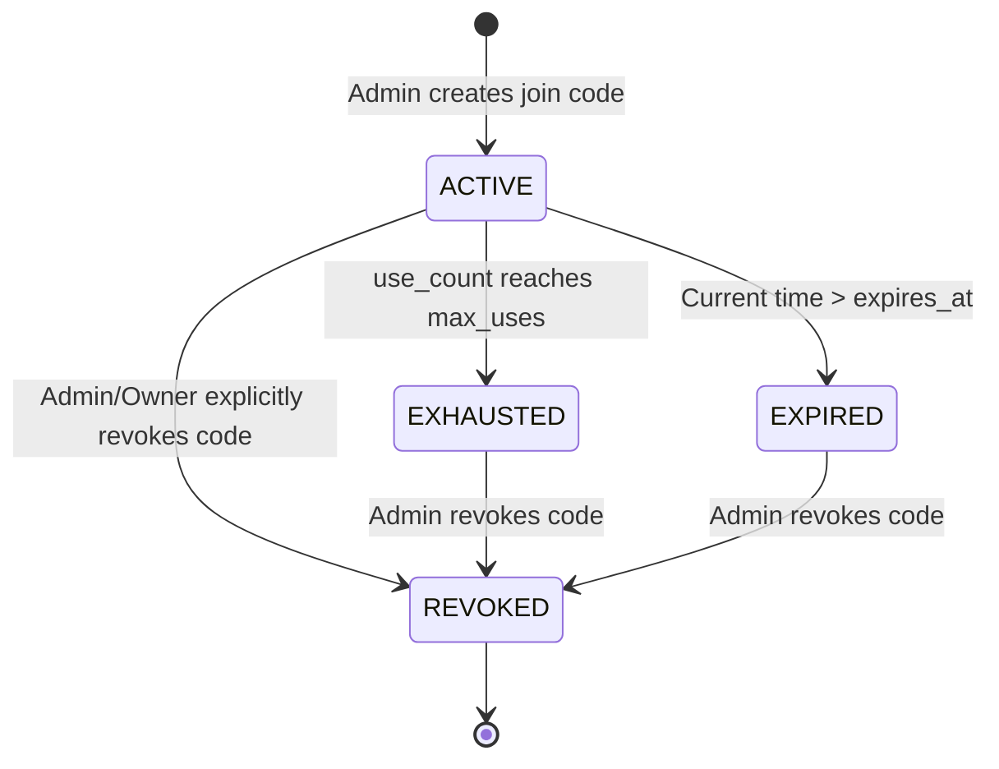
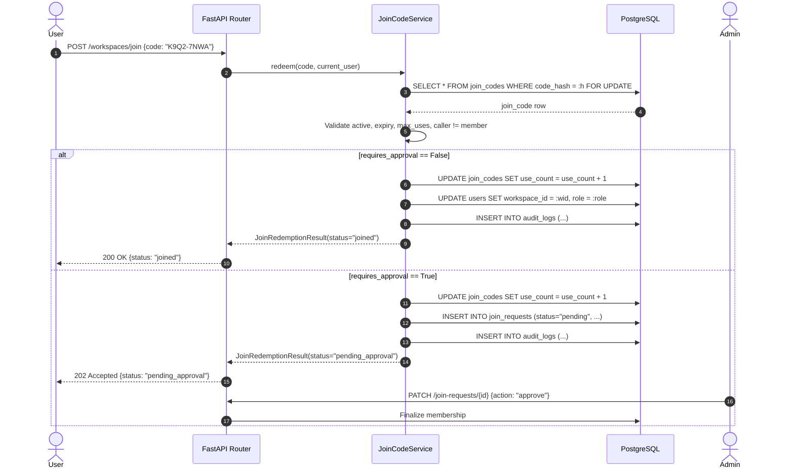

# Join Codes Specification & Contract (Sprint 0)

**Document:** `docs/contracts/join_codes.md`  
**Authors:** Madhav Bhatt (Role 4 — Clarification & Consequences), Parth Agrawal (Role 5 — Backend & Auth Lead)  
**Status:** Sprint 0 Contract Deliverable  
**Target Delivery:** Sprint 1 Implementation (`JoinCodeService`, endpoints) & Shared Migration 0005 (Collaboration)  
**Classification:** Security Architecture & Service Contract  

---

## 1. Executive Summary & Purpose

Join codes provide a secure, low-friction mechanism for onboarding team members into workspaces without requiring manual email invitations or external directory integrations for every user. Because join codes allow access to proprietary Software Requirements Specifications (SRS) and internal analysis findings, their architecture must guarantee strict entropy, tamper-proof storage, role containment, and rigorous redemption semantics.

This contract formalizes:
1. The **code format** and **cryptographic entropy** standards.
2. The **hashing scheme** with server-side peppering (no plaintext storage).
3. The **lifecycle states** (expiry, usage caps, revocation, exhaustion, and approval gating).
4. The exact **redemption transaction semantics** for both direct and gated joins.
5. Strict **role restrictions** (inviolable invariant: join codes never grant Admin or Owner).
6. The service contract required by Parth: `JoinCodeService.redeem(code, user)`.
7. The database schema specifications destined for the shared **Migration 0005** (Collaboration).

---

## 2. Code Format & Cryptographic Entropy

### 2.1 Character Set & Human Usability

Join codes are generated using an unambiguous 32-character alphabet (Crockford-style alphanumeric), excluding visual and audio homoglyphs:
- **Allowed Alphabet**: `23456789ABCDEFGHJKMNPQRSTUVWXYZ` (length = 32)
- **Excluded Characters**:
  - `0` and `O` (easily confused)
  - `1`, `I`, and `L` (easily confused)
  - `U` (excluded in standard Crockford base32 to prevent accidental profanity)

### 2.2 Entropy Calculation

For an 8-character string drawn uniformly at random from an alphabet of size $N = 32$:

$$\text{Search Space} = N^L = 32^8 = (2^5)^8 = 2^{40} \approx 1.0995 \times 10^{12} \text{ combinations}$$

$$\text{Entropy} = \log_2(32^8) = 40.0 \text{ bits}$$

> [!IMPORTANT]
> **Entropy Guarantee**: The 8-character code strictly achieves **at least 40 bits of entropy**, satisfying the security requirement. If a full 36-character alphanumeric set (`0-9, A-Z`) is selected, $36^8 \approx 2.821 \times 10^{12} \approx 41.36\text{ bits}$ of entropy is achieved. Both satisfy the $\ge 40\text{ bits}$ requirement. The 32-character unambiguous set is recommended to avoid user entry errors.

### 2.3 Generation & Representation

- **Generation**: Must use the Python `secrets` module (`secrets.choice(ALPHABET)`), backed by the operating system's cryptographically secure pseudo-random number generator (`/dev/urandom` or `CryptGenRandom`). The standard library `random` module is strictly forbidden.
- **Display Format**: Rendered to the user upon creation grouped into two 4-character blocks separated by a hyphen for readability: `XXXX-XXXX` (e.g., `K9Q2-7NWA`).
- **Canonical Representation**: Before hashing or comparison, all input codes are canonicalized:
  - Strip leading and trailing whitespace.
  - Remove all hyphens (`-`) and spaces.
  - Transform all characters to uppercase.
  - Example: `"  k9q2-7nwa  "` $\rightarrow$ `"K9Q27NWA"`.

---

## 3. Cryptographic Storage & Server-Side Pepper

### 3.1 Zero Plaintext Storage Invariant

Plaintext join codes are ephemeral and **never stored in the database, caches, or persistent logs**. 
- When an administrator generates a join code, the plaintext code is returned in the API response payload **once and only once**.
- The creator must copy and distribute the code immediately.
- Subsequent calls to list or view join codes return only the code metadata, creator, creation date, status, usage statistics, and a masked prefix (e.g., `K9Q2****`).

### 3.2 Hashing Scheme with Server-Side Pepper

The database stores only a cryptographic SHA-256 hash computed with a secret server-side pepper:

$$\text{code\_hash} = \text{HMAC-SHA256}(\text{key}=\text{JOIN\_CODE\_PEPPER}, \text{msg}=\text{canonical\_code})$$

Alternatively, via salted SHA-256:

$$\text{code\_hash} = \text{SHA256}(\text{JOIN\_CODE\_PEPPER} \parallel \text{canonical\_code})$$

```
+--------------------------------------------------------+
| Creator generates code: "K9Q2-7NWA"                   |
+--------------------------------------------------------+
                           |
                           v
+--------------------------------------------------------+
| Canonicalize: "K9Q27NWA"                               |
+--------------------------------------------------------+
                           |
              +------------+------------+
              |                         |
              v                         v
+--------------------------+  +--------------------------+
| Shown ONCE in API        |  | SHA-256(Pepper + Code)   |
| response to creator      |  | Store hash in DB         |
+--------------------------+  +--------------------------+
```

### 3.3 Security Rationale for Pepper

A 40-bit search space ($2^{40} \approx 1.1 \times 10^{12}$) is vulnerable to offline precomputation (rainbow tables) or fast GPU brute-force cracking if a raw un-peppered SHA-256 hash leaks in a database dump. 

By binding every hash to `JOIN_CODE_PEPPER`—a high-entropy secret kept exclusively in the server environment (e.g., Docker secret, `.env`, or AWS Secrets Manager) and never written to the database:
- An attacker who obtains a SQL database dump cannot reverse hashes without also compromising the runtime environment.
- Rainbow tables are useless because the pepper is unknown to the attacker.
- If `JOIN_CODE_PEPPER` is missing in a production environment, the backend refuses to start (fail-fast startup check in `app.core.config.Settings`).

---

## 4. Lifecycle, Usage Limits & Status Machine

### 4.1 Join Code Attributes

| Attribute | Type | Description |
|---|---|---|
| `code_hash` | `VARCHAR(64)` | SHA-256 hex digest of `(pepper + canonical_code)`. Unique index. |
| `workspace_id` | `UUID` | Foreign key to `workspaces.id` (on delete cascade). |
| `role` | `Role` (enum) | Role assigned upon joining (restricted to non-admin roles). |
| `created_by` | `UUID` | Foreign key to `users.id` (the admin who created the code). |
| `expires_at` | `TIMESTAMP WITH TIME ZONE` (nullable) | Optional absolute timestamp after which the code cannot be redeemed. |
| `max_uses` | `INTEGER` (nullable) | Maximum number of successful redemptions allowed (`NULL` = unlimited). |
| `use_count` | `INTEGER` | Current count of completed redemptions (`default=0`). |
| `status` | `JoinCodeStatus` (enum) | Explicit state: `active`, `revoked`, `expired`, `exhausted`. |
| `requires_approval` | `BOOLEAN` | If `True`, redemption creates a `JoinRequest` instead of instant membership. |

### 4.2 Status State Machine



- **`ACTIVE`**: Code is valid for redemption.
- **`EXHAUSTED`**: Code reached its `max_uses` limit. No further redemptions permitted.
- **`EXPIRED`**: The `expires_at` timestamp has passed. (Evaluated both dynamically during redemption and periodically by background cleanup).
- **`REVOKED`**: Explicitly deactivated by a workspace admin. Irreversible.

---

## 5. Role Restrictions & Security Invariants

> [!CAUTION]
> **SECURITY INVARIANT: Join codes MUST NEVER grant `Owner` or `Admin` privileges.**

Join codes are distributed out-of-band (e.g., Slack, email, Jira, onboarding docs) and are susceptible to forwarding. Granting administrative control via an invite code presents an unacceptable risk of privilege escalation.

### 5.1 Enforced Role Whitelist

Join codes may only be created with standard collaborative roles:
- `Role.ANALYST`
- `Role.READ_ONLY`
- `Role.COMPLIANCE_REVIEWER`

Attempting to create a join code with `Role.ADMIN` (or any workspace `Owner` role) must be rejected with HTTP `422 Unprocessable Entity` or `403 Forbidden`.

### 5.2 Defense in Depth

1. **Schema Validation Layer**: Pydantic `JoinCodeCreate` schema validator enforces `role not in (Role.ADMIN, "owner")`.
2. **Service Layer**: `JoinCodeService.create(...)` raises `RoleRestrictedError`.
3. **Database Constraint Layer**: SQL table definition includes:
   ```sql
   CONSTRAINT ck_join_codes_non_admin CHECK (role NOT IN ('admin', 'owner'))
   ```

---

## 6. Redemption Semantics & Approval Gate

### 6.1 Direct Join (`requires_approval = False`)

When `requires_approval` is `False`, redeeming a valid join code immediately binds the user to the workspace:
1. User submits `POST /api/v1/workspaces/join` with `{ "code": "K9Q2-7NWA" }`.
2. System canonicalizes code and looks up row by `code_hash` with `FOR UPDATE` pessimistic row lock.
3. System verifies code is `ACTIVE`, not expired, and `use_count < max_uses`.
4. System verifies the user is not already a member of the workspace (returns `409 Conflict` if already a member).
5. System increments `use_count += 1`. If `use_count == max_uses`, sets `status = EXHAUSTED`.
6. System assigns user to workspace (`user.workspace_id = workspace.id`, `user.role = code.role` or creates workspace membership record).
7. System writes an immutable `AuditLog` entry (`action="join_code_redeemed"`).
8. Response: `200 OK` with `{ "status": "joined", "workspace_id": "...", "role": "analyst" }`.

### 6.2 Gated Join (`requires_approval = True`)

When `requires_approval` is `True`, redeeming the code does **not** grant immediate workspace access:
1. Steps 1–4 are identical.
2. System verifies user does not already have an active or pending join request for this workspace (returns `409 Conflict` if pending).
3. System increments `use_count += 1` (or claims a reservation slot). If `use_count == max_uses`, sets `status = EXHAUSTED`.
4. System inserts a `JoinRequest` record:
   - `workspace_id`: Target workspace.
   - `user_id`: Authenticated user submitting the code.
   - `join_code_id`: Foreign key to `join_codes.id`.
   - `status`: `JoinRequestStatus.PENDING`.
   - `created_at`: Current UTC timestamp.
5. System writes an `AuditLog` entry (`action="join_request_created"`).
6. Response: `202 Accepted` with `{ "status": "pending_approval", "request_id": "...", "workspace_id": "..." }`.
7. A workspace Admin must subsequently call `PATCH /api/v1/workspaces/{wid}/join-requests/{rid}` with `{ "status": "approved" }` to finalize membership.



---

## 7. Failure Cases & Error Matrix

All failure conditions map to explicit domain errors and standard HTTP response status codes:

| Condition | Domain Exception | HTTP Status | Error Code (`error.code`) | Message |
|---|---|---|---|---|
| Malformed code (length $\ne$ 8, invalid chars) | `InvalidJoinCodeFormatError` | `400 Bad Request` | `INVALID_JOIN_CODE_FORMAT` | "Join code must be 8 alphanumeric characters." |
| Hash not found in DB | `JoinCodeNotFoundError` | `404 Not Found` | `JOIN_CODE_NOT_FOUND` | "Invalid or unrecognized join code." |
| Code has status `REVOKED` | `JoinCodeRevokedError` | `410 Gone` | `JOIN_CODE_REVOKED` | "This join code has been revoked by an administrator." |
| Current time > `expires_at` | `JoinCodeExpiredError` | `410 Gone` | `JOIN_CODE_EXPIRED` | "This join code expired on {expires_at}." |
| `use_count >= max_uses` | `JoinCodeExhaustedError` | `410 Gone` | `JOIN_CODE_EXHAUSTED` | "This join code has reached its maximum allowed uses." |
| User is already in workspace | `AlreadyMemberError` | `409 Conflict` | `ALREADY_WORKSPACE_MEMBER` | "User is already an active member of this workspace." |
| User has pending join request | `DuplicateJoinRequestError` | `409 Conflict` | `JOIN_REQUEST_PENDING` | "A join request is already pending approval for this workspace." |
| Admin role assigned to code | `RoleRestrictedError` | `422 Unprocessable` | `INVALID_JOIN_ROLE` | "Join codes cannot grant administrator or owner privileges." |

---

## 8. Service Contract: `JoinCodeService.redeem(code, user)`

The service contract required by Parth is defined below. This contract specifies the exact interface for Sprint 1 implementation:

```python
"""Service contract for join-code redemption (Role 5 boundary)."""

from __future__ import annotations

import uuid
from dataclasses import dataclass
from datetime import datetime
from enum import StrEnum
from typing import Literal

from sqlalchemy.orm import Session

from app.models.enums import Role
from app.models.user import User


class RedemptionStatus(StrEnum):
    JOINED = "joined"
    PENDING_APPROVAL = "pending_approval"


@dataclass(frozen=True)
class JoinRedemptionResult:
    """Immutable result returned by JoinCodeService.redeem."""

    status: RedemptionStatus
    workspace_id: uuid.UUID
    workspace_name: str
    assigned_role: Role
    user_id: uuid.UUID
    join_request_id: uuid.UUID | None = None
    joined_at: datetime | None = None
    message: str = ""


class JoinCodeService:
    """Domain service managing join-code lifecycle and redemption."""

    @classmethod
    def redeem(
        cls,
        db: Session,
        *,
        code: str,
        user: User,
    ) -> JoinRedemptionResult:
        """Redeem a join code for an authenticated user.

        Args:
            db: Active SQLAlchemy database session (enclosing transaction).
            code: Raw 8-character string submitted by user (e.g. 'K9Q2-7NWA').
            user: Authenticated User entity attempting redemption.

        Returns:
            JoinRedemptionResult indicating either direct membership or pending request.

        Raises:
            InvalidJoinCodeFormatError: Code length != 8 or contains illegal characters.
            JoinCodeNotFoundError: Code hash not found in database.
            JoinCodeRevokedError: Code was cancelled by administrator.
            JoinCodeExpiredError: Code past expiration date.
            JoinCodeExhaustedError: Code reached maximum usage limit.
            AlreadyMemberError: User is already an active member of target workspace.
            DuplicateJoinRequestError: User already has a pending join request.
        """
        ...
```

---

## 9. Migration & Integration Boundaries (Shared Migration 0005)

### 9.1 Shared Collaboration Migration Scope

The project architecture reserves **Migration 0005** as the shared Collaboration migration, encompassing:
1. `join_codes`
2. `join_requests`
3. `channels`
4. `channel_members`
5. `messages`

### 9.2 Proposed SQL DDL for Migration 0005

```sql
-- Join Code Status Enum
CREATE TYPE join_code_status AS ENUM ('active', 'revoked', 'expired', 'exhausted');

-- Join Request Status Enum
CREATE TYPE join_request_status AS ENUM ('pending', 'approved', 'rejected');

-- 1. Table: join_codes
CREATE TABLE join_codes (
    id UUID PRIMARY KEY DEFAULT gen_random_uuid(),
    code_hash VARCHAR(64) NOT NULL,
    workspace_id UUID NOT NULL REFERENCES workspaces(id) ON DELETE CASCADE,
    role user_role NOT NULL,
    created_by UUID NOT NULL REFERENCES users(id) ON DELETE RESTRICT,
    max_uses INTEGER NULL,
    use_count INTEGER NOT NULL DEFAULT 0,
    expires_at TIMESTAMP WITH TIME ZONE NULL,
    status join_code_status NOT NULL DEFAULT 'active',
    requires_approval BOOLEAN NOT NULL DEFAULT FALSE,
    created_at TIMESTAMP WITH TIME ZONE NOT NULL DEFAULT now(),
    updated_at TIMESTAMP WITH TIME ZONE NOT NULL DEFAULT now(),

    CONSTRAINT uq_join_codes_code_hash UNIQUE (code_hash),
    CONSTRAINT ck_join_codes_use_count_non_negative CHECK (use_count >= 0),
    CONSTRAINT ck_join_codes_max_uses_positive CHECK (max_uses IS NULL OR max_uses > 0),
    CONSTRAINT ck_join_codes_non_admin CHECK (role NOT IN ('admin'))
);

CREATE INDEX ix_join_codes_workspace_id ON join_codes(workspace_id);
CREATE INDEX ix_join_codes_status ON join_codes(status);

-- 2. Table: join_requests
CREATE TABLE join_requests (
    id UUID PRIMARY KEY DEFAULT gen_random_uuid(),
    workspace_id UUID NOT NULL REFERENCES workspaces(id) ON DELETE CASCADE,
    user_id UUID NOT NULL REFERENCES users(id) ON DELETE CASCADE,
    join_code_id UUID NOT NULL REFERENCES join_codes(id) ON DELETE CASCADE,
    status join_request_status NOT NULL DEFAULT 'pending',
    reviewed_by UUID NULL REFERENCES users(id) ON DELETE SET NULL,
    reviewed_at TIMESTAMP WITH TIME ZONE NULL,
    rejection_reason TEXT NULL,
    created_at TIMESTAMP WITH TIME ZONE NOT NULL DEFAULT now(),
    updated_at TIMESTAMP WITH TIME ZONE NOT NULL DEFAULT now(),

    CONSTRAINT uq_join_requests_user_workspace_pending 
        UNIQUE (user_id, workspace_id, status)
);

CREATE INDEX ix_join_requests_workspace_status ON join_requests(workspace_id, status);
CREATE INDEX ix_join_requests_user_id ON join_requests(user_id);
```

### 9.3 Coordination Protocol with Parth

- **No Competing Migrations**: To maintain single-head Alembic linear integrity (`alembic heads`), Role 4 does not create or submit a separate migration file in Sprint 0.
- **Sprint 0 Deliverable**: This formal contract (`docs/contracts/join_codes.md`) establishes the table definitions, field types, constraints, and service signature.
- **Sprint 1 Execution**: Parth will incorporate the `join_codes` and `join_requests` tables into the consolidated Collaboration migration (Migration 0005) alongside channels and messages.
