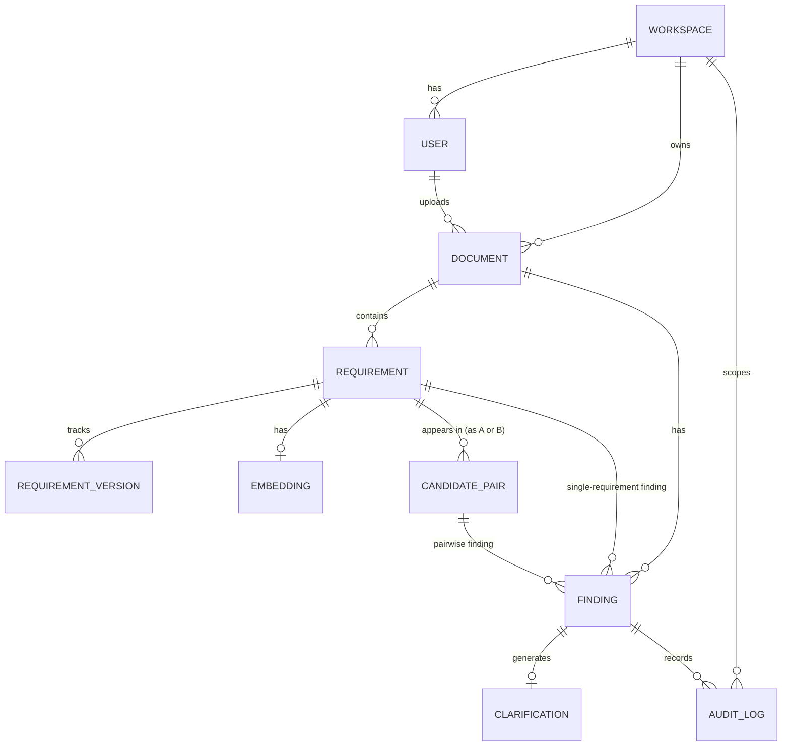

# Database Documentation

**ER Diagram, Table Definitions, and Data Dictionary**

| | |
|---|---|
| **Engine** | PostgreSQL 16 + pgvector (`pgvector/pgvector:pg16`) |
| **Status** | Implemented. 10 tables in `backend/app/models/`, created by migration `20260928_0001_initial_schema` |
| **Source of truth** | The SQLAlchemy models. If this page and the code disagree, the code wins; fix this page in the same PR. |

---

## 1. ER Diagram

## 2. Conventions

- Every table has a UUID primary key `id` (`UUIDPrimaryKeyMixin`).
- `created_at` / `updated_at` (timestamptz) come from `CreatedAtMixin` / `TimestampMixin` and are noted per table below.
- Enums are native Postgres enums whose values come from `backend/app/models/enums.py`.
- Foreign keys use `CASCADE` for owned children (document → requirements → embeddings), `RESTRICT` where deleting would destroy audit evidence, and `SET NULL` for optional "who did it" columns.
- Schema changes only go through Alembic migrations. CI checks that there is exactly one Alembic head.

## 3. Tables (10)

### 3.1 workspaces
Tenant boundary for access scoping (FR-38). Timestamps: created/updated.

| Column | Type | Notes |
|---|---|---|
| name | varchar(120), unique | |
| similarity_threshold | float, default 0.75 | Per-workspace pre-filter threshold (FR-10, US-06). CHECK 0–1 |

### 3.2 users
Timestamps: created/updated.

| Column | Type | Notes |
|---|---|---|
| email | varchar(320), unique | CHECK `email = lower(email)` so uniqueness is case-insensitive |
| full_name | varchar(200) | |
| hashed_password | varchar(255) | Argon2id hash (`core/security.py`), never the password |
| role | enum `Role` | analyst / admin / compliance_reviewer / read_only / service (see `roles-and-access.md`) |
| workspace_id | UUID FK → workspaces (RESTRICT) | |
| is_active | boolean | Inactive users cannot log in or use an existing token |
| last_login_at | timestamptz, nullable | |

### 3.3 documents
Timestamps: created/updated. Indexes: `(workspace_id, uploaded_at)`, `(status)`.

| Column | Type | Notes |
|---|---|---|
| workspace_id | UUID FK → workspaces (RESTRICT) | Access scoping (FR-38) |
| uploaded_by | UUID FK → users (RESTRICT) | Provenance (FR-05) |
| filename | varchar(255) | Original filename |
| format | enum `DocumentFormat` | pdf / docx / txt / reqif. Only pdf and docx are accepted this iteration (CR-16) |
| size_bytes | bigint | CHECK ≥ 0 |
| sha256 | varchar(64) | Detects re-uploads of the same file |
| storage_path | varchar(1024) | Where the API stored the file for the worker |
| status | enum `DocumentStatus` | queued / processing / done / failed (US-03) |
| progress_percent | int, default 0 | CHECK 0–100 (US-03) |
| error_message | text, nullable | Shown to the user when status = failed |
| task_id | varchar(64), nullable | Celery task id for the pipeline run |
| uploaded_at | timestamptz | |

### 3.4 requirements
Timestamps: created/updated. Index: `(document_id, order_index)`.

| Column | Type | Notes |
|---|---|---|
| document_id | UUID FK → documents (CASCADE) | |
| source_req_id | varchar(64), nullable | ID exactly as printed in the source; null if none (FR-04, DR-03) |
| body | text | Requirement statement, original wording |
| location | varchar(64), nullable | e.g. "page 3", "paragraph 12" |
| order_index | int, default 0 | Position in the document. CHECK ≥ 0 |
| stakeholder_group | varchar(120), nullable | Provenance (FR-05, DR-11) |
| is_protected | boolean, default false | Compliance-critical flag (FR-21, DR-05) |
| current_version | int, default 1 | Latest `requirement_versions.version_no`. CHECK ≥ 1 |

> Planned by the ingestion follow-up (see `../ingestion-design.md`): `section_heading`, `needs_review`, `review_reason`.

### 3.5 requirement_versions
Unique `(requirement_id, version_no)`.

| Column | Type | Notes |
|---|---|---|
| requirement_id | UUID FK → requirements (CASCADE) | |
| version_no | int | CHECK ≥ 1 |
| body_snapshot | text | Text at this version (FR-26, DR-08) |
| changed_by | UUID FK → users (SET NULL), nullable | |
| changed_at | timestamptz | |

### 3.6 embeddings
Timestamp: created. HNSW index `ix_embeddings_vector_hnsw` on `vector`.

| Column | Type | Notes |
|---|---|---|
| requirement_id | UUID FK → requirements (CASCADE), unique | One embedding per requirement |
| vector | vector(384) | all-MiniLM-L6-v2 output (FR-07, FR-08) |
| model_version | varchar(64) | So embeddings can be regenerated after a model upgrade |

### 3.7 candidate_pairs
Unique `(requirement_a_id, requirement_b_id)`, plus an index on `requirement_b_id` so lookups from either side are fast (graph view, FR-29).

| Column | Type | Notes |
|---|---|---|
| requirement_a_id | UUID FK → requirements (CASCADE) | |
| requirement_b_id | UUID FK → requirements (CASCADE) | CHECK `requirement_a_id < requirement_b_id`, so each pair is stored once |
| similarity_score | float | Cosine similarity (FR-09, FR-10). CHECK −1 to 1 |
| generated_at | timestamptz | |

### 3.8 findings
Timestamps: created/updated. Indexes: `(document_id, status)`, `(document_id, category)`.

| Column | Type | Notes |
|---|---|---|
| document_id | UUID FK → documents (CASCADE) | |
| candidate_pair_id | UUID FK → candidate_pairs, nullable | Set for pairwise findings (Conflicting, Duplicate, Dependent) |
| requirement_id | UUID FK → requirements, nullable | Set for single-requirement findings (Ambiguous, Incomplete) |
| category | enum `FindingCategory` | Conflicting / Duplicate / Ambiguous / Incomplete / Dependent |
| confidence | float | CHECK 0–1 (FR-13) |
| rationale | text | Natural-language explanation (FR-14) |
| status | enum `FindingStatus` | flagged / confirmed / dismissed / merged / reclassified (FR-18) |
| severity | enum `Severity`, nullable | low / medium / high / critical (US-08). See open question below |
| original_ai_output | jsonb | Verbatim classifier output, kept after human correction (FR-20) |
| reviewed_by | UUID FK → users (SET NULL), nullable | |
| reviewed_at | timestamptz, nullable | |

CHECK `num_nonnulls(candidate_pair_id, requirement_id) = 1`: every finding is about exactly one pair **or** one requirement.

### 3.9 clarifications
Timestamp: created. Currently 1:1 with findings.

| Column | Type | Notes |
|---|---|---|
| finding_id | UUID FK → findings (CASCADE), unique | |
| question | text | FR-22 |
| resolution | text, nullable | FR-23 |
| resolved_by | UUID FK → users (SET NULL), nullable | |
| resolved_at | timestamptz, nullable | |

> `../clarification-impact-design.md` §3 proposes moving to 1:N with a `ClarificationStatus` enum, and adding a `requirement_impact_links` table for US-11. Both are pending approval. Update this page when the migration lands.

### 3.10 audit_log
Append-only. Indexes: `(workspace_id, at)`, `finding_id`, `requirement_id`, `actor_id`.

| Column | Type | Notes |
|---|---|---|
| workspace_id | UUID FK → workspaces (RESTRICT) | So audit queries are scoped like everything else |
| actor_id | UUID FK → users (RESTRICT) | |
| finding_id | UUID FK → findings (RESTRICT), nullable | |
| requirement_id | UUID FK → requirements (RESTRICT), nullable | e.g. protection changes |
| action | varchar(64) | Values from `AuditAction`: viewed_protected, confirmed, dismissed, merged, reclassified, protection_changed, signed_off (FR-19, FR-36, NFR-13) |
| details | jsonb, nullable | |
| at | timestamptz | |

## 4. Notes & Open Questions

- **Audit log is append-only.** The application never updates or deletes rows (FR-36). `RESTRICT` foreign keys stop a cascade from deleting audit evidence.
- **Severity levels:** US-08 / FR-42 say Low/Medium/High, but the `Severity` enum also has `critical`. Decide which is right and change the enum or the backlog to match.
- **Workspace scoping (FR-38):** every query for documents, requirements or findings must filter by the user's `workspace_id`. A shared helper is task T15 (Sprint 2).
