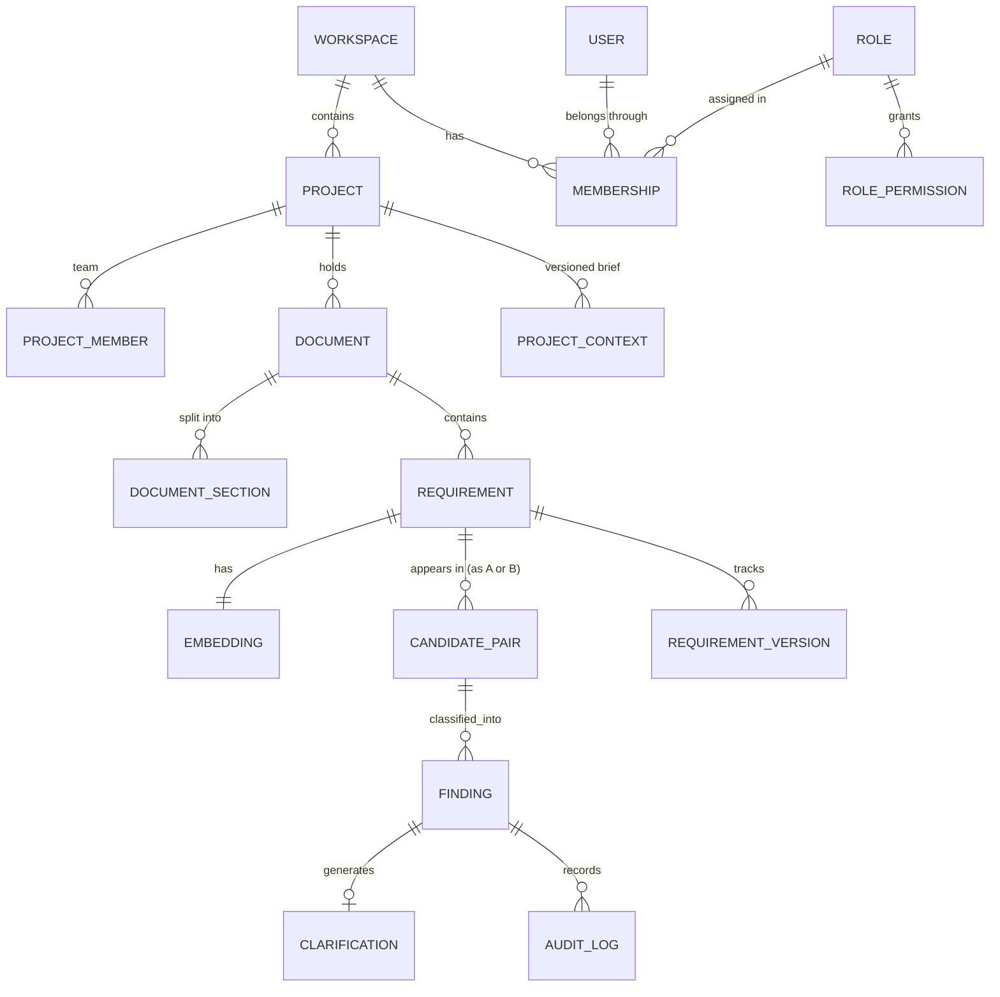

# Database Documentation

**ER Diagram, Table Definitions, and Data Dictionary**

| | |
|---|---|
| **Engine** | PostgreSQL + pgvector extension |
| **Status** | Implemented through migrations `0004`/`0004a` (Sprint 0) and `0011` (Sprint 1, project context). Later migrations add the rest — see [`IT314_RCD_Design_Update_v5.md` §4.3](../planning/v5/IT314_RCD_Design_Update_v5.md#43-migration-plan) |

---

## 1. ER Diagram

## 2. Tenancy tables (Sprint 0 — migration 0004)

People belong to workspaces through **memberships**; the old single `users.role` / `users.workspace_id`
columns are gone. See `roles-and-access.md` for how they are used.

### 2.0a projects

| Column | Type | Notes |
|---|---|---|
| id | UUID (PK) | |
| workspace_id | UUID (FK) | RESTRICT; `(workspace_id, name)` unique |
| name / description | varchar(120) / text | |
| status | `setup` / `active` / `archived` | New projects start in `setup` (FR-103); no analysis until `active` |
| context_version | int, default 0 | Current confirmed context version (written by the context service, US-60). *Created here rather than in 0011 — see the migration docstring* |
| similarity_threshold, confidence_threshold | float 0–1 | Defaults 0.75 / 0.5 (team-tunable, US-06) |
| llm_budget_monthly_calls | int ≥ 0 | Default 2000 |
| chat_detection_enabled | bool, default false | Chat text reaches the LLM only if a manager enables it (SX-04) |
| required_approvals | int 1–3 | Default 1 |
| created_by | UUID (FK -> users, nullable) | |

### 2.0b roles and role_permissions

`roles`: `id`, `workspace_id` (NULL for the nine platform defaults), `name`, `description`, `is_default`.
A CHECK keeps defaults global and custom roles per workspace; partial unique indexes keep names unique
(among defaults, and within a workspace). `role_permissions`: PK `(role_id, permission)`, `permission` is a name
from `app.core.permissions.PERMISSIONS`, `protected_only` marks "held for protected requirements only".
The nine default roles and their grants are seeded by migration 0004; `tests/db/test_default_roles.py` checks
the rows against `app/core/permissions.py`.

### 2.0c memberships and project_members

`memberships`: `user_id`, `workspace_id`, `role_id` (RESTRICT — a role in use cannot be deleted),
`stakeholder_group`, `joined_at`, `ended_at`. **At most one active membership per (user, workspace)** — a
partial unique index `WHERE ended_at IS NULL`; ended rows are history, so rejoining never edits old rows.
`project_members`: PK `(project_id, user_id)`, optional `role_override_id` (project-level role, FR-79).

### 2.0d Columns added to existing tables

| Table | Column | Notes |
|---|---|---|
| users | `platform_role` | NULL, `platform_admin` or `service`. Replaces `role` and `workspace_id` |
| documents | `project_id` | NOT NULL FK; `workspace_id` stays and equals the project's |
| documents | `import_mode` | `baseline` (requirements Approved) or `proposals` (Proposed, default) — FR-01 |
| documents | `stakeholder_group` | optional, copied onto the document's requirements (FR-05) |
| requirements | `project_id` | NOT NULL FK, denormalised from the document |
| requirements | `state` | Proposed / Under_Review / Approved / Rejected / Implemented / Deprecated (default Proposed) |
| requirements | `origin` | document / post / change_request (default document) |
| requirements | `owner_id` | nullable FK -> users |
| findings | `severity` | now `low` / `medium` / `high` only (migration 0003; `critical` became `high`) |

`workspaces.name` is **not unique** (migration `0004a`): a platform-wide unique name would let one tenant learn that
another tenant's workspace exists. Workspaces are identified by id.

Existing data is backfilled by 0004: one `active` project per workspace, one membership per user (the first
admin — else the earliest user — becomes Owner), existing documents count as baseline imports and their
requirements as `Approved`.

## 2.0e Project context (Sprint 1 — migration 0011)

US-60 and US-02 (FR-103 to FR-105, ADR-28). `projects.status` and `projects.context_version` already exist (created in `0004`, §2.0a).

**`project_contexts`** — one row per version of the project brief; unique `(project_id, version)`, `version ≥ 1`.

| Column | Type | Notes |
|---|---|---|
| id | UUID (PK) | |
| project_id | UUID (FK) | |
| version | int ≥ 1 | Increments on every edit; never rewritten |
| purpose, scope_in, scope_out, environment | text | Required fields (FR-103) |
| actors, glossary, references | jsonb | Lists; glossary entries are `{term, meaning}` |
| constraints, quality_goals, regulations | text | Optional fields |
| source_document_id | UUID (FK, nullable) | The initial SRS the brief was drafted from |
| field_status | jsonb, default `{}` | Per field: `ai_drafted` or `confirmed` |
| summary | text | Generated on confirmation; always in the context pack |
| created_by, reason, created_at | UUID / text / timestamptz | Author and reason of each version |

**`document_sections`** — each heading of an uploaded document and the verbatim text under it, used by the brief drafter and the context pack.

| Column | Type | Notes |
|---|---|---|
| id | UUID (PK) | |
| document_id, project_id | UUID (FK) | Indexed `(document_id, order_index)` and `project_id` |
| heading | text, nullable | |
| body | text | Verbatim |
| location | text, nullable | |
| order_index | int ≥ 0 | |
| embedding | vector(384), nullable | NULL until the embedding stage fills it |

**Columns added:** `findings.context_version` (which context the classifier was given); `requirements.section_heading`, `needs_review` (default false), `review_reasons` (jsonb, default `[]`) — the segmenter's review flags (US-02).

No context is backfilled: projects that `0004` created as `active` keep `context_version = 0` until their manager drafts a brief (`POST /projects/{p}/context/draft`).

## 2.1 Original tables (7)

### documents

| Column | Type | Notes |
|---|---|---|
| id | UUID (PK) | Primary key |
| filename | varchar | Original uploaded filename |
| format | varchar | pdf / docx / txt / reqif — FR-01 |
| status | varchar | queued / processing / done / failed — FR-02, US-03 |
| workspace_id | UUID (FK) | Access scoping — FR-38 |
| uploaded_by | UUID (FK -> users) | Provenance — FR-05 |
| uploaded_at | timestamp | |

### requirements

| Column | Type | Notes |
|---|---|---|
| id | UUID (PK) | |
| document_id | UUID (FK) | |
| source_req_id | varchar, nullable | Preserves original REQ-ID if present — FR-04, DR-03 |
| body | text | Extracted requirement statement |
| stakeholder_group | varchar, nullable | Provenance — FR-05, DR-11 |
| is_protected | boolean, default false | Compliance-critical flag — FR-21, DR-05 |
| current_version | int | FK target into requirement_versions |

### requirement_versions

| Column | Type | Notes |
|---|---|---|
| id | UUID (PK) | |
| requirement_id | UUID (FK) | |
| version_no | int | |
| body_snapshot | text | Prior text at this version — FR-26, DR-08 |
| changed_by | UUID (FK -> users) | |
| changed_at | timestamp | |

### embeddings

| Column | Type | Notes |
|---|---|---|
| id | UUID (PK) | |
| requirement_id | UUID (FK, unique) | |
| vector | vector(384) | all-MiniLM-L6-v2 output — FR-07, FR-08 |
| model_version | varchar | For re-embedding on model upgrade |

### candidate_pairs

| Column | Type | Notes |
|---|---|---|
| id | UUID (PK) | |
| requirement_a_id | UUID (FK) | |
| requirement_b_id | UUID (FK) | |
| similarity_score | float | Above configurable threshold — FR-09, FR-10 |
| generated_at | timestamp | |

### findings

| Column | Type | Notes |
|---|---|---|
| id | UUID (PK) | |
| candidate_pair_id | UUID (FK, nullable) | Null for single-requirement findings (e.g., Incomplete) |
| category | enum | Conflicting / Duplicate / Ambiguous / Incomplete / Dependent |
| confidence | float (0-1) | FR-13 |
| rationale | text | Natural-language explanation — FR-14 |
| status | varchar | flagged / confirmed / dismissed / merged / reclassified — FR-18 |
| original_ai_output | jsonb | Preserved even after human correction — FR-20 |
| severity | `low` / `medium` / `high`, nullable | US-08 (FR-42) — `critical` retired in migration 0003 |

### audit_log

| Column | Type | Notes |
|---|---|---|
| id | UUID (PK) | |
| finding_id | UUID (FK, nullable) | |
| actor_id | UUID (FK -> users) | |
| action | varchar | e.g. viewed_protected, dismissed, merged — FR-19, FR-36, NFR-13 |
| at | timestamp | |

*An 8th planned table, `clarifications` (finding_id, question, resolution — FR-22/FR-23), is intentionally kept 1:1 with findings and is described inline in the class diagram in `diagrams.md` rather than repeated here.*

## 3. Indexing Notes

- `embeddings.vector` needs an IVFFlat or HNSW pgvector index for similarity search to stay within the NFR-01/NFR-02 performance targets at scale.
- `candidate_pairs` should be indexed on `(requirement_a_id, requirement_b_id)` to support fast lookups from the graph view (FR-29).
- `audit_log` should be append-only with no update/delete permission at the application layer, consistent with FR-36 (exportable, complete audit trail).
