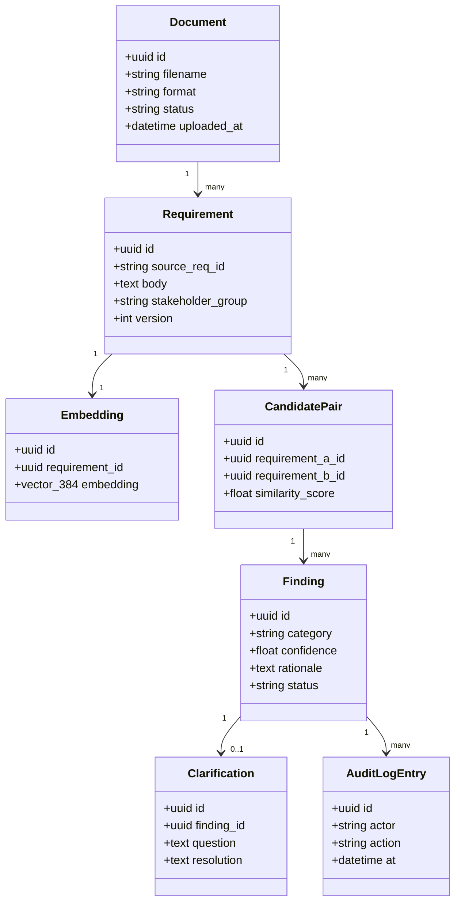
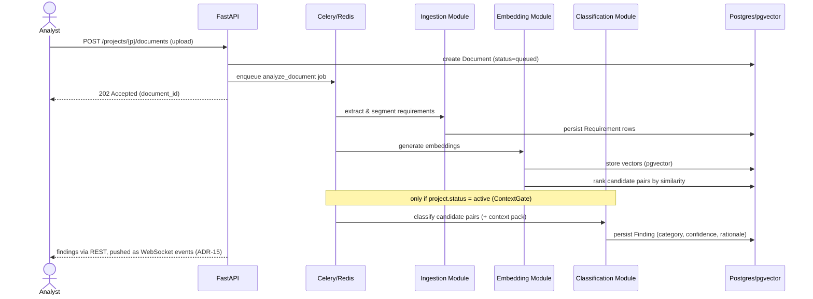
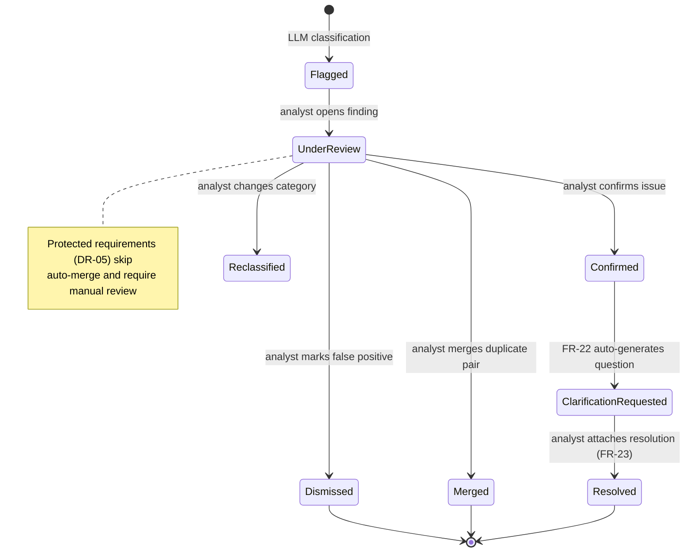
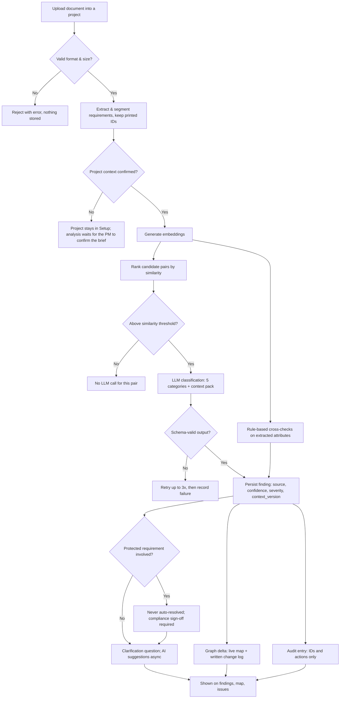
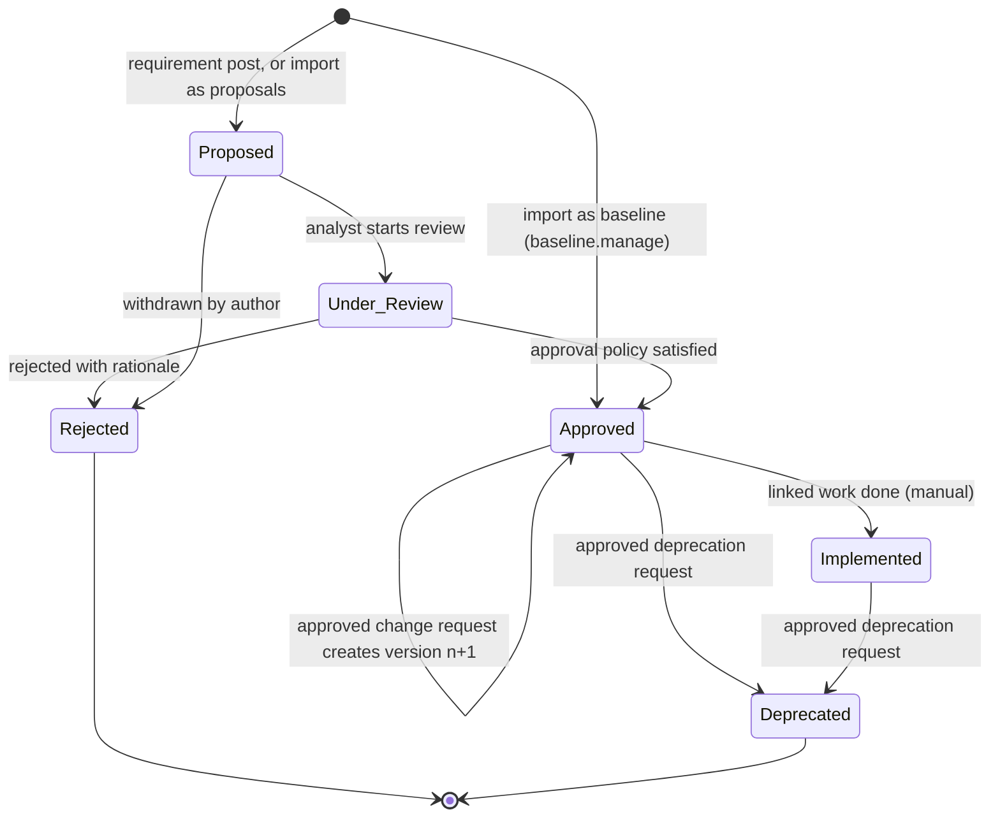
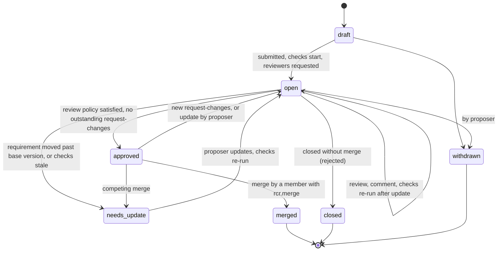

# UML Diagrams

**Class, Sequence, State & Activity Diagrams**

> Status: Diagrams 1–3 are the original design-stage diagrams; the implemented domain model is in `object-design.md` §2, which supersedes Diagram 1. Diagrams 4–6 reflect the revision 5 scope ([`IT314_RCD_Design_Update_v5.md`](../planning/v5/IT314_RCD_Design_Update_v5.md) §7, §12).
> These render natively as diagrams in GitHub's markdown viewer (Mermaid fenced code blocks) — no extra tooling needed.

A hand-drawn activity diagram for the core pipeline workflow was submitted with Lab 6 as a separate photograph. Diagram 4 below is a typed Mermaid re-expression of that same workflow for repo documentation purposes.

---

## 1. Class Diagram — Core Data Model (original, superseded)

*Superseded by `object-design.md` §2: requirements now belong to a workspace and a project, findings to a project and an analysis run (SX-09), and roles are permission sets (ADR-20).*

## 2. Sequence Diagram — Upload to Classification

*Updated for projects: the upload goes to `POST /projects/{p}/documents`, and classification starts only once the project is `active` (FR-103).*

## 3. State Diagram — Finding Lifecycle (original)

*The finding lifecycle for the extended scope (AI, Rule and Person sources; issues separate from findings, SX-18) is designed in `object-design.md` §5.2.*

## 4. Activity Diagram — Conflict-Detection Pipeline (revision 5)

Re-expression of the Lab 6 hand-drawn diagram, extended with the context gate (FR-103), rule-based cross-checks (FR-101), the context pack (FR-105) and the live map (FR-84).

## 5. State Diagram — Requirement Lifecycle (revision 5)

From [`IT314_RCD_Design_Update_v5.md` §7.1](../planning/v5/IT314_RCD_Design_Update_v5.md#71-requirement-lifecycle). Only Approved and Implemented requirements form the baseline (DR-13); after approval, text changes only through a change request (DR-14).

## 6. State Diagram — Change Request Lifecycle (revision 5)

From [`IT314_RCD_Design_Update_v5.md` §7.2](../planning/v5/IT314_RCD_Design_Update_v5.md#72-change-request-lifecycle-rev-2-pull-request-style). Checks are a property of the open request, not a state; merge re-verifies the agreement rules in one transaction (FR-98).

