# Object Design

**Domain model, class designs, state machines, object interactions, patterns and responsibilities**

| | |
|---|---|
| **Scope** | The classes and modules inside the backend, from the domain model down to collaborations |
| **Companion** | `system-design.md` (architecture, runtime, deployment, cross-cutting) |
| **Supersedes** | The class diagram in `diagrams.md`, which predates the implementation (differences in §2.3) |
| **Status legend** | ✅ implemented and tested · 🟡 stub file exists, the design here is a **proposal for its owner to confirm** · ⬜ planned |
| **Revision 5** | Written before the Step 7 scope extension. [`IT314_RCD_Design_Update_v5.md`](../planning/v5/IT314_RCD_Design_Update_v5.md) extends §2–§5 and replaces §10 (done below); anything it does not mention is unchanged |

**Notation.** The backend is Python, and much of it is modules of functions rather than classes. A module that plays a class-like role in a diagram is drawn as `<<module>>`. `<<DTO>>` marks Pydantic data-transfer objects, `<<entity>>` marks SQLAlchemy ORM classes, `<<interface>>` marks a Protocol/ABC.

---

## 1. Design Approach

1. **Domain model first.** Entities and their invariants come from the requirements (DR-01 to DR-12), not from the framework.
2. **Entities are not DTOs.** ORM entities (`app.models`) never leave the service layer. Pydantic schemas (`app.schemas`) are the API contract, built by explicit `from_model()` mappers. This keeps database changes from silently changing the API and keeps secrets (`hashed_password`, `storage_path`, `sha256`) off the wire.
3. **Behaviour in services, rules in the database.** Business flow lives in service functions; invariants that must hold *whatever* the application does (pair ordering, finding subject, audit immutability, enum values) are `CHECK`s and triggers.
4. **Depend on abstractions at the edges.** Parsers, LLM providers and file storage sit behind small interfaces so they can be swapped (NFR-18, NFR-19).
5. **Make illegal states unrepresentable where cheap.** Examples: `CandidatePair.ordered()` is the only sensible way to build a pair; storage keys cannot resolve outside their root; `Finding` must reference exactly one subject.

---

## 2. Domain Model ✅

> **Extended in revision 5** by [Design Update v5 §4 and §4.2](../planning/v5/IT314_RCD_Design_Update_v5.md#4-data-design-changes-extends-sd-7-and-od-2) (new tables and invariants), §11.1 and §12.1. The implemented tenancy and context entities are documented in `data-model.md` §2.0.

### 2.1 Class diagram — entities and enumerations

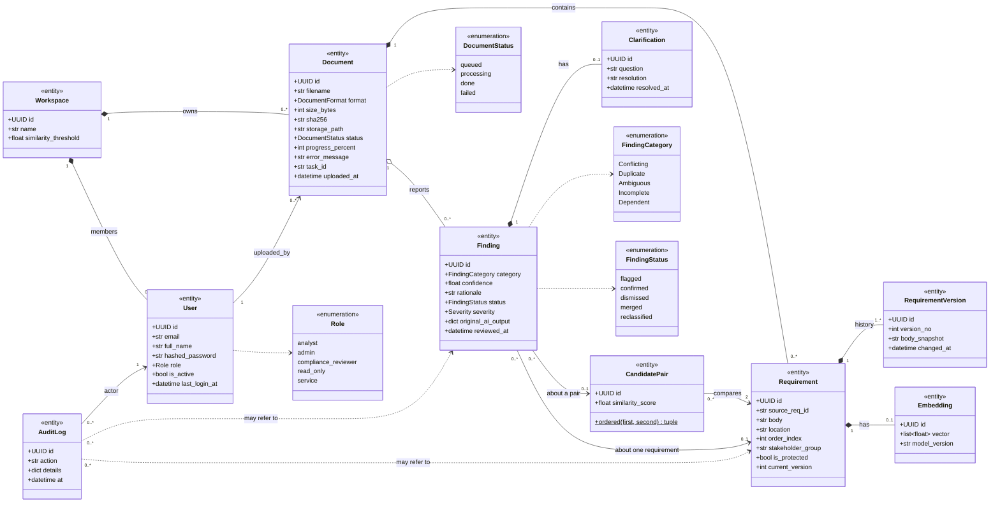

*Composition (`*--`) means the child cannot outlive the parent and is deleted with it. `AuditLog` is deliberately **not** composed under anything: its foreign keys are `RESTRICT`, so an audited record cannot be deleted out from under its trail.*

### 2.2 Class invariants

Each rule says where it is enforced. "DB" rules hold even if the application has a bug.

| Class | Invariant | Enforced by |
|---|---|---|
| `User` | `email` is stored lower-case and is unique | DB `CHECK (email = lower(email))` + unique; `normalize_email()` |
| `User` | A deactivated user can neither log in nor use an existing token | `authenticate_user()` and `get_current_user()` |
| `Workspace` | `similarity_threshold` is between 0 and 1 | DB `CHECK` |
| `Document` | `progress_percent` between 0 and 100; `size_bytes` ≥ 0 | DB `CHECK` |
| `Document` | `storage_path` is `<workspace_id>/<document_id>.<ext>`, never client-supplied | `storage_key()` |
| `Document` | A document is only ever read through its own workspace | every service query filters `workspace_id` |
| `Requirement` | `body` is the verbatim source text; changes only through a new `RequirementVersion` | service rule (FR-26, DR-04) |
| `Requirement` | `source_req_id` is an ID printed in the source document or `NULL`, never a generated one | `processing._to_row()` (DR-03) |
| `RequirementVersion` | `(requirement_id, version_no)` unique; version ≥ 1 | DB unique + `CHECK` |
| `Embedding` | Exactly 384 dimensions; at most one per requirement | `Vector(384)` + unique |
| `CandidatePair` | `requirement_a_id < requirement_b_id`; each pair stored once; similarity in [-1, 1] | DB `CHECK` + unique; `ordered()` |
| `Finding` | References exactly one of `candidate_pair_id` / `requirement_id` | DB `CHECK num_nonnulls(...) = 1` |
| `Finding` | `confidence` in [0, 1]; `original_ai_output` is never overwritten | DB `CHECK`; service rule |
| `Clarification` | At most one per finding | unique `finding_id` |
| `AuditLog` | Append-only | DB trigger rejects `UPDATE`/`DELETE`/`TRUNCATE` |

### 2.3 Differences from `diagrams.md`

| `diagrams.md` (design stage) | Implemented model | Reason |
|---|---|---|
| `Requirement.version` | `current_version` + a `RequirementVersion` history table | DR-08 needs the full history, not a counter |
| `CandidatePair "1" → "many" Finding` and `Requirement "1" → "many" CandidatePair` | A finding references a pair **or** a single requirement | Ambiguous/Incomplete findings have no pair |
| `Finding "1" → "many" AuditLogEntry` | `AuditLog` references a finding **or** a requirement (both optional) | NFR-13 requires logging *viewing* a protected requirement, which involves no finding |
| `Finding.status` includes *UnderReview*, *ClarificationRequested*, *Resolved* | Persisted: `flagged`, `confirmed`, `dismissed`, `merged`, `reclassified` | The others are derived or UI-only — see §5.2 |
| `Document.format` string | `DocumentFormat` enum; `status` enum | Constrained in the database |
| Not modelled | `Workspace`, `User`, `Role`, `Severity`, `AuditAction` | Required by FR-37/38, US-08, NFR-13 |

---

## 3. Object Design of the Implemented Subsystems

> **Extended in revision 5** by [Design Update v5 §5](../planning/v5/IT314_RCD_Design_Update_v5.md#5-object-design-additions-extends-od-3-and-4), §11.8 and §12.6 (`ProjectContextService`, `BriefDrafter`, `ContextPackBuilder`, `SrsDraftGenerator`, `FidelityChecker` and others).

### 3.1 Error model ✅

All expected, client-facing failures are exceptions that carry their own HTTP status and machine-readable `code`; one handler turns any of them into the standard body `{"error": {"code", "message", "request_id"}}`. Code raises a meaningful exception; it never builds a response.

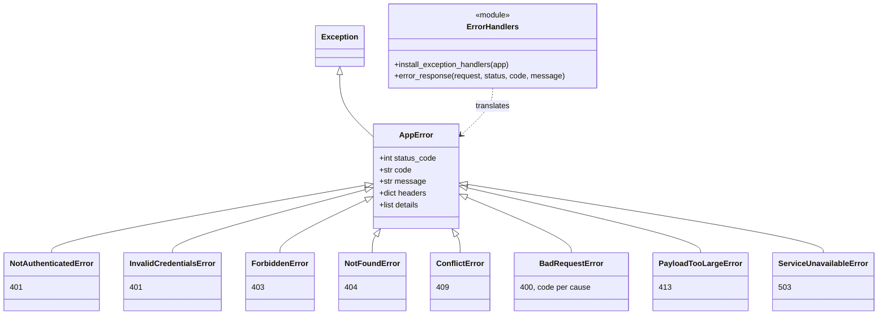

`BadRequestError` carries the upload codes (`unsupported_file_type`, `empty_file`, `corrupted_file`, `file_content_mismatch`, `unsafe_file`) so a client can branch on `code` without parsing prose.

### 3.2 Authentication and authorisation ✅

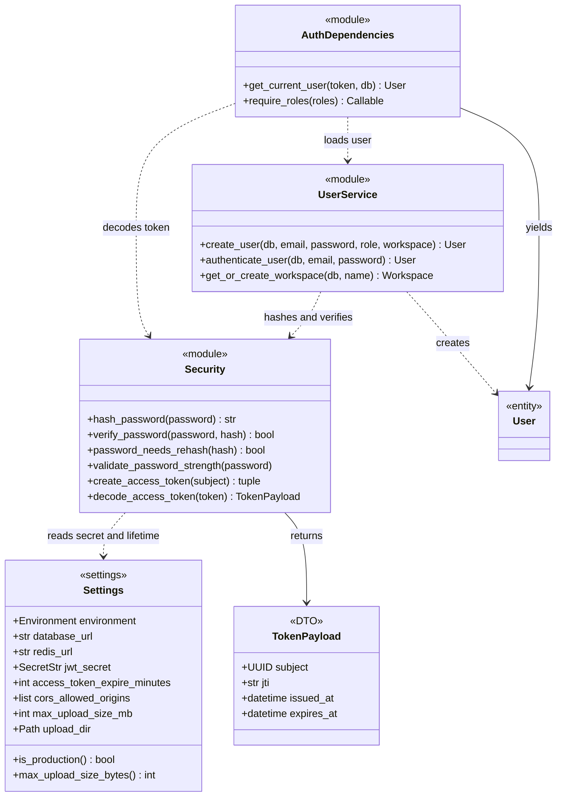

`require_roles(*roles)` is a **dependency factory**: it returns a closure that depends on `get_current_user` and raises `ForbiddenError` unless the user's role is allowed. Routes declare their policy in their signature, e.g. `Uploader = Annotated[User, Depends(require_roles(Role.ANALYST, Role.ADMIN))]`.

### 3.3 Upload subsystem ✅

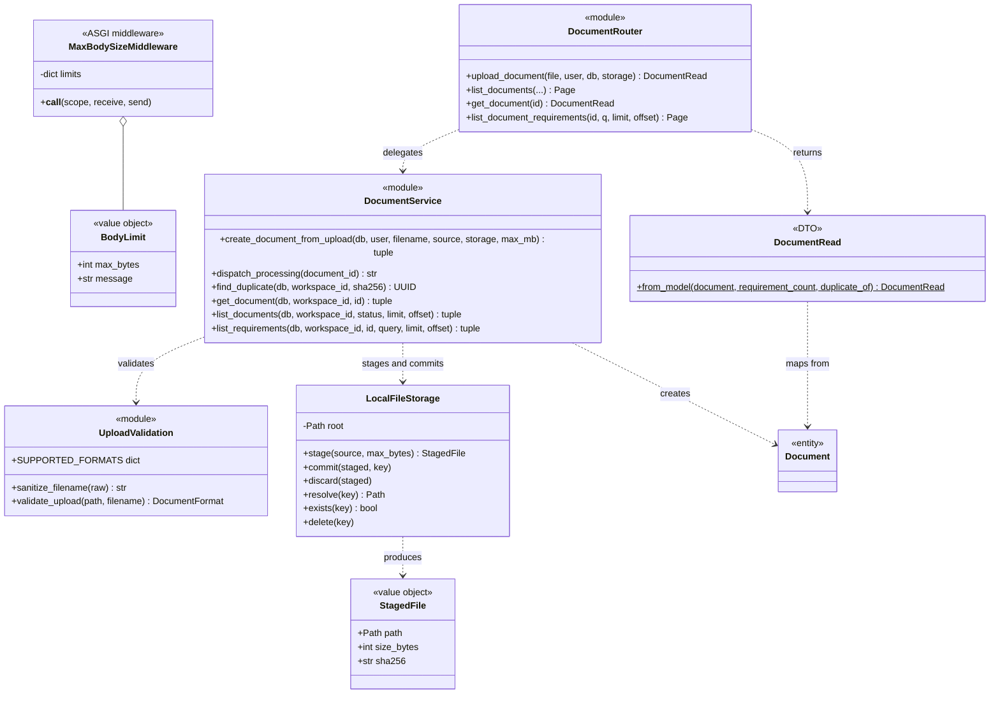

**Responsibility split.** The *middleware* protects the server from the cost of reading a huge body. The *router* only translates HTTP to a service call and the result to a schema. The *service* owns the transaction and the ordering rules. *UploadValidation* is pure (path in, format out, or `BadRequestError`). *LocalFileStorage* knows files but nothing about documents or HTTP.

### 3.4 Document processing (worker side) ✅

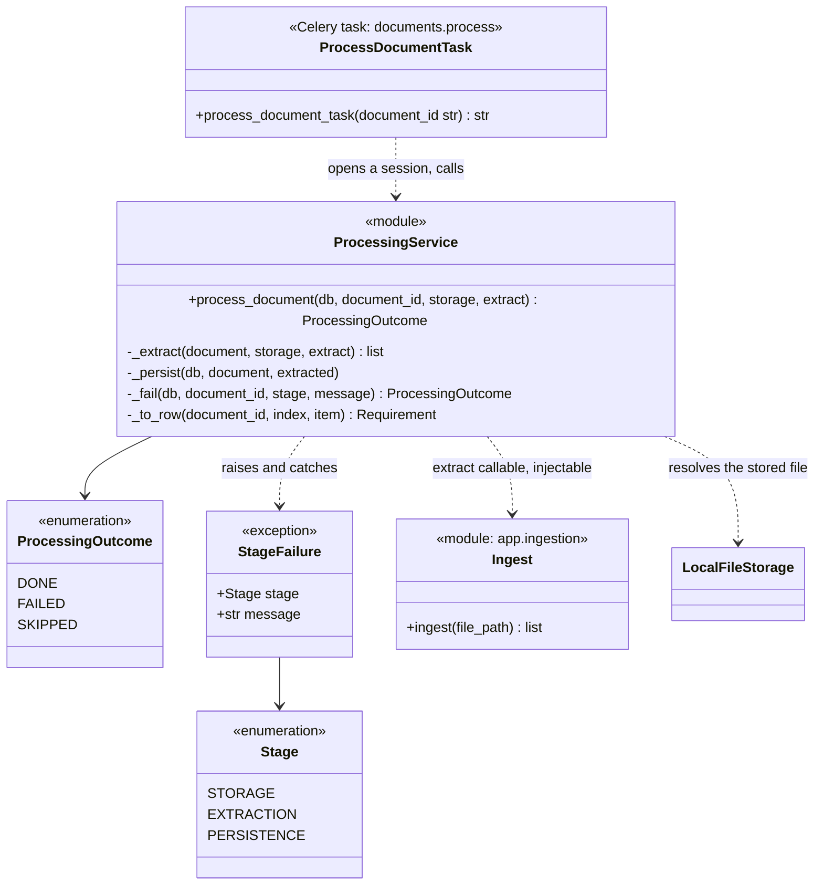

`extract` is a **parameter** with `ingest` as its default. Tests inject fakes (a failing extractor, a slow one), and a different pipeline could be swapped in without editing the service.

### 3.5 Ingestion ✅ (Bansil)

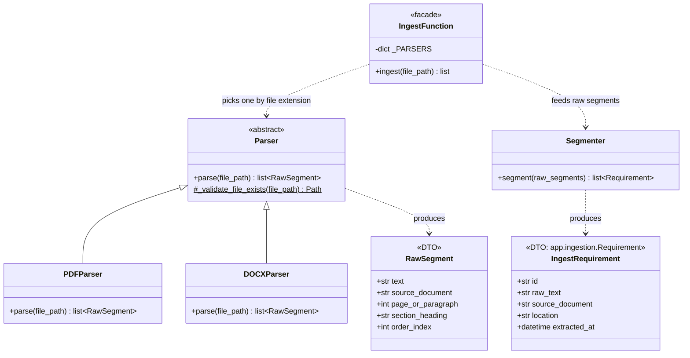

> **Naming hazard.** `app.ingestion.Requirement` (a Pydantic DTO, the extractor's output) and `app.models.Requirement` (the ORM entity) share a name. `services/processing.py` imports the DTO as `ExtractedRequirement` and maps it to the entity in `_to_row()`. Anyone adding code that touches both should keep that alias.

---

## 4. Object Design of the Analysis Pipeline 🟡 (proposal)

The stub files exist (`embeddings/embed.py`, `vector_store.py`, `candidate_filter.py`; `classification/classifier.py`, `schemas.py`; `clarification/question_gen.py`, `impact_analysis.py`) but are empty. This is a **proposed contract** that fits the data model and runtime design. Owners — Heet (embeddings), Keval (classification), Madhav (clarification) — should adopt or amend it before Sprint 2.

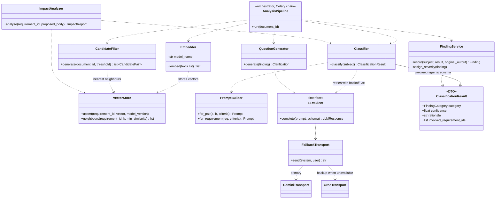

Contract notes:

- `CandidateFilter.generate` builds pairs with `CandidatePair.ordered()` and **does not decide protection**: it marks pairs that touch a protected requirement so the orchestrator can route them to manual review (DR-05).
- `Classifier.classify` accepts a *pair* or a *single requirement* because Ambiguous/Incomplete concern one requirement. Its output is a **validated** `ClassificationResult`; schema failure triggers a retry, never a partial finding (FR-15).
- `FindingService.record` stores the model's raw answer in `original_ai_output` before anything else is derived from it.
- `LLMClient` is the Adapter boundary: Gemini and Groq have different SDKs and error types; `Classifier` sees one interface and one error vocabulary. `FallbackTransport` switches to Groq only when Gemini is unavailable (rate limit, 5xx, timeout), never on a refusal or an invalid reply (ADR-31, [`ai-providers.md`](ai-providers.md) §3).
- `ImpactAnalyzer.analyse` is **read-only**: it embeds the proposed text and reports affected requirements without saving, which is how US-11 shows impact *before* the edit is committed.

---

## 5. State Machines

> **Extended in revision 5** by [Design Update v5 §7](../planning/v5/IT314_RCD_Design_Update_v5.md#7-new-state-machines-extends-od-5): requirement lifecycle, PR-style change request, join code and join request, issue. The first two are also drawn in `diagrams.md` §5–§6.

### 5.1 Document status ✅

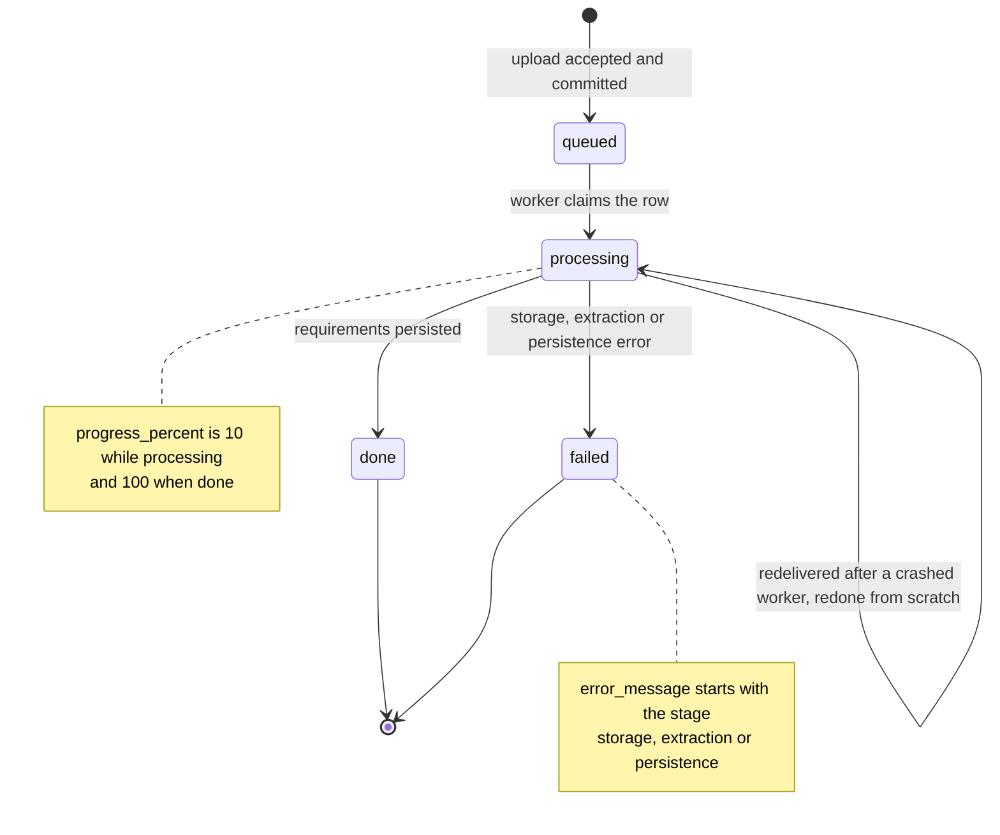

`done` and `failed` are terminal for the worker: a repeat delivery returns `SKIPPED`. A retry endpoint (`reprocess`) is a planned, small addition (system design G5). Planned change: when later stages are chained, `done` is reached only after the final stage (G2).

### 5.2 Finding lifecycle ⬜

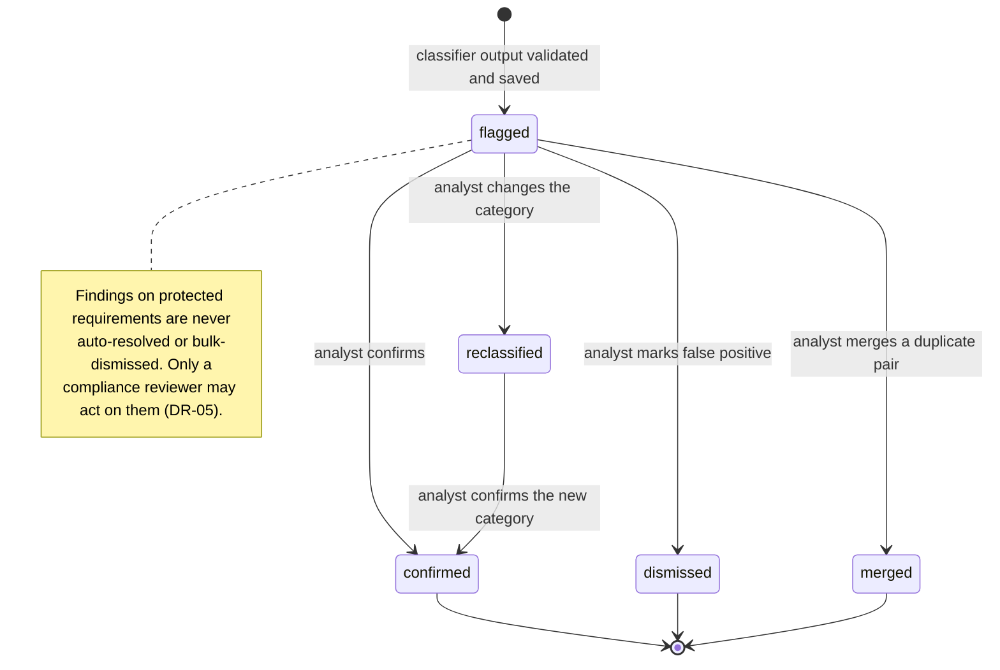

**Persisted versus derived states.** `diagrams.md` also shows *UnderReview*, *ClarificationRequested* and *Resolved*. They are not stored in `findings.status`:

| Diagram state | How it is represented |
|---|---|
| *UnderReview* | UI state only (the analyst has the finding open) |
| *ClarificationRequested* | `status = confirmed` **and** a `clarifications` row exists with `resolved_at IS NULL` |
| *Resolved* | `status = confirmed` **and** `clarifications.resolved_at IS NOT NULL` |

Storing only the human decision keeps one source of truth; the rest is a query.

Every transition out of `flagged` records `reviewed_by`/`reviewed_at` and appends an `audit_log` row.

---

## 6. Object Interactions

### 6.1 Uploading a document ✅

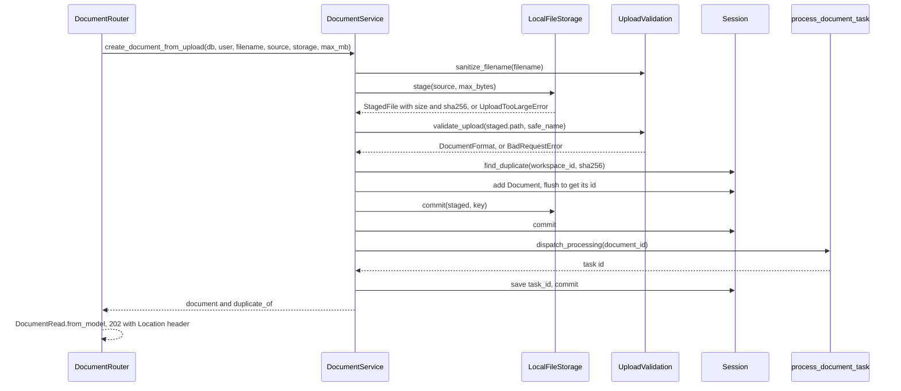

On any exception the service rolls back, discards the staged file and deletes the final file if it was already moved, then re-raises — the router never sees a half-finished upload.

### 6.2 Processing a document ✅

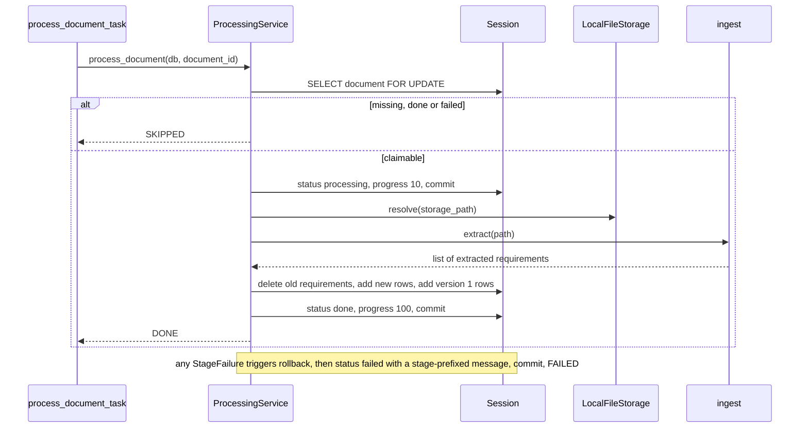

### 6.3 Classifying one candidate pair 🟡

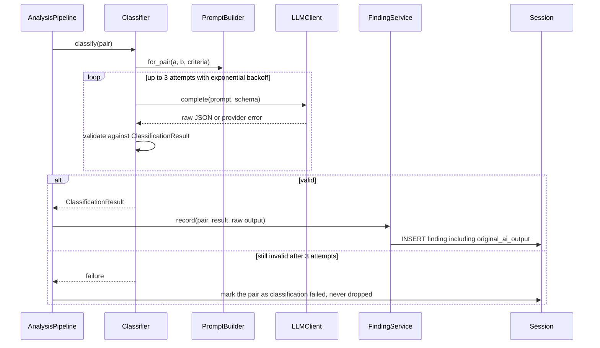

### 6.4 Edit with impact preview 🟡

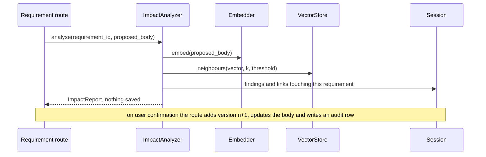

---

## 7. Design Patterns in Use

| Pattern | Where | Why | Status |
|---|---|---|---|
| **Strategy** | `Parser` subclasses chosen by extension in `ingest()` | New formats are added without touching the pipeline (NFR-18) | ✅ |
| **Registry / Factory** | `_PARSERS` dict; `create_app()`; `get_storage()`; `get_db()` | One place decides which concrete object to build | ✅ |
| **Facade** | `ingest()`; `DocumentService`; `process_document()` | One call hides a multi-step workflow | ✅ |
| **Dependency Injection** | FastAPI `Depends(...)`; `process_document(extract=…)`; dependency overrides in tests | Swap a database, storage or extractor without editing the caller | ✅ |
| **Dependency factory / Decorator** | `require_roles(*roles)` | Adds an authorisation policy to a route declaratively | ✅ |
| **Chain of Responsibility** | Middleware stack: request-context → CORS → body-size guard → router | Each layer handles one concern and passes the request on | ✅ |
| **Template-style pipeline** | Upload: stage → validate → insert → move → commit → enqueue; worker: claim → extract → persist | A fixed order with a defined failure path at each step | ✅ |
| **State** | `DocumentStatus`, `FindingStatus`, enforced by `CHECK` constraints and service transitions | Legal transitions are explicit | ✅ / ⬜ |
| **Data Transfer Object + Mapper** | `schemas.*` with `from_model()` | The API contract is independent of storage | ✅ |
| **Value object** | `StagedFile`, `BodyLimit`, `TokenPayload` (frozen dataclasses) | Immutable, comparable, safe to share | ✅ |
| **Singleton (via caching)** | `get_settings()`, `get_engine()`, `get_sessionmaker()` use `lru_cache` | One configuration and one connection pool per process | ✅ |
| **Unit of Work** | A SQLAlchemy `Session`; `session_scope()` for non-request code | One transaction boundary per operation | ✅ |
| **Adapter** | `LLMClient` → Gemini / Groq transports behind a fallback; a future S3 storage behind the same methods as `LocalFileStorage` | Isolates third-party SDKs and error types | 🟡 / ⬜ |
| **Template Method / retry policy** | Classifier retry with backoff | One reliability policy for every LLM call | ⬜ |
| **Idempotent receiver** | `process_document` claim and skip rules | Duplicate delivery is harmless | ✅ |

## 8. Design Principles Applied

| Principle | Example in this codebase |
|---|---|
| **Single Responsibility** | Middleware guards size; router maps HTTP; service owns the transaction; `UploadValidation` only judges content; `LocalFileStorage` only moves bytes |
| **Open/Closed** | Add a parser or an LLM provider by adding a class and registering it; `ingest()` and `Classifier` do not change |
| **Liskov Substitution** | Every `Parser` returns `list[RawSegment]` and raises on bad input, so `ingest()` treats them identically; any `LLMClient` returns one response shape |
| **Interface Segregation** | `LLMClient` has one method; `LocalFileStorage` exposes stage/commit/discard/resolve/delete, not a general filesystem |
| **Dependency Inversion** | High-level services take their collaborators as parameters (`storage`, `extract`, `db`) instead of constructing them |
| **Separation of concerns** | HTTP, business rules, persistence and AI integration live in different packages with one-way dependencies |
| **Fail fast, fail safe** | Start-up validation of settings; validation before storage; cleanup on every failure path |
| **Least privilege** | Per-route roles; workspace-scoped queries; service accounts separate from people |
| **Don't trust input** | Content sniffing, filename sanitisation, key containment, schema-validated LLM output |

---

## 9. CRC Cards (key classes)

| Class | Responsibilities | Collaborators |
|---|---|---|
| **Document** (entity) | Represents one uploaded SRS and its processing state; points at its stored file; scoped to a workspace | Workspace, User, Requirement, Finding |
| **Requirement** (entity) | Holds one requirement's verbatim text, source ID and location; knows whether it is protected; owns its version history | Document, RequirementVersion, Embedding, CandidatePair, Finding |
| **Finding** (entity) | Records one AI-proposed issue with category, confidence, rationale and the verbatim model output; carries the human decision | CandidatePair or Requirement, Clarification, AuditLog, User |
| **CandidatePair** (entity) | Represents two requirements worth comparing; guarantees canonical ordering | Requirement, Finding |
| **AuditLog** (entity) | One immutable record of an auditable action | User, Workspace, Finding, Requirement |
| **DocumentService** | Runs the upload transaction in the right order; lists and fetches documents and requirements within a workspace; detects re-uploads | LocalFileStorage, UploadValidation, Session, the Celery task |
| **ProcessingService** | Claims a document, extracts and persists its requirements idempotently, and records any failure with a readable reason | Session, LocalFileStorage, `ingest`, Requirement, RequirementVersion |
| **LocalFileStorage** | Streams bytes to a staging file with a hard size cap and a hash; atomically commits to a key; guarantees keys stay inside its root | StagedFile, the filesystem |
| **UploadValidation** | Decides whether staged content is an acceptable PDF or DOCX and says specifically why not | BadRequestError |
| **MaxBodySizeMiddleware** | Refuses over-limit bodies before they are read, including bodies with no declared length | BodyLimit, the error response builder |
| **AuthDependencies** | Turns a bearer token into an active user and enforces role policy per route | Security, UserService, Session |
| **Settings** | Holds validated configuration and refuses unsafe production values | the process environment |
| **Classifier** 🟡 | Classifies a pair or single requirement into one of five categories with confidence and rationale; retries and validates | PromptBuilder, LLMClient, ClassificationResult |
| **CandidateFilter** 🟡 | Produces candidate pairs above the workspace threshold using vector neighbours, in canonical order | VectorStore, CandidatePair |
| **ImpactAnalyzer** 🟡 | Reports what an edit would affect, without saving anything | VectorStore, Classifier, Finding |

## 10. Module-to-Code Map

*Replaced in revision 5 by [Design Update v5 §10](../planning/v5/IT314_RCD_Design_Update_v5.md#10-updated-module-to-code-map-replaces-od-10); the Status column reflects `main` on 22 Oct 2026.*

| Design element | Path | Owner | Status |
|---|---|---|---|
| Entities, enums, migrations | `backend/app/models/`, `backend/alembic/` | Parth | ✅ (`0001`–`0004a`, `0011`) |
| Auth, membership, permissions and roles | `backend/app/core/auth.py`, `app/core/permissions.py`, `app/services/{access,membership}.py`; `roles.py` (custom roles) | Parth | ✅ · custom roles ⬜ |
| Join codes and join requests | `app/services/join_codes.py` | Madhav | ⬜ (sign-up redeems a code in `app/services/signup.py` ✅) |
| Channels, messages | `app/services/channels.py`, `app/api/channels.py` | Madhav | ⬜ |
| Requirement posts, drafts, ownership, votes, watches, links | `app/intake/` | Bansil | 🟡 EARS templates and composer schemas |
| Real-time gateway, event bus, queues, beat | `app/realtime/`, `app/core/celery_app.py` | Dhavni didi | 🟡 Celery ✅ · real-time ⬜ |
| Graph service, deltas and change narrator | `app/graph/` | Dhavni didi | ⬜ |
| Issues and auto conflict issues | `app/services/issues.py` | Dhavni didi | ⬜ |
| Ingestion, chat detection, SRS export | `app/ingestion/`, `app/intake/`, `app/export/` | Bansil | ✅ ingestion · ⬜ export |
| Project context, brief drafting, context gate | `app/context/` | Bansil | ✅ |
| Context pack | `app/classification/context_pack.py` | Keval | ⬜ |
| Updated SRS: readiness, generator, fidelity, exporter | `app/export/srs/` | Bansil (Keval: prompts) | ⬜ |
| Embeddings, candidates, incremental retrieval, similar hints, search | `app/embeddings/`, `app/search/` | Heet | 🟡 |
| Classification, LLM clients, budget guard, lint catalogue, pre-flight, AI wording | `app/classification/`, `app/lint/` | Keval | 🟡 |
| Clarification, impact, consequence checks, risk scoring, notifications, AI suggestions and feedback | `app/clarification/`, `app/consequences/`, `app/suggestions/`, `app/notifications/` | Madhav (Keval: prompts) | 🟡 clarification, impact · ⬜ rest |
| Change requests, review policy, merge, review state, baselines, audit | `app/services/{change_requests,reviews,baselines}.py` | Parth | ⬜ |
| DTOs and `Page[T]` | `backend/app/schemas/` | Parth | ✅ |
| Error model, middleware, security, config | `backend/app/core/` | Parth | ✅ |
| Frontend shell, channels, composer, requirements, issues, dashboard, baselines, analytics, map preview | `frontend/src/features/{channels,composer,requirements,issues,dashboard,baselines,analytics}` | Pranshu | ⬜ |
| Frontend members and roles, findings, review, map, change requests, inbox, compliance, project setup wizard | `frontend/src/features/{members,findings,review,map,changes,notifications,compliance,setup}` | Abhijeet | ⬜ |
| Frontend updated SRS screen | `frontend/src/features/srs` | Pranshu | ⬜ |
| Accuracy benchmark and API tests | `backend/tests/`, `eval/` | Abhyudit | 🟡 backend tests ✅ · `eval/` ⬜ |
| E2E, load and security tests | `e2e/`, `load/` | Affan | ⬜ |

## 11. Hand-offs and Open Design Items

| For | Item |
|---|---|
| **Keval, Madhav, Heet** | Confirm or amend the §4 contracts before Sprint 2 starts, so `AnalysisPipeline` can be wired against them |
| **Keval + Parth** | Add per-pair classification status/error (system design G1) in the Sprint 2 migration |
| **Bansil** | Exclude non-requirement content in `ingest()` (US-02); keep `Requirement` DTO field names stable, since `processing._to_row()` maps from them |
| **Parth** | Move `done` to the last pipeline stage when stages are chained (G2); add `reprocess` (G5) |
| **Everyone** | Never return ORM entities from routes; always go through a schema's `from_model()` |
