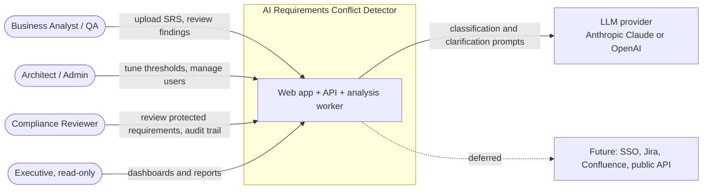
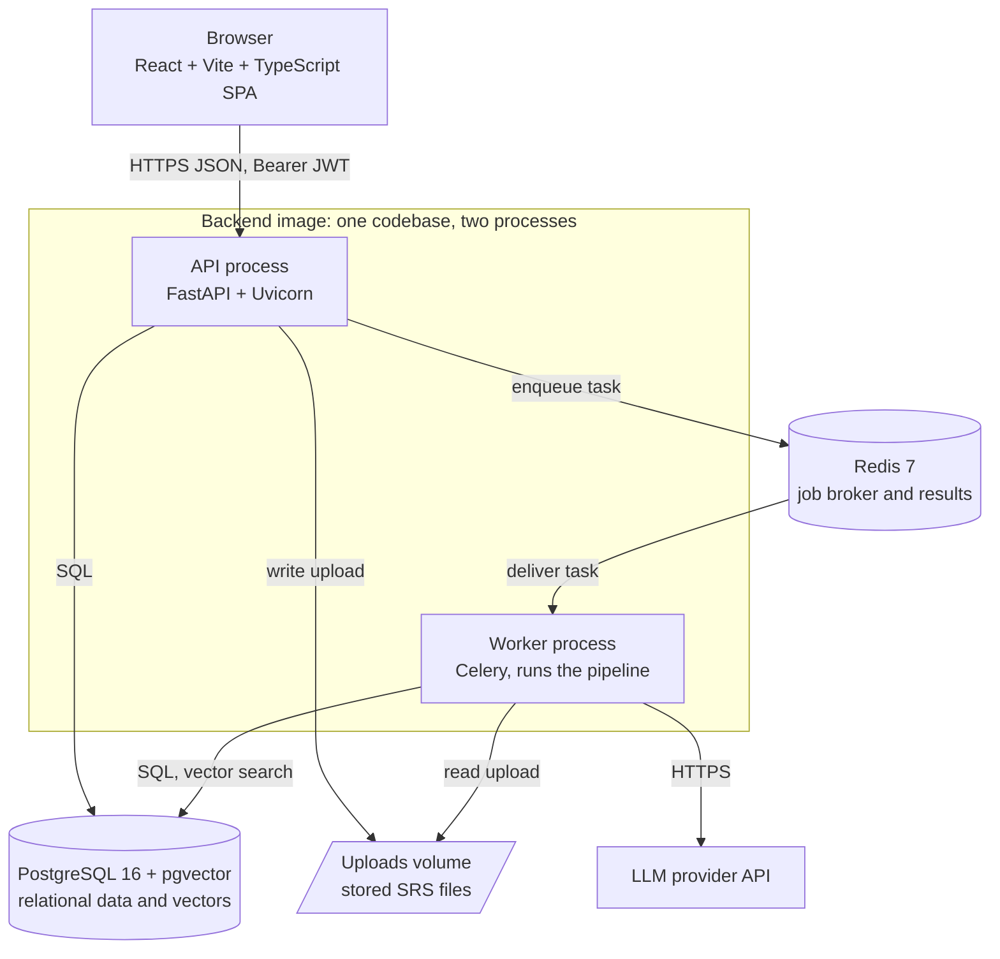
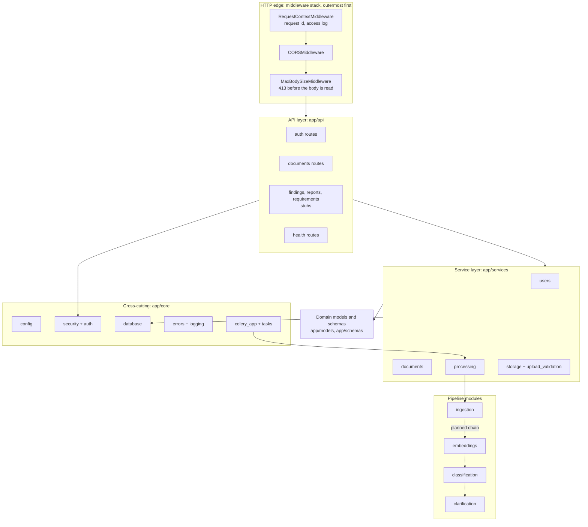
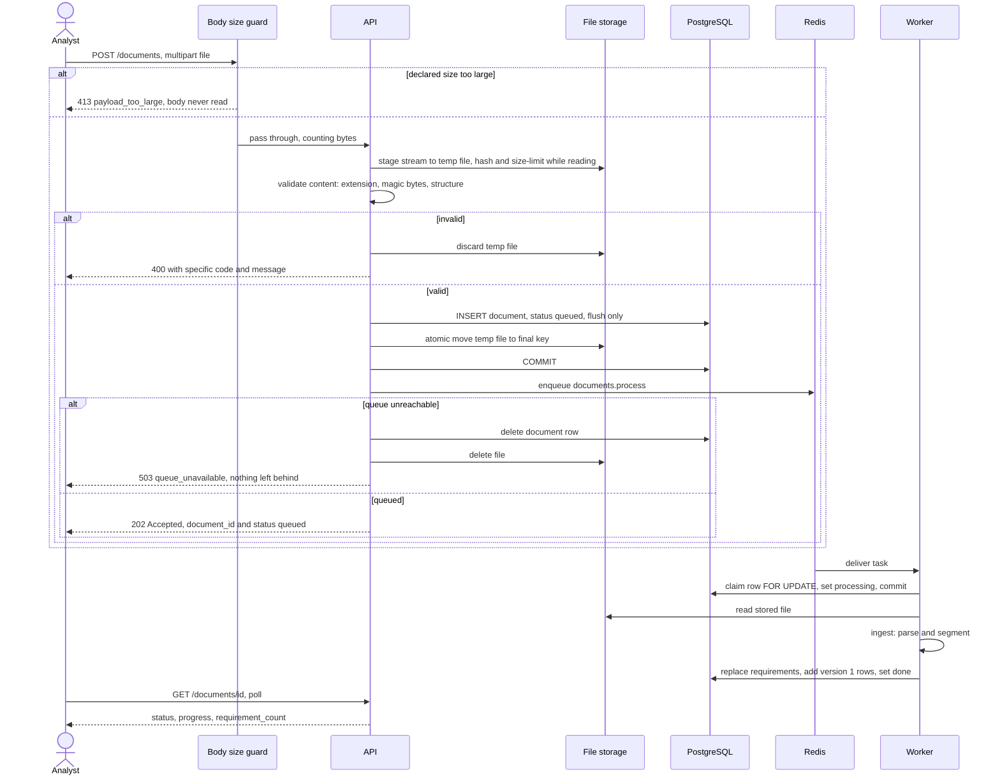
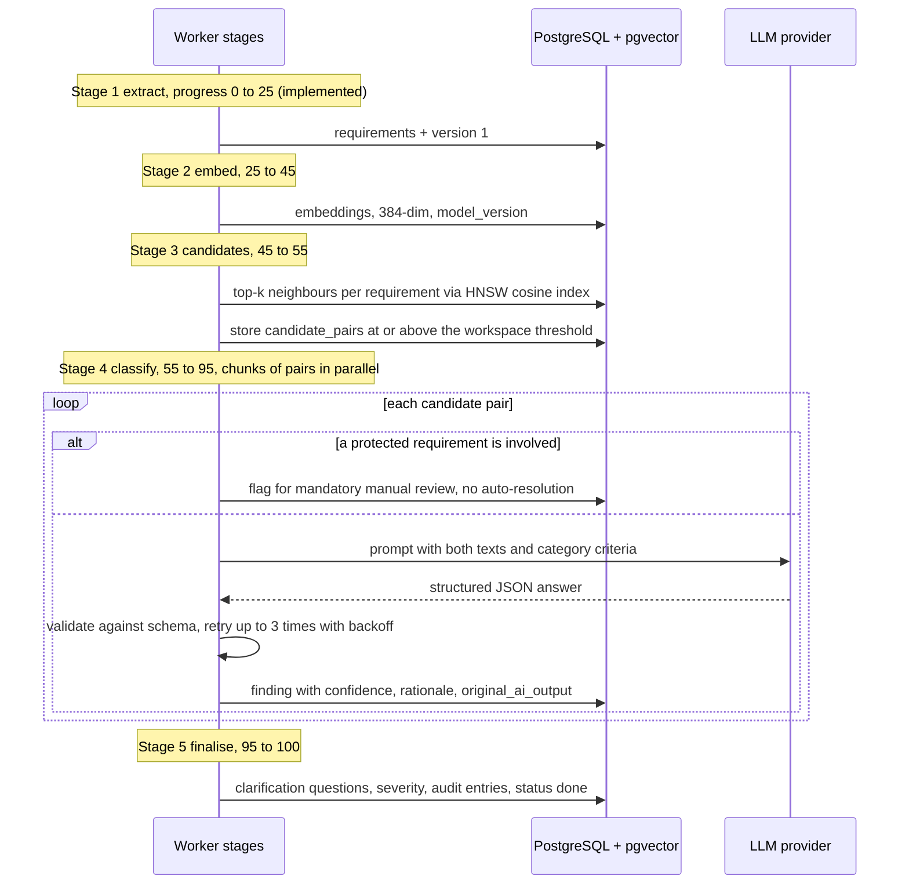
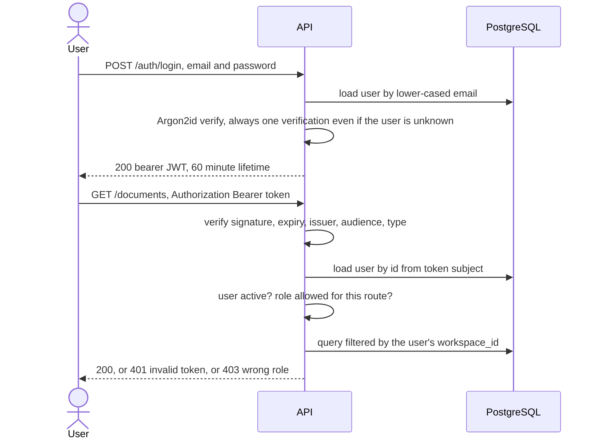
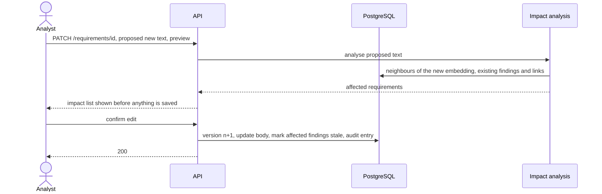
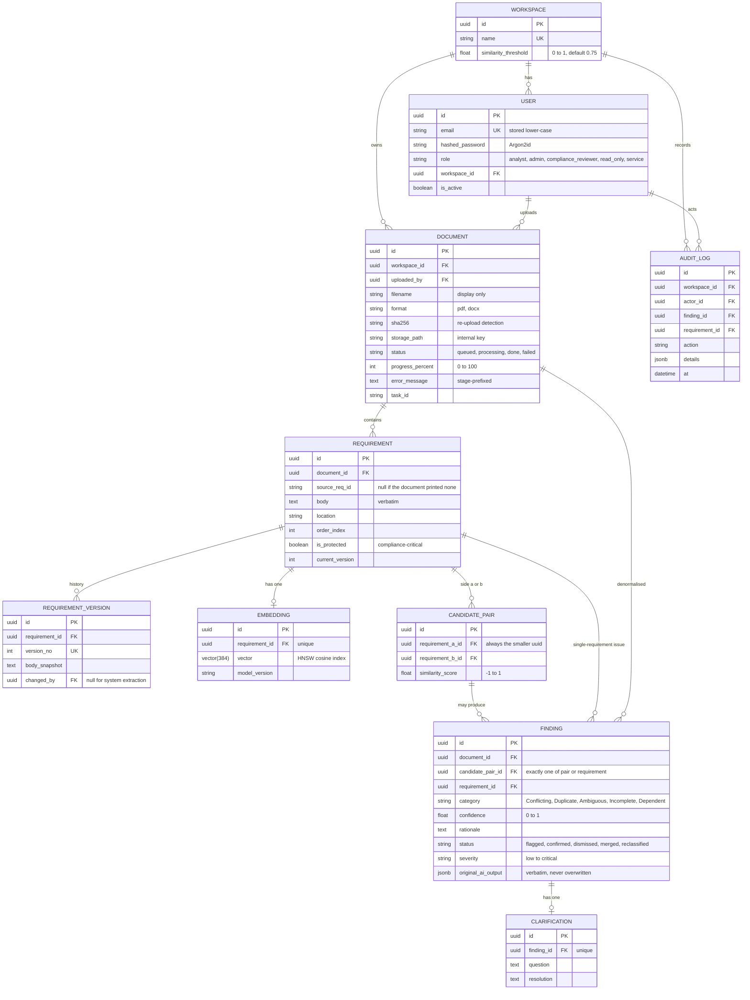
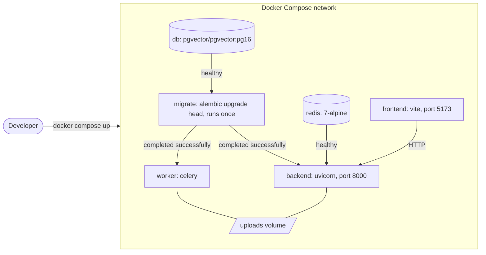
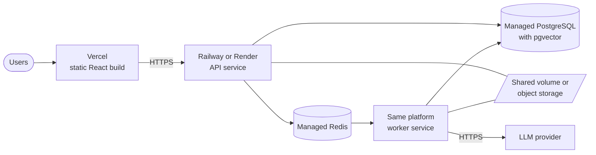

# System Design

**Architecture views, runtime flows, data, deployment, and cross-cutting design**

| | |
|---|---|
| **Scope** | The whole AI Requirements Conflict Detector — implemented parts (Sprint 0–1) and planned parts (Sprint 2+) |
| **Companion** | `object-design.md` (classes, patterns, state machines, object-level interactions) |
| **Builds on** | `architecture.md` (module ownership), `diagrams.md` (initial UML), `data-model.md`, `decision-log.md` |
| **Status legend** | ✅ implemented and tested · 🟡 stub file exists, design is a proposal for its owner to confirm · ⬜ planned, nothing in the repo yet |
| **Revision 5** | This document was written before the Step 7 scope extension. [`IT314_RCD_Design_Update_v5.md`](../planning/v5/IT314_RCD_Design_Update_v5.md) extends or replaces the sections marked below; anything it does not mention is unchanged. Since this was written, tenancy and permissions (migration `0004`) and project context (`0011`) have been implemented — see `data-model.md`, `roles-and-access.md` and `api-reference.md` for those |

---

## 1. Purpose and Scope

SRS documents are written by many stakeholders over time and accumulate **conflicting, duplicate, ambiguous, incomplete and dependent** requirements (ADR-02). Checking every pair by hand does not scale: a 300-requirement document has 44,850 pairs.

The system takes an uploaded SRS, extracts the individual requirements, finds the pairs worth comparing with vector similarity, asks an LLM to classify them with a confidence score and rationale, generates clarification questions, and lets an analyst review everything. Humans decide; the AI only proposes (DR-04, ADR-06).

**In scope for the semester MVP:** upload → extraction → issue detection → clarification (the protected core path), then review, impact analysis, dashboard/graph, reports.

**Out of scope (kept only to show awareness of an industry deployment):** SSO/LDAP, Jira/Confluence/GitHub integrations, public REST API, compliance tagging UI.

### Design goals, in priority order

1. **Trustworthy output** — every finding carries evidence, confidence and provenance; AI content is distinguishable from human-approved content (NFR-17, DR-04, DR-06).
2. **Protect the core value path** — conflict detection is the last thing cut if the schedule slips (checkpoints at Week 7 and Week 11).
3. **Bounded cost and latency** — never call the LLM on all pairs (ADR-01, NFR-05); never block an HTTP request on analysis (ADR-04, NFR-01).
4. **Safe by default** — authenticated and workspace-scoped everywhere, nothing partial left behind on failure, failures reported rather than swallowed.
5. **Buildable by 7 people in 14 weeks** — module boundaries that match team ownership, one deployable backend image.

---

## 2. Architecture Style

A **modular monolith with an asynchronous worker**, in three tiers:

- **Presentation** — a React single-page app that only talks to the API over HTTPS/JSON.
- **Application** — one FastAPI codebase, built into **one Docker image that runs two ways**: as the HTTP API, and as a Celery worker. Inside it the four pipeline modules (`ingestion`, `embeddings`, `classification`, `clarification`) are separate packages with narrow interfaces, which satisfies NFR-19 (independently deployable *modules*) without paying the operational cost of microservices.
- **Data** — PostgreSQL with pgvector for relational data *and* vector search (ADR-03), Redis as the job broker, a shared volume for uploaded files.

Why not microservices: seven people, fourteen weeks, one release train. The module boundaries are real (each is owned by one person and imported only through its package interface), so any of them can be split into its own service later without a rewrite.

---

## 3. System Context

> **Replaced in revision 5** by [Design Update v5 §1](../planning/v5/IT314_RCD_Design_Update_v5.md#1-updated-system-context-replaces-sd-3) (workspaces, members joining with codes, real-time clients).

The LLM provider is the only external runtime dependency. Requirement text leaves the system only in prompts to it, which matters for data residency (NFR-14, see §10).

---

## 4. Container View

> **Extended in revision 5** by [Design Update v5 §2](../planning/v5/IT314_RCD_Design_Update_v5.md#2-updated-container-view-extends-sd-4) (WebSocket gateway, Redis pub/sub, graph service).

| Container | Technology | Responsibility | Status |
|---|---|---|---|
| SPA | React, Vite, TypeScript, Tailwind, TanStack Query, React Flow | UI; holds no business rules | 🟡 scaffold only |
| API | FastAPI, Pydantic, SQLAlchemy | AuthN/Z, validation, short synchronous reads/writes, enqueueing jobs | ✅ auth, documents; ⬜ findings, reports |
| Worker | Celery | Long-running pipeline stages | ✅ extraction task; ⬜ later stages |
| PostgreSQL + pgvector | `pgvector/pgvector:pg16` | System of record and similarity search | ✅ schema + migrations |
| Redis | `redis:7` | Broker and result backend | ✅ |
| Uploads volume | named Docker volume | Raw uploaded files, shared by API and worker | ✅ |

**Why the API never does analysis itself:** parsing, embedding and LLM calls take seconds to minutes. A request that waits for them would hit proxy timeouts and tie up API capacity (NFR-02). Instead the API answers `202 Accepted` and the client polls status (US-03).

---

## 5. Backend Component View

**Dependency rules** (enforced by review, and partly by `mypy.ini`, which is strict for these packages):

- Routes depend on services and schemas; **services never import from `app.api`**.
- Services own transactions. The `get_db` dependency never commits, so a request that fails half-way cannot leave partial writes.
- Pipeline modules (`ingestion`, `embeddings`, …) know nothing about HTTP or Celery. The worker task is the only caller, which keeps each module unit-testable on its own.
- ORM models stay inside the service layer; the API returns Pydantic schemas (`DocumentRead`, `RequirementRead`, `Page[T]`), never ORM objects.

---

## 6. Runtime View

### 6.1 Upload and extraction ✅

Two ordering rules carry most of the reliability:

1. **The job is queued only after the commit**, so a worker can never look for a row that is not visible yet.
2. **Stage → validate → insert → move → commit**: a failure at any step undoes everything before it, so there are no orphan files and no rows without files.

The worker task is **idempotent** (§9.2): a duplicate delivery does nothing, and a re-run after a crash replaces partial output instead of duplicating it.

### 6.2 Analysis pipeline ⬜ (Sprint 2–3)

The existing 14-step flow from `architecture.md`, expressed as Celery stages. Each stage is its own task so it can be retried alone, and progress maps onto `documents.progress_percent` (US-03).

Design points:

- **Similarity is a filter, not a verdict** (DR-09, DR-10). Stage 3 only decides which pairs are worth a model call; Stage 4 decides what they are.
- **Ambiguous and Incomplete findings concern one requirement**, not a pair. They are produced by a per-requirement pass (DR-07 grounds it in recognised ambiguity patterns, not free LLM judgement), which is why `findings` references *either* a pair *or* a requirement (§7).
- **Chunking:** classification is the slow, rate-limited stage, so pairs go out in chunks of about 20 per task with a task-level rate limit. A failed chunk retries alone.
- **LLM cost control:** results can be cached by a hash of the two requirement texts plus the prompt version, so re-running after a threshold change does not pay twice for unchanged pairs.
- **Today** extraction alone ends in `done`. When Stage 2+ are wired, `done` moves to Stage 5 and extraction ends at progress 25 — a small change in `services/processing.py`, tracked in §12.

### 6.3 Authentication and authorisation ✅

The token holds only the user id. **Role, workspace and active flag are read from the database on every request**, so deactivating or demoting a user takes effect immediately instead of when their token expires.

### 6.4 Review and change-impact ⬜ (Sprint 3)

> **Replaced in revision 5** by [Design Update v5 §3.2](../planning/v5/IT314_RCD_Design_Update_v5.md#32-change-request-consequence-report-and-approval-new-replaces-sd-64): edits to Approved requirements go through PR-style change requests with consequence checks (SX-03). New runtime flows — live analysis of a post, member removal, live map update, auto conflict issue, joining with a code, AI suggestions, written change log, trust layer, project setup and updated SRS — are in Design Update §3.1, §3.3–§3.8, §11 and §12.

Edits never overwrite history: every change adds a `requirement_versions` row (FR-26, DR-08), and the AI never edits requirement text on its own (DR-04).

---

## 7. Data Design

> **Extended in revision 5** by [Design Update v5 §4](../planning/v5/IT314_RCD_Design_Update_v5.md#4-data-design-changes-extends-sd-7-and-od-2). The ER diagram below is the original Sprint 0 design; the implemented schema (projects, memberships, roles, project contexts) is in `data-model.md`.

### Data design rules

| Rule | Where it is enforced | Why |
|---|---|---|
| **Workspace scoping.** Every read filters by the caller's `workspace_id`. Another workspace's row is a **404, not a 403**. | Service layer queries | FR-38; a 403 would confirm the row exists |
| **Pairs are stored once**, `requirement_a_id < requirement_b_id`. | `CHECK` + unique constraint + `CandidatePair.ordered()` | (A,B) and (B,A) must not both exist or be classified twice |
| **A finding is about a pair *or* a single requirement**, never both, never neither. | `CHECK num_nonnulls(...) = 1` | Conflicts relate two requirements; Ambiguous/Incomplete concern one |
| **`original_ai_output` is kept verbatim** next to the human-editable fields. | Column semantics + service rule | A reviewer's correction must not erase what the model said (DR-06, NFR-17, NFR-22) |
| **The audit log is append-only.** | A Postgres trigger rejects `UPDATE`, `DELETE` and `TRUNCATE`; foreign keys are `RESTRICT` | NFR-13 must hold even against a buggy or malicious application |
| **Requirement text is immutable except through a new version.** | `requirement_versions` + service rule | DR-04, DR-08 |
| **Users are deactivated, never deleted.** | `is_active` flag; `RESTRICT` foreign keys | Audit and provenance rows point at users |
| **Enums are `VARCHAR` + `CHECK`**, not native PostgreSQL enums. | `enum_column()` helper | A `CHECK` can change in a normal migration; native enums cannot drop values |
| **UUID primary keys**, generated in Python and by the database. | `UUIDPrimaryKeyMixin` | IDs can be created before insert and are unguessable in URLs |
| **Constraint names are deterministic.** | `NAMING_CONVENTION` on `MetaData` | Migrations behave the same on every machine |
| **Cascades follow ownership.** Deleting a document removes its requirements, versions, embeddings, findings. | `ON DELETE CASCADE` down the tree, `RESTRICT` toward audit/users | Cleanup is automatic; history that must survive cannot be cascaded away |

**Vector search.** `embeddings.vector` is `vector(384)` (all-MiniLM-L6-v2) behind an **HNSW** index with cosine distance. HNSW needs no training data and works from the first row, unlike IVFFlat. Changing the embedding model means a new migration plus a re-embed job; `model_version` identifies stale rows.

---

## 8. Deployment View

### Local development and CI

`migrate` runs once and `backend`/`worker` wait for it, so two containers can never race to apply the same migration. GitHub Actions runs the same stack shape: real Postgres+pgvector and Redis service containers (not mocks), then ruff, mypy, pytest with coverage, a single-migration-head check, `pip-audit`, and a Docker build.

### Production target

> **Open constraint (Sprint 5):** container disks on these platforms are private and ephemeral. API and worker run as **separate services**, so uploads need a shared volume or S3-compatible object storage. `app/services/storage.py` is the one place to swap, because callers use storage *keys*, never filesystem paths.

| Environment | `ENVIRONMENT` | Differences |
|---|---|---|
| Development | `development` | Reload on, `/docs` open, weak dev secret allowed |
| Test / CI | `test` | Dedicated `_test` database, fast password hashing |
| Staging / Production | `staging`, `production` | The app **refuses to start** with a weak `JWT_SECRET` or `*` in CORS; JSON logs; in `production` only, `/docs`, `/redoc` and `/openapi.json` are also disabled |

---

## 9. Cross-Cutting Design

> **Extended in revision 5** by [Design Update v5 §9](../planning/v5/IT314_RCD_Design_Update_v5.md#9-cross-cutting-additions-extends-sd-9) (socket re-checks, join-code security, prompt-injection containment, delta batching).

### 9.1 Security

| Threat | Mitigation | Status |
|---|---|---|
| Credential theft / guessing | Argon2id hashing; min 12-character passphrases; one generic login error; constant-time-ish path for unknown emails | ✅ |
| Token forgery | JWT pinned to HS256 (no `alg=none`/algorithm confusion); issuer, audience, expiry, type and `jti` required | ✅ |
| Stale privileges | Role and active flag re-read from the database on every request | ✅ |
| Cross-tenant access | Workspace filter in every query; 404 for foreign rows; an invariant test fails if any `/api/v1` route lacks authentication | ✅ |
| Privilege escalation | `require_roles()` per route; no public sign-up, accounts are provisioned via CLI | ✅ |
| Malicious uploads | Extension allow-list, **content sniffing** (never the client `Content-Type`), PDF end-marker check, DOCX structure and zip-bomb limits, sanitised filename used for display only, files stored under generated keys, storage keys cannot escape the root | ✅ |
| Upload DoS | Size limit refused before the body is read, plus byte counting for chunked bodies | ✅ |
| Tampering with history | Append-only audit trigger; immutable `original_ai_output` | ✅ |
| Secrets exposure | Environment variables only; `SecretStr`; startup refuses weak production secrets; GitGuardian config in the repo | ✅ |
| Information leakage | Standard error body with a request id; stack traces and file paths stay in server logs; worker error messages are sanitised | ✅ |
| **Prompt injection** — requirement text is untrusted input to the LLM | Requirement text is delimited as data in the prompt; the model can take **no actions**; its output must validate against a schema (FR-15); it can only *propose* findings that a human reviews | ⬜ |
| Brute force / abuse | Rate limiting on login and upload | ⬜ |
| Data at rest / in transit (NFR-10) | TLS at the platform edge; managed-database encryption | ⬜ deploy-time |

### 9.2 Reliability and failure handling

- **All-or-nothing writes.** Upload stages, validates, inserts, moves, commits, then enqueues; any failure cleans up what it already did.
- **Idempotent workers.** `acks_late` plus `task_reject_on_worker_lost` means a task may run twice. `process_document` claims the row with `SELECT … FOR UPDATE`; a `done`/`failed` document is skipped, and one stuck in `processing` is redone from scratch, replacing partial output.
- **Failures are visible.** A failed document ends `failed` with a readable reason prefixed by the stage (`[storage]`, `[extraction]`, `[persistence]`) — US-02/US-03 forbid silent drops. Raw exception text goes to the logs only.
- **Bounded runtime.** Celery soft and hard time limits stop a stuck LLM or parser call from holding a worker forever.
- **LLM calls (planned, NFR-07).** Up to 3 retries with exponential backoff; a pair that still fails is recorded as failed, not dropped (see §12, gap G1).
- **Health.** `/health` (liveness, touches nothing) and `/health/ready` (checks PostgreSQL and Redis, returns 503 when degraded).

### 9.3 Performance and scalability

For *n* requirements there are *n(n−1)/2* pairs. At n = 300 that is **44,850 pairs**. Vector search shrinks it before any model call:

| Approach | Candidate retrieval | LLM calls (illustrative: 5% of pairs pass the threshold) |
|---|---|---|
| Brute force all pairs | O(n²) | 44,850 |
| Embedding pre-filter (ADR-01) | HNSW top-k per requirement, about O(n log n) | about 2,240 — a ~95% reduction against a target of ≥70% (NFR-05) |

The 5% figure is an assumption; the real pass rate depends on the document and threshold and must be measured on the labelled benchmark (ADR-05).

Scaling levers: worker concurrency and queue-per-stage (NFR-04), chunked classification with a rate limit, pagination on every list endpoint, indexes on the hot lookups (`documents(workspace_id, uploaded_at)`, `documents(workspace_id, sha256)`, `requirements(document_id, order_index)`, `findings(document_id, status)`), and the API/worker split so each scales on its own.

### 9.4 Observability

Every request gets an `X-Request-ID` (honouring a safe incoming one), echoed in the response header and in error bodies, and attached to every log line. Development logs are readable; staging/production logs are one JSON object per line. Health endpoints are excluded from the access log. ⬜ Later: metrics (queue depth, stage durations, LLM latency and cost) and error tracking.

### 9.5 Configuration

One typed `Settings` object, populated from environment variables (12-factor), validated at start-up, with required values failing fast. `.env.example` documents every variable. Pipeline tunables that analysts adjust at runtime — similarity threshold, confidence threshold — live **in the database per workspace** (US-06), not in the environment, so they change without a redeploy (NFR-18).

### 9.6 Testing strategy

Real PostgreSQL + pgvector and Redis in tests and CI — not sqlite or mocks — because the design depends on database behaviour (CHECK constraints, triggers, HNSW, `FOR UPDATE`). The suite covers units (security, config, validation, storage), database guarantees (schema, migrations up/down, models in sync with migrations), API behaviour (RBAC matrix, workspace isolation, upload rejection paths, size limits, atomicity) and an upload → extract → list flow through the real HTTP API. A separate accuracy track measures precision/recall/F1 of classification on a planted-conflict benchmark (ADR-05).

---

## 10. Quality-Attribute Traceability

| Driver | How the design meets it | Status |
|---|---|---|
| NFR-01/02 responsiveness | Async job queue; API answers 202 and never waits on analysis | ✅ mechanism, ⬜ measured |
| NFR-04 concurrency | Stateless API, queued workers scaled independently | ✅ mechanism |
| NFR-05 LLM-call reduction | HNSW candidate pre-filter | ⬜ |
| NFR-07 reliability | Retries with backoff; idempotent tasks; visible failures | ✅ tasks, ⬜ LLM retries |
| NFR-10 encryption | TLS at the edge, managed DB encryption | ⬜ deploy |
| NFR-11 RBAC | JWT + `require_roles` + workspace scoping | ✅ |
| NFR-12 credential protection | Env-only secrets, `SecretStr`, production start-up checks | ✅ |
| NFR-13 audit | Append-only trigger-protected `audit_log`; viewing protected requirements logged | ✅ storage, ⬜ writers (Sprint 3/5) |
| NFR-14 residency / erasure | See open question Q3 | ⬜ |
| NFR-17 explainability | Rationale, confidence and `original_ai_output` on every finding; AI content visibly separate | ⬜ |
| NFR-18 configurability | Thresholds per workspace in the DB; modular parser registry | ✅ registry, ⬜ thresholds |
| NFR-19 modularity | Four pipeline packages behind narrow interfaces | ✅ |
| NFR-23 portability | Docker Compose parity; one image for API and worker | ✅ |

---

## 11. Key Decisions

> ADR-14 to ADR-29 (Step 7, revisions 1–5) are listed in `decision-log.md`.

Existing ADR-01 to ADR-07 are in `decision-log.md`. These decisions were made during implementation and are **proposed as ADR-08 to ADR-13**:

| # | Decision | Rationale and consequence |
|---|---|---|
| ADR-08 | Modular monolith with one image run as API and worker | Fits team size and timeline; module boundaries keep a later split cheap |
| ADR-09 | Services own transactions; routes are thin; `get_db` never commits | A failed request cannot leave partial writes; business rules live in one testable layer |
| ADR-10 | Enums as `VARCHAR` + `CHECK` | The taxonomy may evolve; `CHECK`s migrate cleanly, native enums do not |
| ADR-11 | Two-phase file storage, storage keys not paths, a body-size guard before parsing | No orphan files, no traversal, and no gigabyte writes before a size check |
| ADR-12 | Cross-workspace access returns 404 | Does not reveal that another tenant's row exists |
| ADR-13 | Worker tasks are idempotent and claim-based | Required by `acks_late`; makes duplicate delivery and crash recovery safe |

---

## 12. Risks, Gaps and Open Questions

| # | Item | Impact | Proposed handling |
|---|---|---|---|
| **G1** | No place to record a **failed classification** per pair: `candidate_pairs` has no status column, yet NFR-07 and `api-reference.md` say failures must not be silently dropped | A pair that fails 3 retries would vanish | Add `classification_status` (pending/classified/failed) and `error` to `candidate_pairs` in the Sprint 2 migration (owners: Keval + Parth) |
| **G2** | `done` is currently set when *extraction* finishes | Wrong once embedding/classification are chained | Move `done` to the last stage; extraction ends at progress 25 |
| **G3** | `ingest()` returns every non-empty line as a "requirement" | Headings and prose will be sent to the classifier, wasting cost and adding noise (US-02 requires excluding them) | Bansil's US-02 filtering; the processing glue stores whatever `ingest()` returns |
| **G4** | Upload accepts only `.pdf` and `.docx`; the backlog also lists `.txt` and ReqIF | Spec gap | Add parsers; a test fails if the parser registry and the upload allow-list drift apart |
| **G5** | `failed` documents have no retry endpoint | Users must re-upload | Add `POST /documents/{id}/reprocess` (small, idempotent) |
| **Q1** | LLM cost and latency are unmeasured | May threaten the 5-minute NFR-01 target | Measure on the benchmark at Checkpoint 1; cache by pair hash |
| **Q2** | Classification accuracy is unknown until the benchmark exists | Core value proposition | Abhyudit's planted-conflict SRS; track precision/recall/F1 per category |
| **Q3** | **Erasure vs immutable audit.** NFR-14 wants right-to-erasure; NFR-13 wants an append-only audit log | They pull in opposite directions | Keep requirement *text* out of audit rows (ids and actions only), so deleting content leaves a pseudonymous trail; decide with the team before any real-data pilot |
| **Q4** | Uploaded files on ephemeral hosts | Worker cannot read API files | Shared volume or object storage in Sprint 5 (§8) |
| **Q5** | Requirement text is sent to a third-party LLM | Data residency and confidentiality | Make the provider configurable (already) and state the data flow in deployment docs |

---

## 13. Extension Points

| To add… | Touch |
|---|---|
| A new input format (`.txt`, ReqIF) | A `Parser` subclass registered in `ingest()`'s `_PARSERS` plus an entry in `upload_validation.SUPPORTED_FORMATS` (a test enforces they match) |
| Another LLM provider | A client class implementing the LLM-client interface (object-design §6); selected by `LLM_PROVIDER` |
| Object storage | Another class with the same methods as `LocalFileStorage`; swap `get_storage()` |
| SSO / LDAP | Replace the token-decoding step in `get_current_user`; roles and workspace still come from the database |
| A public REST API | New routes under `/api/v1` using the `service` role; authentication-by-default already applies |
| A new finding category | Update the `FindingCategory` enum, add a migration for the `CHECK`, extend the prompt criteria and the taxonomy docs |
