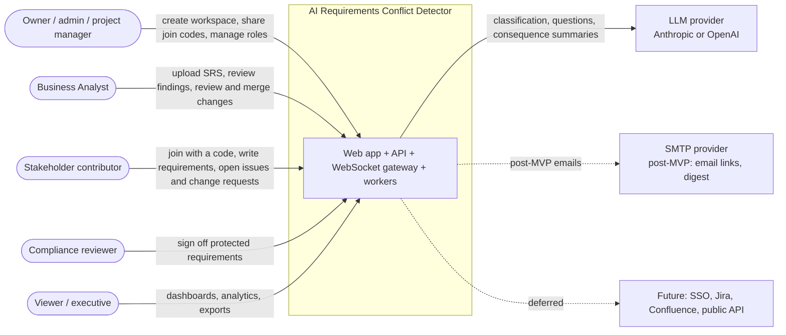
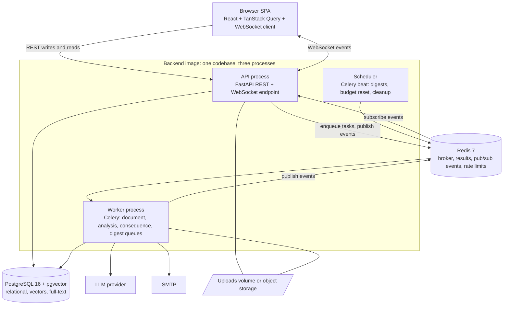
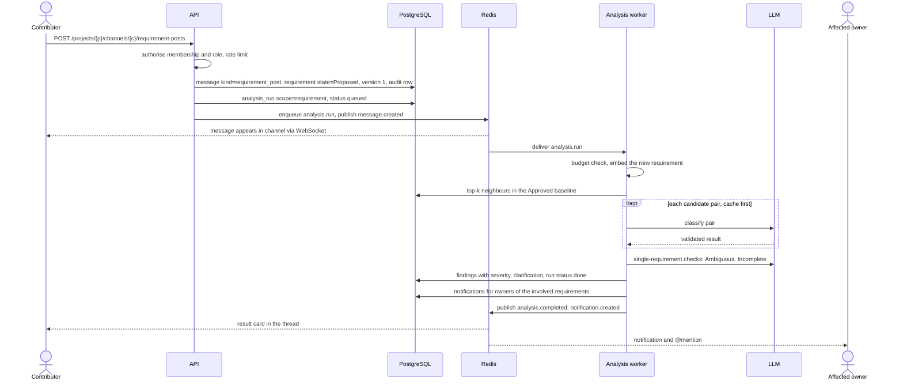
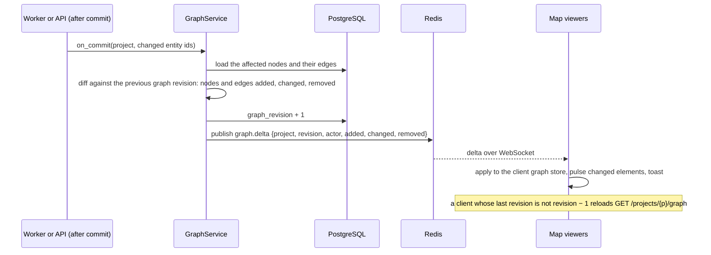
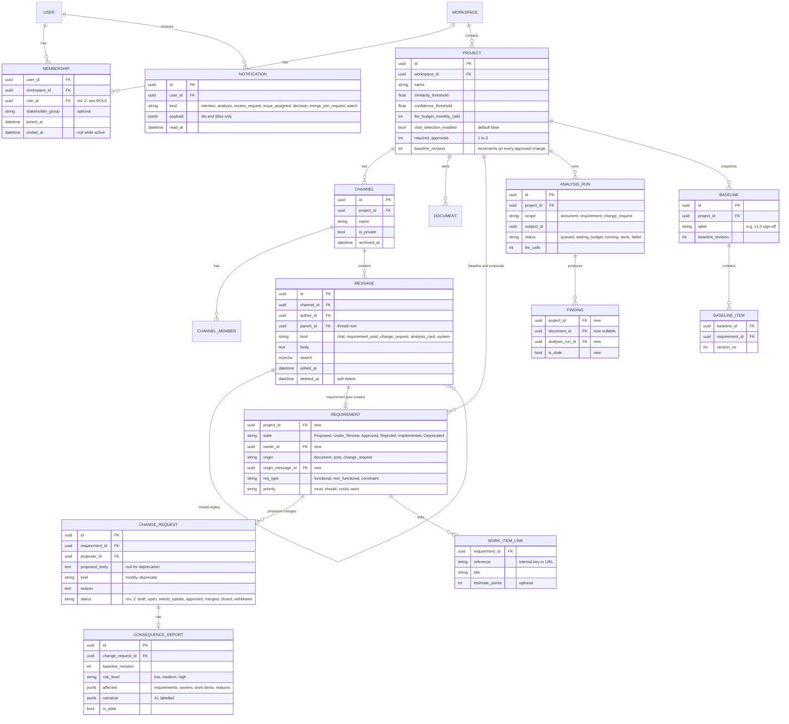
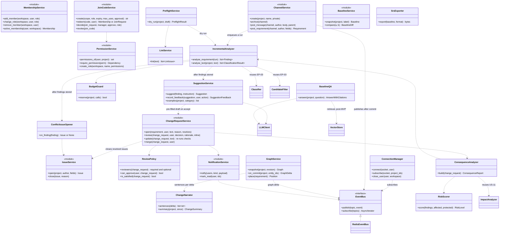
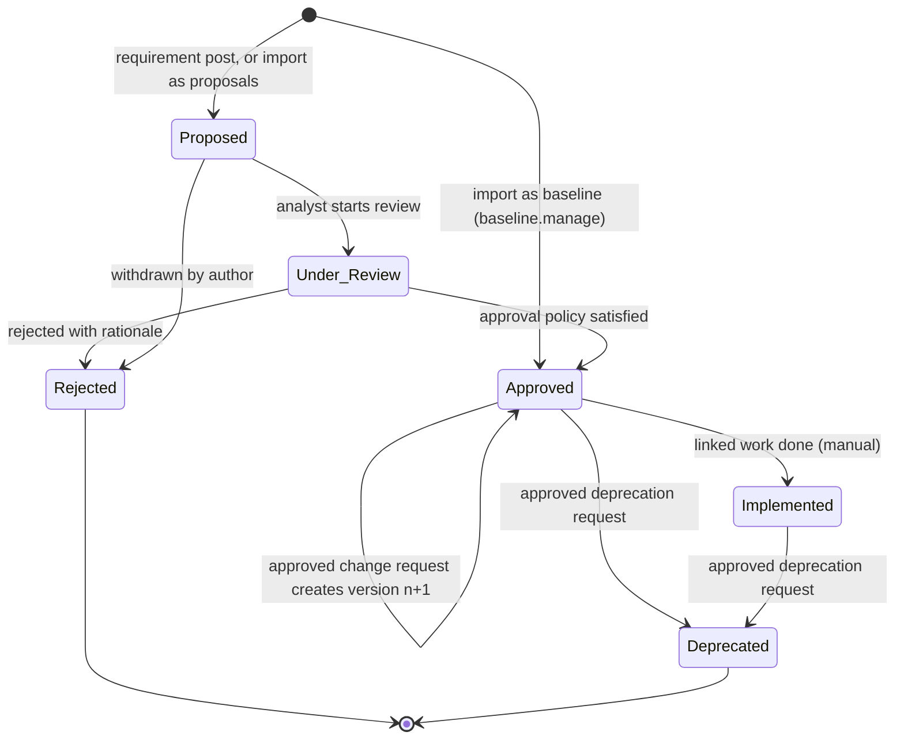
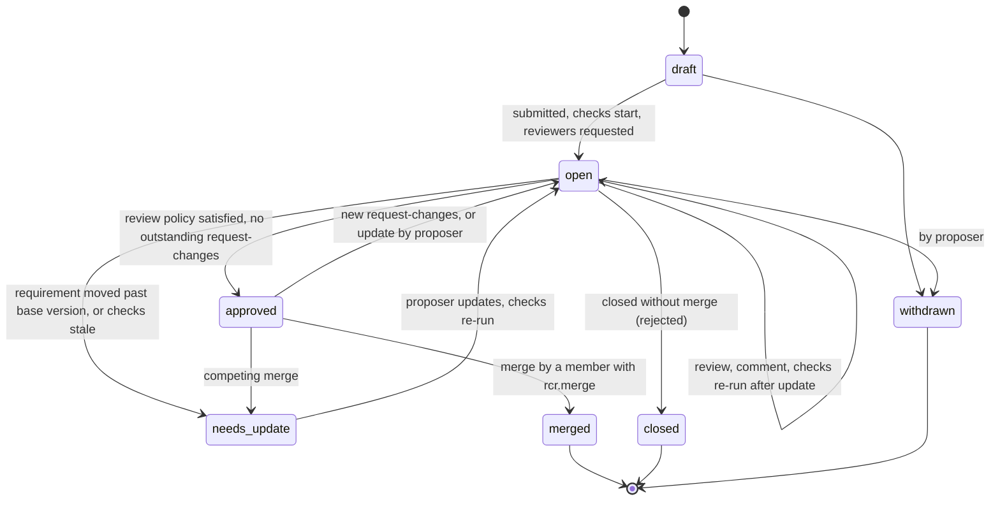

# Design Update for the Extended Scope

**Changes to `system-design.md` and `object-design.md` required by Step 7 (`IT314_RCD_Scope_Extension_v5.md`, revision 5)**

| | |
|---|---|
| **How to read this** | Each section names the section of `system-design.md` (SD) or `object-design.md` (OD) it **extends** or **replaces**. Anything not mentioned is unchanged |
| **Decisions** | ADR-14 to ADR-29 (proposed), from `IT314_RCD_Scope_Extension_v5.md` §9 |
| **Revision 5** | Project context and the updated SRS (§12): `project_contexts`, project status *setup/active*, the context pack in every LLM call, `srs_documents` and `srs_sections`, fidelity check, export; ADR-28, ADR-29; migrations `0011`, `0012` |
| **Revision 4** | Trust layer (§11): finding sources, decision rules, proposal revisions and agreement checks at merge, findings delta, rule-based cross-checks on extracted attributes, open-items report; ADR-25 to ADR-27 |
| **Revision 3** | AI resolution suggestions with human feedback for every finding (§3.7, tables `suggestions`, `suggestion_feedback`); written change log and summaries beside the map (§3.8, table `graph_events`); ADR-24 |
| **Revision 2** | Join codes replace email invitations; permission-based roles; requirement issues; PR-style change requests with base version, reviews and merge; votes, watches and links; the live map (graph API and deltas); lint and pre-flight. New material is marked *(rev. 2)* |
| **Screens** | `IT314_RCD_Interface_Design_v5.md` |
| **Status legend** | ✅ implemented · 🟡 stub or partial · ⬜ planned; every ⬜ item here is a **proposal for its owner to confirm in Sprint 0** |

---

## 1. Updated System Context (replaces SD §3)



The data that can leave the system is now: requirement text in LLM prompts (as before); chat message text **only** when chat detection is enabled for a project (ADR-19); and, post-MVP only, email addresses and notification summaries in emails (no requirement text beyond ID and title). In the MVP no email leaves the system: joining uses codes and links (SX-21).

## 2. Updated Container View (extends SD §4)



| New or changed element | Responsibility | Owner | Status |
|---|---|---|---|
| WebSocket endpoint `/api/v1/ws` | Authenticated connection; subscribe to project channels; push events; heartbeat | Dhavni didi | ⬜ |
| Event bus (Redis pub/sub) | `publish(topic, event)` after commit; every API process forwards events to its subscribed sockets | Dhavni didi | ⬜ |
| Worker queues | `documents`, `analysis` (live, high priority), `consequence`, `suggestions` (rev. 3), `notifications` | Dhavni didi | 🟡 `documents` exists |
| Celery beat | Monthly LLM budget reset, join-code and join-request expiry, waiting-run re-enqueue (email digests post-MVP) | Dhavni didi | ⬜ |
| PostgreSQL full-text | `tsvector` columns on messages and requirements for search (US-46) | Heet | ⬜ |
| Graph module `app/graph/` *(rev. 2)* | Builds the project graph from stored requirements, findings and links; derives `graph.delta` events after each commit; persists node positions | Dhavni didi | ⬜ |
| Lint service *(rev. 2)* | Pattern catalogue (shared with DR-07) exposed as a pure function; runs server-side and is also bundled for the client | Keval | ⬜ |
| SMTP | **Post-MVP** (SX-21): email links and digests | — | ⏸ |

## 3. Runtime Flows

### 3.1 Post a requirement and receive live analysis (new, SD §6.5)



**Budget exhausted:** the run stays `waiting_budget`, and the card says so. When the cap rises or the month resets, beat re-enqueues waiting runs in order.

### 3.2 Change request, consequence report and approval (new, replaces SD §6.4)

```mermaid
sequenceDiagram
  actor P as Proposer
  participant API as API
  participant W as Consequence worker
  participant D as PostgreSQL
  actor A as Approvers

  P->>API: POST /requirements/{id}/change-requests, new text and reason
  API->>D: change_request RCR-n status=open, base_version, audit row
  API->>W: enqueue consequence.build
  W->>W: incremental analysis of the proposed text, nothing saved to the baseline
  W->>D: impact traversal: direct and transitive affected requirements
  W->>D: owners, stakeholder groups, linked work items
  W->>W: risk level by rule (ADR-17), LLM narrative with cited IDs
  W->>D: consequence_report as checks (baseline revision recorded)
  W->>D: review_requests per ReviewPolicy, notifications
  A->>API: POST /change-requests/{id}/reviews approve, request changes or comment
  API->>API: policy check: not the proposer; compliance reviewer if protected; then a member with rcr.merge calls /merge
  alt all required approvals collected
    API->>D: requirement version n+1, baseline updated, findings involving it marked stale, audit
    API->>W: enqueue re-analysis of stale findings
  else rejected
    API->>D: CR status=rejected, rationale kept, baseline untouched
  end
```

**Staleness (FR-64):** each consequence report stores the `baseline_revision` it was computed against. If the baseline changes before a decision, the report is marked **stale**, and approving is blocked until it is regenerated.

**Revision 2 refinements (FR-65, FR-66, FR-89):**
- Every change request stores `base_version`. If the requirement's `current_version` differs, its status becomes `needs_update`, merge is blocked, and the page shows a three-way diff.
- "Approval requests per policy" means `ReviewPolicy` computes **required reviewers** (owner of the changed requirement, owners of requirements in direct conflict, merge-capable members up to the project setting, compliance reviewer if protected) and **optional reviewers** (transitively affected owners), and creates `review_requests`.
- Approval and merge are separate: when the policy is satisfied the status becomes `approved`; a member with `rcr.merge` then calls `POST /change-requests/{id}/merge`, which re-checks policy, staleness and base version inside one transaction before writing version *n+1*, closing linked issues and publishing `graph.delta`.

### 3.3 Member removal (new)

1. An owner or admin calls `DELETE /workspaces/{w}/members/{user}`; the last owner cannot be removed (FR-49).
2. The membership gets `ended_at`, and an audit row is written.
3. An event `membership.revoked` is published, and every socket of that user in that workspace is closed within 5 s (NFR-27).
4. Change requests, approvals and owned requirements of that user are listed under "needs reassignment" for admins (SX-11).
5. Every later REST call fails with 404 for that workspace's resources, because each request re-reads the membership (as tokens already do for roles).


### 3.4 Live map update *(rev. 2, ADR-21)*



Triggers: requirement created or state changed, analysis run done, finding reviewed, link added or removed, change request opened, merged or closed, issue opened or closed (badge counts). No trigger causes re-analysis (SX-16). A new node gets a position next to its nearest neighbour, saved in `node_positions` so every viewer sees the same layout.

### 3.5 Auto conflict issue *(rev. 2, FR-87)*

1. When an analysis run stores a Conflicting or Duplicate finding with severity Medium or High, `ConflictIssueOpener` reads the owners of the involved requirements.
2. If there are two or more distinct owners and no issue is linked to this finding, it creates ISS-n (label `conflict`, severity label, `auto`), assigns all owners, adds both requirements as links and posts the clarification question as the first comment.
3. When the finding's suggestions are ready (§3.7) they are attached to the issue, and each owner can mark a preferred option.
4. Owners receive `issue.assigned` notifications; the map badge counts update via `graph.delta`.
5. The issue closes automatically on finding resolution or dismissal, or on merge of a change request that resolves it; the closing event names the cause.

### 3.6 Joining with a code *(rev. 2, FR-44, FR-77)*

1. A manager creates a code: the server generates 8 random characters from a 32-character alphabet, stores `sha256(code)`, returns the code once.
2. A person signs up with the code (or signs in, then enters it): the server rate-limits, hashes, looks up an active code, checks expiry and remaining uses in one transaction.
3. Without approval: membership created (and project membership if the code is project-scoped), uses incremented. With approval: a `join_request` is created and managers are notified.
4. All steps are audited; failures return one generic message (NFR-35).

### 3.7 AI suggestions with human feedback *(rev. 3, ADR-24)*

```mermaid
sequenceDiagram
  participant A as Analysis worker
  participant S as SuggestionService
  participant D as PostgreSQL
  participant L as LLM
  actor H as Owner or analyst
  participant API as API

  A->>D: finding stored (commit)
  A->>S: enqueue suggest(finding) on the suggestions queue
  S->>D: load finding and requirements (plus up to 5 past decisions from this project only if use_feedback_examples is on)
  S->>S: budget check
  S->>L: category-specific prompt with the examples
  L-->>S: options (wording, trade-off, confidence), schema-validated
  S->>D: suggestion row, status=ready; publish suggestion.ready
  H->>API: POST /suggestions/{id}/feedback accepted / accepted_edited / rejected_* / deferred / regenerate
  API->>D: suggestion_feedback row (action, final text, reason)
  alt accept or edit
    API->>D: change_request draft pre-filled, linked to finding and issue, origin=ai_suggestion
    API-->>H: open the change editor
  else regenerate
    API->>S: enqueue suggest(finding, instruction)
  end
```

- Suggestions are generated **after** the finding is committed, so findings and the map never wait for them (NFR-36: 30 s for 90%).
- `[TBD — confirm]` placeholders are part of the output schema; the change editor refuses to open a change request while any remain.
- Example re-use is off by default (`project.use_feedback_examples`); when switched on for the experiment, examples come only from the same `project_id` (SX-23, SX-30).

### 3.8 Written change log *(rev. 3, FR-95, FR-96)*

- `GraphService.on_commit` already produces a `graph.delta`; `ChangeNarrator.sentences(delta)` turns it into one or more sentences using fixed templates per event kind (requirement added, version merged, finding created or resolved, issue opened or closed, link added, suggestion preference marked). The sentences are stored in `graph_events` with the revision, so the panel and the time slider read the same history.
- `ChangeNarrator.summary(project, since)` computes counts and the significant-change list from `graph_events` with SQL; the optional narrative is one LLM call with only that computed data as input, labelled as AI.
- No sentence is ever produced by the LLM, so the log is exact and costs nothing.

## 4. Data Design Changes (extends SD §7 and OD §2)

### 4.1 New and changed tables



### 4.2 New invariants (extends OD §2.2)

| Class | Invariant | Enforced by |
|---|---|---|
| `Membership` | At most one **active** membership per (user, workspace); a workspace always has at least one active owner | Partial unique index on `ended_at IS NULL`; service check |
| `Requirement` | Only `Approved` requirements are in the baseline; text changes only through an approved change request after approval | Service rule (DR-13, DR-14) |
| `ChangeRequest` | The proposer is never an approver; a protected requirement needs a compliance reviewer's approval | `ReviewPolicy` + DB trigger rejecting an approving review by the proposer |
| `ConsequenceReport` | A decision is impossible while `is_stale` is true | Service rule |
| `Message` | A `requirement_post` cannot be edited after submission; changes go through a change request | Service rule |
| `Finding` | References exactly one subject (unchanged), now also a `project_id` that matches its requirements' project | DB `CHECK`; service rule |
| `Notification` | `payload` holds IDs and titles, never requirement text (CR-04) | Schema |
| `JoinCode` *(rev. 2)* | Stored only as a hash; cannot carry Owner or Admin; `uses ≤ max_uses`; usable only while `status = active` and before `expires_at` | Hash column; `CHECK`; transaction with `FOR UPDATE` |
| `Role` *(rev. 2)* | Default roles are immutable; a role referenced by an active membership cannot be deleted | `is_default` flag; FK `RESTRICT` |
| `Issue` *(rev. 2)* | Numbers are unique per project; at most one auto issue per finding | Unique `(project_id, number)`; unique `finding_id` where `auto` |
| `ChangeRequest` *(rev. 2)* | Merge only if `base_version = requirement.current_version`, policy satisfied, no outstanding `request_changes`, report not stale | `ChangeRequestService.merge()` in one transaction |
| `Vote` *(rev. 2)* | One vote per member per subject | Unique `(subject, user_id)` |
| `RequirementLink` *(rev. 2)* | Human links only; both ends in the same project; no self-link | `CHECK`; service rule (DR-19) |
| `Suggestion` *(rev. 3)* | Never modifies a requirement; options validated against a schema; examples only from the same project | Service rule (DR-20, SX-23) |
| `SuggestionFeedback` *(rev. 3)* | Append-only; `final_text` required for `edit`, `reason` required for `reject` | DB `CHECK`; no update or delete path |
| `GraphEvent` *(rev. 3)* | One or more per graph revision; `sentence` comes from a template | Service rule |

### 4.1.1 Revision 2 tables

Revision 1's `INVITATION` and `APPROVAL` tables are **replaced by** `JOIN_CODE`/`JOIN_REQUEST` and `REVIEW`/`REVIEW_REQUEST`; `MEMBERSHIP.role` becomes `role_id`.

```mermaid
erDiagram
  WORKSPACE ||--o{ ROLE : defines
  ROLE ||--o{ ROLE_PERMISSION : grants
  MEMBERSHIP }o--|| ROLE : has
  PROJECT ||--o{ PROJECT_MEMBER : includes
  WORKSPACE ||--o{ JOIN_CODE : issues
  JOIN_CODE ||--o{ JOIN_REQUEST : produces
  PROJECT ||--o{ ISSUE : tracks
  ISSUE ||--o{ ISSUE_REQUIREMENT : links
  ISSUE ||--o{ COMMENT : has
  CHANGE_REQUEST ||--o{ REVIEW_REQUEST : requests
  CHANGE_REQUEST ||--o{ REVIEW : receives
  REVIEW ||--o{ REVIEW_COMMENT : inline
  CHANGE_REQUEST ||--o{ CHANGE_REQUEST_ISSUE : resolves
  REQUIREMENT ||--o{ REQUIREMENT_LINK : "human links"
  REQUIREMENT ||--o{ COMMENT : discussion
  USER ||--o{ VOTE : casts
  USER ||--o{ WATCH : follows
  PROJECT ||--o{ NODE_POSITION : layout
  USER ||--o{ REQUIREMENT_DRAFT : writes
  FINDING ||--o{ SUGGESTION : "rev. 3"
  SUGGESTION ||--o{ SUGGESTION_FEEDBACK : "rev. 3"
  PROJECT ||--o{ GRAPH_EVENT : "rev. 3"

  ROLE {
    uuid id PK
    uuid workspace_id FK "null for platform defaults"
    string name
    bool is_default
  }
  ROLE_PERMISSION {
    uuid role_id FK
    string permission "from the catalogue, e.g. rcr.merge"
  }
  PROJECT_MEMBER {
    uuid project_id FK
    uuid user_id FK
    uuid role_override_id FK "optional"
  }
  JOIN_CODE {
    uuid id PK
    uuid workspace_id FK
    uuid project_id FK "optional"
    string code_hash
    string code_hint "last 4 characters"
    uuid role_id FK "never owner or admin"
    datetime expires_at
    int max_uses
    int uses
    bool requires_approval
    string status "active, revoked, expired, exhausted"
  }
  JOIN_REQUEST {
    uuid id PK
    uuid join_code_id FK
    uuid user_id FK
    string status "pending, approved, denied, expired"
    uuid decided_by FK
  }
  ISSUE {
    uuid id PK
    uuid project_id FK
    int number "ISS-n"
    string title
    text body
    string status "open, closed"
    string close_reason "resolved_by_merge, finding_resolved, manual"
    bool auto
    uuid finding_id FK "for auto conflict issues"
    jsonb labels
  }
  ISSUE_REQUIREMENT {
    uuid issue_id FK
    uuid requirement_id FK
  }
  COMMENT {
    uuid id PK
    string subject_type "requirement, issue, change_request"
    uuid subject_id
    uuid author_id FK
    text body
  }
  REVIEW_REQUEST {
    uuid change_request_id FK
    uuid reviewer_id FK
    bool required
    string reason "owner, direct_conflict, merge_quota, compliance, transitive"
  }
  REVIEW {
    uuid id PK
    uuid change_request_id FK
    uuid reviewer_id FK
    string decision "approve, request_changes, comment"
    text rationale
    int reviewed_base_version
  }
  REVIEW_COMMENT {
    uuid review_id FK
    string field "statement, priority, ..."
    int start_offset
    int end_offset
    text body
  }
  CHANGE_REQUEST_ISSUE {
    uuid change_request_id FK
    uuid issue_id FK
  }
  REQUIREMENT_LINK {
    uuid from_id FK
    uuid to_id FK
    string kind "depends_on, refines, related_to"
    uuid created_by FK
  }
  VOTE {
    string subject_type "requirement, change_request"
    uuid subject_id
    uuid user_id FK
    int value "+1 or -1"
    text reason
  }
  WATCH {
    string subject_type
    uuid subject_id
    uuid user_id FK
  }
  NODE_POSITION {
    uuid project_id FK
    uuid requirement_id FK
    float x
    float y
  }
  SUGGESTION {
    uuid id PK
    uuid finding_id FK
    uuid change_request_id FK "when attached to a failing check"
    string category
    jsonb options "wording, trade_off, confidence, tbd_slots"
    string status "pending, ready, failed, superseded"
    string prompt_version
    string model
    text instruction "for regenerated suggestions"
  }
  SUGGESTION_FEEDBACK {
    uuid id PK
    uuid suggestion_id FK
    uuid user_id FK
    string action "accept, edit, reject, rate_up, rate_down, regenerate, prefer"
    int option_index
    text final_text "for edit"
    string reason "changes_meaning, not_feasible, missing_context, other"
    uuid change_request_id FK "created on accept or edit"
  }
  GRAPH_EVENT {
    uuid id PK
    uuid project_id FK
    int graph_revision
    uuid actor_id FK
    string kind
    jsonb entity_ids
    text sentence "templated, never LLM"
    datetime at
  }
  REQUIREMENT_DRAFT {
    uuid id PK
    uuid author_id FK
    uuid project_id FK
    jsonb fields "template, slots, metadata"
  }
```



`CHANGE_REQUEST` gains `number` (RCR-n per project), `base_version`, and status values `draft, open, needs_update, approved, merged, closed, withdrawn` (§7.2). `PROJECT` gains `graph_revision`.

### 4.3 Migration plan

| Migration | Sprint | Content |
|---|---|---|
| `0003_severity_audit` | S0 | Severity enum to low/medium/high (A1); `escalated` audit action (A2) |
| `0004_tenancy_roles` | S0 | `projects`, `memberships`, **`roles`, `role_permissions` with the 9 defaults seeded**, `project_members`; backfill one project per workspace and one membership per user; add `project_id` to documents and requirements; drop the old columns once tests pass |
| `0005_collaboration` | S1–S2 | **`join_codes`, `join_requests`**, `channels`, `channel_members`, `messages` with full-text index |
| `0006_lifecycle_runs` | S2–S3 | Requirement `state`, `owner_id`, `origin`; `requirement_drafts`; `analysis_runs`; finding changes; `candidate_pairs.classification_status` (G1); `node_positions`, `project.graph_revision` |
| `0007_issues_change_requests` | S4 | **`issues`, `issue_requirements`, `comments`**, `change_requests` (with `number`, `base_version`), `consequence_reports`, **`review_requests`, `reviews`, `review_comments`, `change_request_issues`**, `project.baseline_revision` |
| `0008_notifications_baselines_social` | S5 | `notifications`, `baselines`, `baseline_items`, **`votes`, `watches`, `requirement_links`**, **`suggestions`, `suggestion_feedback`** (rev. 3) |
| `0011_project_context` *(rev. 5)* | S1 | `projects.status`, `context_version`, **`project_contexts`**, `document_sections`, `findings.context_version` (§12.1) |
| `0009_change_log_work_items` | S6 | **`graph_events`** (rev. 3; backfilled from the audit log for earlier revisions); `work_item_links` deferred with US-48 (rev. 5) |
| `0012_srs_documents` *(rev. 5)* | S6 | **`srs_documents`, `srs_sections`**, `suggestions.context_version` (§12.1) |

Every migration runs up and down in CI (existing rule). Role mapping in `0004`: `analyst→Business Analyst`, `admin→Admin`, `compliance_reviewer→Compliance Reviewer`, `read_only→Viewer`; the first admin of each workspace becomes `Owner`. `service` stays a platform role for API keys (post-MVP).

## 5. Object Design Additions (extends OD §3 and §4)



**Design notes**

- `require_permission()` (rev. 2, ADR-20) replaces `require_roles()`. Routes declare `Depends(require_permission("rcr.merge"))`; the dependency resolves the workspace and project from the path, loads the active membership, applies any project role override and checks the permission set. **No code compares role names.** The authentication-by-default invariant test is extended to every new route and to the WebSocket handshake, and a second invariant test fails if any route lacks a permission declaration.
- `ReviewPolicy` (formerly `ApprovalPolicy`) is the only place that knows who must review and who may approve. It enforces SX-13, CR-19 and FR-65.
- `GraphService.on_commit` is called by the same after-commit hook that publishes other events, so the map can never show uncommitted data.
- `LintService` is pure; the same catalogue is exported to the frontend as JSON so lint runs in the browser without a request (NFR-34).
- `SuggestionService` (rev. 3) is asynchronous and idempotent per finding and instruction; it only ever creates suggestions and, on accept, a **draft** change request, never a version.
- `ChangeNarrator` (rev. 3) is pure template code; only `summary()` may call the LLM, and only for the optional labelled paragraph.
- `PreflightService.dry_run` calls `IncrementalAnalyzer.analyse_text` with `persist=False`; it never writes findings, issues or graph state.
- `EventBus` is an interface so tests use an in-memory bus. Events are published **after** commit, the same rule as enqueueing tasks (SD §6.1).
- `IncrementalAnalyzer` adds **no new classification logic**. It changes only the scope of the candidates: one requirement against the approved baseline. That keeps EP-03 the single source of truth.
- `RiskScorer` is pure and deterministic (ADR-17), so it is unit-tested with a table of cases.
- `BaselineQA` answers only from retrieved requirements and must cite IDs. If retrieval returns nothing above the threshold, it answers "not found in the baseline" without calling the LLM.

## 6. Interface Contracts to Agree in Sprint 0

| Contract | Producer | Consumers |
|---|---|---|
| `IncrementalAnalyzer.analyse_text(project, text) → list[ClassificationResult]` | Heet, Keval | Madhav (consequences), Bansil (chat detection) |
| `ImpactAnalyzer.analyse(requirement_id, proposed_body) → ImpactReport` | Madhav | Consequence report, US-11 export |
| Event schema `{type, workspace_id, project_id, channel_id?, entity_id, at}` | Dhavni didi | Pranshu, Abhijeet (UI), NotificationService |
| `NotificationService.notify(users, kind, payload)` | Madhav | Parth, Heet, Keval |
| Review-state and change-request REST API | Parth | Abhijeet |
| *(rev. 2)* `graph.delta` schema `{project_id, revision, actor_id, added:{nodes,edges}, changed:{…}, removed:{…}}` and `GET /graph?revision=` | Dhavni didi | Abhijeet, Pranshu (map) |
| *(rev. 2)* Permission catalogue (names and meanings, `IT314_RCD_Requirements_Spec_v5.md` §1.22) | Parth | Everyone writing routes; Affan (tests) |
| *(rev. 2)* Lint catalogue JSON `{id, pattern, message, hint, severity}` | Keval | Pranshu, Bansil (composer) |
| *(rev. 2)* Issue and conflict-issue API | Dhavni didi | Pranshu, Madhav |
| *(rev. 3)* Suggestion schema `{options:[{text, trade_off, confidence, tbd_slots}]}` and feedback API | Madhav | Abhijeet (panel), Keval (prompts), Bansil (change editor pre-fill) |
| *(rev. 3)* `graph_events` sentence templates | Dhavni didi | Pranshu (Changes panel), Abhyudit (tests) |
| *(rev. 5)* Project brief schema and `ContextPackBuilder.build(project, texts, purpose)` | Bansil, Keval | Everyone who calls the LLM: Madhav, Heet, Keval |
| *(rev. 5)* SRS draft API and section schema `{key, title, kind, body, source, status}` | Bansil | Pranshu (Updated SRS screen) |

## 7. New State Machines (extends OD §5)

### 7.1 Requirement lifecycle



### 7.2 Change request lifecycle *(rev. 2: pull-request style)*



Checks are a property of the open request, not a state: each check carries `pending`, `pass`, `warning`, `fail` or `info`, and the whole report carries `is_stale`.

### 7.3 Join code and join request *(rev. 2, replaces the invitation lifecycle)*

- **Join code:** `active → revoked` (by a manager) · `active → expired` (time, by beat) · `active → exhausted` (uses = max uses). Only `active` codes can be redeemed.
- **Join request:** `pending → approved` (membership created with the chosen role) · `pending → denied` · `pending → expired` (14 days).

### 7.4 Issue *(rev. 2)*

`open → closed` with `close_reason` = `resolved_by_merge`, `finding_resolved` or `manual`; `closed → open` (reopen, by the author or `issue.manage`). An auto conflict issue reopens automatically if its finding is re-flagged after re-analysis.

## 8. API Surface Additions (extends `api-reference.md`)

| Area | Endpoints |
|---|---|
| Workspaces | `POST /workspaces` · `GET /workspaces` · `GET/PATCH /workspaces/{w}` |
| Members | `GET /workspaces/{w}/members` · `PATCH /workspaces/{w}/members/{u}` (role) · `DELETE /workspaces/{w}/members/{u}` · `POST /workspaces/{w}/leave` |
| Join codes *(rev. 2)* | `POST/GET /workspaces/{w}/join-codes` · `DELETE /join-codes/{id}` · `POST /join` (body: code; signed-in user) · `POST /auth/signup` (body includes code) · `GET/POST /workspaces/{w}/join-requests/{id}/decision` |
| Roles *(rev. 2)* | `GET /permissions` (catalogue) · `GET/POST /workspaces/{w}/roles` · `PATCH/DELETE /roles/{id}` · `PUT /projects/{p}/members/{u}` (project role override) · `GET /me/permissions?project=` (drives which actions the UI shows) |
| Projects | `POST/GET /workspaces/{w}/projects` · `GET/PATCH /projects/{p}` (thresholds, budget, approvals, chat detection) |
| Channels | `POST/GET /projects/{p}/channels` · `PATCH /channels/{c}` · `POST /channels/{c}/archive` |
| Messages | `GET/POST /channels/{c}/messages` (cursor pagination) · `PATCH/DELETE /messages/{id}` · `GET /messages/{id}/thread` |
| Requirements and drafts | `POST /projects/{p}/requirements` (from composer) · `POST /channels/{c}/requirement-posts` · `GET/POST/PATCH/DELETE /me/drafts` · `POST /messages/{id}/promote` · `GET /projects/{p}/requirements?state=&owner=&q=` · `PATCH /requirements/{id}` (owner, group, state transitions only) · `POST /requirements/{id}/ownership-requests` · `GET /requirements/{id}/timeline` · `POST/DELETE /requirements/{id}/work-items` |
| Authoring aids *(rev. 2)* | `GET /lint/catalogue` · `POST /projects/{p}/lint` (server fallback) · `POST /projects/{p}/similar` · `POST /projects/{p}/preflight` · `POST /projects/{p}/improve-wording` |
| Social *(rev. 2)* | `GET/POST /{subject}/{id}/comments` · `PUT/DELETE /{subject}/{id}/vote` · `PUT/DELETE /{subject}/{id}/watch` · `POST/DELETE /requirements/{id}/links` |
| Issues *(rev. 2)* | `GET/POST /projects/{p}/issues` · `GET/PATCH /issues/{id}` (labels, assignees, close, reopen) · `GET/POST /issues/{id}/comments` |
| Change requests *(rev. 2)* | `POST /requirements/{id}/change-requests` · `GET /change-requests/{id}` (diff, checks, reviewers, votes) · `PATCH /change-requests/{id}` (update proposal) · `POST /change-requests/{id}/reviews` (approve, request changes, comment, inline comments) · `POST /change-requests/{id}/reviewers` · `POST /change-requests/{id}/merge` · `POST /change-requests/{id}/close` · `POST /change-requests/{id}/withdraw` · `POST /change-requests/{id}/checks/rerun` |
| AI suggestions *(rev. 3)* | `GET /findings/{id}/suggestions` · `POST /findings/{id}/suggestions/regenerate` (instruction) · `POST /suggestions/{id}/feedback` (accept, edit, reject, rate, prefer) · `GET /projects/{p}/suggestions/stats` |
| Change log *(rev. 3)* | `GET /projects/{p}/changes?since=&actor=&kind=&requirement=` · `POST /projects/{p}/changes/summary` (since, narrative: bool) |
| Map *(rev. 2)* | `GET /projects/{p}/graph?revision=&layers=` · `GET /projects/{p}/graph/revisions` · `PUT /projects/{p}/graph/positions` · `GET /change-requests/{id}/graph-preview` |
| Notifications | `GET /notifications?group=` · `POST /notifications/read` |
| Baselines | `POST/GET /projects/{p}/baselines` · `GET /baselines/{a}/compare/{b}` · `GET /baselines/{id}/export?format=docx|pdf` |
| Search and analytics | `GET /projects/{p}/search?q=` · `GET /projects/{p}/analytics` |
| Real-time | `GET /ws` (WebSocket; token in the first message, not the URL). Event types: `message.*`, `analysis.*`, `suggestion.ready`, `notification.created`, `issue.*`, `change_request.*`, `graph.delta` (carries its sentences), `membership.revoked` |

The WebSocket token goes in the first frame because URLs end up in logs and proxies. Invitation endpoints from revision 1 are removed (SX-21).

## 9. Cross-Cutting Additions (extends SD §9)

| Concern | Addition |
|---|---|
| Security | Membership and permissions re-read on each REST request and each WebSocket subscribe; socket closed on revocation; **join codes hashed, rate-limited, never granting Owner or Admin** (NFR-35); rate limits per user and workspace on posts, pre-flight checks, change requests and join attempts (Redis token bucket); all user content rendered as text, never HTML (XSS) |
| Prompt injection | Requirement and chat text delimited as data; the model has no tools; all output schema-validated; AI wording suggestions are shown as a diff and applied only by the user |
| Reliability | Events published after commit; clients re-sync by REST on reconnect (`since` cursors, `graph_revision`); analysis, consequence and issue-opening tasks idempotent per run ID; merge in one transaction with a base-version check |
| Performance | NFR-24 to NFR-26 and **NFR-32 to NFR-34** measured in the Sprint 5 load test; graph deltas batched per 250 ms per project |
| Observability | Metrics per queue; LLM calls per run and per pre-flight; budget used per project; delta lag (commit → client) |
| Accessibility | Core flows keyboard-navigable; colour never the only signal; map has a table equivalent (NFR-29) |

## 10. Updated Module-to-Code Map (replaces OD §10)

| Design element | Path | Owner |
|---|---|---|
| Entities, enums, migrations | `backend/app/models/`, `backend/alembic/` | Parth |
| Auth, membership, **permissions and roles** | `backend/app/core/auth.py`, `app/services/{membership,roles}.py` | Parth |
| **Join codes and join requests** | `app/services/join_codes.py` | Madhav |
| Channels, messages | `app/services/channels.py`, `app/api/channels.py` | Madhav |
| Requirement posts, drafts, ownership, votes, watches, links, work items | `app/intake/` | Bansil |
| Real-time gateway, event bus, queues, beat | `app/realtime/`, `app/core/celery_app.py` | Dhavni didi |
| **Graph service, deltas and change narrator** | `app/graph/` | Dhavni didi |
| **Issues and auto conflict issues** | `app/services/issues.py` | Dhavni didi |
| Ingestion, chat detection, SRS export | `app/ingestion/`, `app/intake/`, `app/export/` | Bansil |
| **Project context, brief drafting, context gate** *(rev. 5)* | `app/context/` | Bansil |
| **Context pack** *(rev. 5)* | `app/classification/context_pack.py` | Keval |
| **Updated SRS: readiness, generator, fidelity, exporter** *(rev. 5)* | `app/export/srs/` | Bansil (Keval: prompts) |
| Embeddings, candidates, incremental retrieval, similar hints, search | `app/embeddings/`, `app/search/` | Heet |
| Classification, LLM clients, budget guard, **lint catalogue, pre-flight, AI wording** | `app/classification/`, `app/lint/` | Keval |
| Clarification, impact, consequence checks, risk scoring, notifications, **AI suggestions and feedback** | `app/clarification/`, `app/consequences/`, `app/suggestions/`, `app/notifications/` | Madhav (Keval: prompts) |
| Change requests, **review policy, merge**, review state, baselines, audit | `app/services/{change_requests,reviews,baselines}.py` | Parth |
| Frontend shell, channels, composer, requirements, issues, dashboard, baselines, analytics, map preview | `frontend/src/features/{channels,composer,requirements,issues,dashboard,baselines,analytics}` | Pranshu |
| Frontend members and roles, findings, review, **map**, change requests, inbox, compliance, **project setup wizard** | `frontend/src/features/{members,findings,review,map,changes,notifications,compliance,setup}` | Abhijeet |
| Frontend **Updated SRS** screen *(rev. 5)* | `frontend/src/features/srs` | Pranshu |
| Accuracy benchmark and API tests | `backend/tests/`, `eval/` | Abhyudit |
| E2E, load and security tests | `e2e/`, `load/` | Affan |

## 11. Revision 4: The Trust Layer (ADR-25 to ADR-27)

Implements FR-97 to FR-102 and DR-21 to DR-23 (`IT314_RCD_Scope_Extension_v5.md` §3.8).

### 11.1 Data changes

| Table | Change | Why |
|---|---|---|
| `findings` | `source` (`ai`, `rule`, `person`), `raised_by` (user, for person), `external_ref` (text, e.g. "Contract §7.2"), `rule_id` (for rule), `decision_owner_id`, `decision_rule_id`, `accepted_risk_reason` | One finding model for every source (ADR-25); decision owner on every finding |
| `decision_rules` *(new)* | `project_id`, `priority`, match fields (`category`, `label`, `stakeholder_group`, `req_type`, `protected`), `decision_owner_role_id` or `decision_owner_user_id`, `required_reviewers` (jsonb), `optional_reviewers` (jsonb), `is_default` | Explicit authority (ADR-26) |
| `change_requests` | `proposal_revision` (int, +1 on every edit), `checks_revision` (proposal revision and base version the checks ran on) | Approvals and checks bind to exact text (FR-98) |
| `reviews` | `proposal_revision`; reviews of an older revision are shown as *dismissed* | No stale approvals |
| `consequence_reports` | `findings_delta` (jsonb: `resolved`, `new`, `still_open`, `must_rerun`) | FR-99 |
| `requirement_attributes` *(new)* | `requirement_id`, `version_no`, `entity`, `metric`, `value`, `unit`, `comparison`, `actor`, `condition`, `negated`, `modality`, `extractor` (`rules` or `llm`), `confidence`; index on (`project_id`, `entity`, `metric`) | Rule-based cross-checks outside the similarity filter (ADR-27) |
| `suggestion_feedback` | `action` values: `accepted`, `accepted_edited`, `rejected_meaning`, `rejected_infeasible`, `rejected_missing_context`, `deferred`, `regenerate`; `expert_rating` (nullable, set by the evaluation study) | FR-94, NFR-36 |
| `project` | `use_feedback_examples` (bool, default **false**) | Example re-use is an opt-in experiment (SX-30) |

Migration `0010_trust_layer` (Sprint 4–5) adds these columns and tables; `findings.source` is backfilled as `ai`.

### 11.2 Raise a concern (FR-97)

1. `POST /projects/{p}/concerns` with category, requirement IDs, explanation, optional `external_ref`.
2. The API creates a finding (`source=person`, `raised_by`), resolves its decision owner from the rules, opens an issue linked to it, and publishes `graph.delta` (the map shows a *Person* badge).
3. If no AI or rule finding exists on the same requirement set, the event `ai_miss` is recorded for NFR-37.
4. Closing a person-sourced finding requires the decision owner and a reason; the "no conflict" result of a later analysis run is attached as information only.

### 11.3 Merge with agreement rules (FR-98)

```mermaid
sequenceDiagram
  actor M as Member with rcr.merge
  participant API as API
  participant D as PostgreSQL

  M->>API: POST /change-requests/{id}/merge
  API->>D: BEGIN; lock requirement and change request FOR UPDATE
  API->>API: base_version == requirement.current_version?
  API->>API: checks_revision == (proposal_revision, base_version)?
  API->>API: decision owner + required reviewers approved this proposal_revision?
  API->>API: no outstanding request_changes; no open High finding without accepted risk?
  alt all true
    API->>D: version n+1, baseline_revision+1, close linked issues, findings delta applied, audit; COMMIT
    API-->>M: 200 merged
  else any false
    API->>D: ROLLBACK
    API-->>M: 409 with the list of unmet conditions
  end
```

Editing a proposal (`PATCH /change-requests/{id}`) increments `proposal_revision`, marks earlier approving reviews as dismissed, and re-runs the checks.

### 11.4 Findings delta (FR-99)

`ConsequenceAnalyzer.build()` re-analyses the proposed text and every **directly related** requirement (AI findings, rule checks, human links), then compares with currently open findings on those requirements:

- **resolved:** open findings whose condition no longer holds with the proposed text;
- **new:** findings that appear only with the proposed text;
- **still open:** open findings on affected requirements not touched by the change;
- **must re-run:** checks whose inputs changed (e.g. transitive impact beyond one hop) and that the decision owner can trigger before approving.

### 11.5 Rule-based cross-checks (FR-101)

- `AttributeExtractor` fills `requirement_attributes` on every new version: deterministic patterns first (numbers with units, "shall not", "within / at most / at least", EARS triggers), the LLM only for what the patterns cannot parse, recorded as `extractor=llm` with a confidence.
- `RuleChecker` runs after each change, for every requirement sharing an `entity` or `metric` with the changed one: **numeric-limit conflict** (same metric and condition, incompatible values), **negation conflict** (same action, shall vs shall not), **actor conflict** (same action, different actors where exclusive), **condition overlap** (overlapping conditions, different responses).
- Rule findings get `source=rule`, the `rule_id`, and a human-readable rationale built from the attributes; the LLM may add an explanation but cannot drop them.
- `eval/` gains a below-threshold subset; the CP reports show recall by layer (NFR-37).

### 11.6 Open-items report (FR-102)

`BaselineExporter.export(baseline)` writes only Approved and Implemented requirements and a first-page exclusion note; `OpenItemsReport.build(baseline_revision)` lists proposed requirements, open findings by source and severity, open issues with decision owners, closed or rejected change requests with reasons and accepted risks. Both are served from `GET /baselines/{id}/export?format=docx|pdf` and `GET /baselines/{id}/open-items?format=pdf|md`.

### 11.7 API additions

| Area | Endpoints |
|---|---|
| Concerns | `POST /projects/{p}/concerns` · findings list filter `?source=ai,rule,person` |
| Decision rules | `GET/POST /projects/{p}/decision-rules` · `PATCH/DELETE /decision-rules/{id}` · `GET /findings/{id}/decision` · `GET /change-requests/{id}/decision` |
| Merge | `POST /change-requests/{id}/merge` returns `409 {unmet: [...]}` with the failed agreement conditions |
| Evaluation | `GET /projects/{p}/quality` (recall report from the latest benchmark run, AI-miss count, suggestion outcome distribution and expert ratings) |
| Baselines | `GET /baselines/{id}/open-items` |

### 11.8 Object design additions

| Class | Responsibility | Owner |
|---|---|---|
| `DecisionRuleEngine` | Choose the matching rule; return decision owner and reviewers; explain the choice | Parth |
| `AgreementGuard` | Evaluate FR-98 conditions; used by the merge transaction and by the UI to explain why Merge is disabled | Parth |
| `AttributeExtractor`, `RuleChecker` | FR-101 extraction and checks | Keval, Heet |
| `ConcernService` | Create person-sourced findings and their issues; record AI misses | Bansil |
| `OpenItemsReport` | FR-102 report | Bansil |

## 12. Revision 5: Project Context and the Updated SRS (ADR-28, ADR-29)

Implements FR-103 to FR-107, NFR-38, NFR-39, DR-24 and DR-25 (`IT314_RCD_Scope_Extension_v5.md` §3.9; screens in `IT314_RCD_Interface_Design_v5.md` §8c and §8d).

### 12.1 Data changes

| Table | Columns | Why |
|---|---|---|
| `projects` | `status` (`setup`, `active`, `archived`), `context_version` (int, current) | No analysis while `setup` (FR-103) |
| `project_contexts` *(new)* | `project_id`, `version`, `purpose`, `scope_in`, `scope_out`, `actors` (jsonb list), `environment`, `glossary` (jsonb `[{term, meaning}]`), `constraints`, `quality_goals`, `regulations`, `references` (jsonb), `source_document_id` (nullable), `field_status` (jsonb: per field `ai_drafted` or `confirmed`), `summary` (≤ 300 words, generated on confirm), `created_by`, `reason`, `created_at`; unique (`project_id`, `version`) | Versioned context (ADR-28) |
| `document_sections` *(new)* | `document_id`, `heading`, `body`, `embedding vector(384)` | Lets the context pack pick the 3 most relevant initial-SRS sections |
| `findings`, `suggestions` | `context_version` (int) | Know which context an AI output used (FR-105) |
| `srs_documents` *(new)* | `id`, `project_id`, `baseline_id` or `baseline_revision`, `version_label` (v1.0, v1.1), `status` (`draft`, `published`, `discarded`), `context_version`, `override_reason` (nullable), `fidelity_report` (jsonb), `published_by`, `published_at` | One updated SRS per draft or version (ADR-29) |
| `srs_sections` *(new)* | `srs_id`, `key` (e.g. `1.2_scope`), `order`, `title`, `kind` (`narrative`, `requirements`, `appendix`), `body` (Markdown), `source` (`llm`, `system`, `edited`), `status` (`pending`, `accepted`), `regenerations` (int), `instruction` (last), `llm_calls` | Section-by-section review (FR-107) |

**Migrations.** `0011_project_context` (Sprint 1): `projects.status`, `context_version`, `project_contexts`, `document_sections`, `findings.context_version`; existing projects get `status=active` and a version-1 context backfilled from their first document, marked `ai_drafted`. `0012_srs_documents` (Sprint 6): `srs_documents`, `srs_sections`, `suggestions.context_version`. Work-item links are dropped from `0009` (US-48 deferred).

**Invariants.** `ContextGate`: no `analysis_runs` row may be created for a project whose `status ≠ active` (service check plus a DB trigger). `srs_documents` with `status=published` are immutable. Sections of kind `requirements` always have `source=system` and cannot be edited (DR-25).

### 12.2 Project setup (FR-103, FR-104)

```mermaid
sequenceDiagram
  actor PM as Project Manager
  participant API as API
  participant W as Worker
  participant L as LLM

  PM->>API: POST /workspaces/{w}/projects (name) → status=setup
  PM->>API: POST /projects/{p}/documents (initial SRS, import as baseline)
  API->>W: extract requirements + split sections
  W->>L: draft brief from introduction and overall description (+ schema)
  W-->>API: project_contexts v1, fields ai_drafted
  PM->>API: PUT /projects/{p}/context (confirm or edit each field)
  API->>API: 4 required fields confirmed? → status=active, summary generated
  API-->>PM: project.activated event; analysis of imported requirements starts
```

A brief-only project skips the document steps; the PM writes the fields and confirms them in one call.

### 12.3 Context pack (FR-105, ADR-28)

`ContextPackBuilder.build(project, texts, purpose) → ContextPack`:

1. Load the current confirmed context.
2. Always include: `summary` and `actors`.
3. Glossary: entries whose term (or simple plural) appears in `texts`, up to 15.
4. Sections: embed `texts`, take the 3 nearest `document_sections` of the source document above similarity 0.35.
5. Trim to 1,500 tokens in the order sections → glossary → actors; the summary is never trimmed.
6. Return the pack with its `context_version`; the prompt template places it in a delimited `<project_context>` block marked as data.

The pack is cached per (project, context version, input hash) in Redis for 24 h. Every prompt in `app/classification/prompts/` gains the `<project_context>` slot; `LLMClient.call()` refuses a project-scoped call without a pack.

### 12.4 Updated SRS generation (FR-106, FR-107, DR-25)

```mermaid
sequenceDiagram
  actor BA as Business Analyst
  participant API as API
  participant W as Worker
  participant L as LLM

  BA->>API: GET /projects/{p}/srs/readiness
  API-->>BA: blocking items (questions, High findings, RCRs, issues)
  BA->>API: POST /projects/{p}/srs (baseline, override_reason?)
  API->>W: SrsDraftGenerator.run(srs_id)
  W->>W: outline (ISO/IEC/IEEE 29148); render requirement sections from baseline items
  loop each narrative section (about 12)
    W->>L: section prompt + context pack + section inputs (change log, decisions, glossary)
    L-->>W: Markdown (schema: title, body)
  end
  W-->>API: srs.draft_ready event
  BA->>API: PATCH /srs/{id}/sections/{key} (accept | edit | regenerate + instruction)
  BA->>API: POST /srs/{id}/fidelity
  API->>API: FidelityChecker: each baseline requirement once and verbatim; no Proposed text; no stray "shall"
  BA->>API: POST /srs/{id}/publish → v1.1, immutable
  BA->>API: GET /srs/{id}/export?format=docx|pdf|md
```

**Narrative section inputs.** Purpose and scope: brief. Definitions: glossary. Product perspective, user classes, environment, constraints, assumptions: brief and the requirements' stakeholder groups. Changes since the previous version: `graph_events` between the two baseline revisions. Decisions appendix: closed issues with the accepted suggestion, decision owner and reason. The LLM never receives requirement text it is asked to restate; it receives IDs and titles for cross-references only.

**Fidelity check.** Normalise whitespace, then for every Approved or Implemented requirement in the baseline find its exact text in a `requirements` section (exactly one match); fail on any Proposed or Rejected requirement text; scan narrative sections for sentences containing *shall* or *must* and fail unless the sentence quotes a requirement ID that exists in the baseline.

### 12.5 API additions

| Area | Endpoints |
|---|---|
| Context | `GET /projects/{p}/context` · `PUT /projects/{p}/context` (fields, confirmations, reason) · `GET /projects/{p}/context/versions` · `POST /projects/{p}/context/draft` (re-draft from a document) · `POST /projects/{p}/rerun-open-findings` |
| Updated SRS | `GET /projects/{p}/srs/readiness` · `POST /projects/{p}/srs` · `GET /projects/{p}/srs` (versions) · `GET /srs/{id}` · `PATCH /srs/{id}/sections/{key}` · `POST /srs/{id}/fidelity` · `POST /srs/{id}/publish` · `GET /srs/{id}/compare/{other}` · `GET /srs/{id}/export?format=docx|pdf|md` |
| Events | `project.activated`, `context.updated`, `srs.draft_ready`, `srs.section_ready`, `srs.published` |

Permissions: `project.context` for context writes; `srs.generate` to create drafts and review sections; `srs.publish` to publish and to override readiness (`IT314_RCD_Requirements_Spec_v5.md` §1.22).

### 12.6 Object design additions

| Class | Responsibility | Path | Owner |
|---|---|---|---|
| `ProjectContextService` | Create, version and confirm context; activate the project; `ContextGate` | `app/context/service.py` | Bansil |
| `BriefDrafter` | Draft brief fields from an initial SRS with the LLM | `app/context/drafter.py` | Bansil (Keval: prompt) |
| `ContextPackBuilder` | Build the bounded pack for any LLM call | `app/classification/context_pack.py` | Keval |
| `SrsReadiness` | Compute blocking items for a baseline | `app/export/srs/readiness.py` | Bansil |
| `SrsDraftGenerator` | Outline, render requirement sections, call the LLM per narrative section | `app/export/srs/generator.py` | Bansil (Keval: prompts) |
| `FidelityChecker` | DR-25 checks before publishing | `app/export/srs/fidelity.py` | Bansil (Abhyudit: tests) |
| `SrsExporter` | DOCX, PDF and Markdown from a published version | `app/export/srs/exporter.py` | Bansil |
