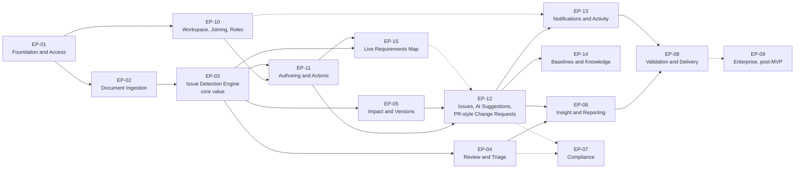

# Epics

**Fifteen epics covering all 61 user stories and the non-story enabler work (collaborative workspace scope, revision 5)**

| | |
|---|---|
| **Built from** | `IT314_RCD_Product_Backlog_v5.md` (v3.4, 61 stories), `IT314_RCD_Sprint_Plan_v5.md`, `IT314_RCD_Requirements_Spec_v5.md`, `IT314_RCD_Scope_Extension_v5.md`, `IT314_RCD_Interface_Design_v5.md` |
| **Epic IDs** | EP-01–EP-09 unchanged in name; EP-10–EP-14 added in Step 7; **EP-15 Live Requirements Map** added in revision 2 |
| **Totals** | **284 points**, of which **224 are scheduled** (S1 37 · S2 38 · S3 37 · S4 37 · S5 38 · S6 37) and 60 deferred |
| **Revision 5 (context and updated SRS)** | New: US-60 project context compulsory before analysis (EP-10, S1), US-61 LLM-generated updated SRS with review (EP-14, S6). US-41 exports the published SRS. Deferred: US-48 work-item links |
| **Revision 4 (trust review)** | New: US-56 human-raised concerns (EP-04, S4), US-57 decision rules (EP-12, S5), US-58 rule-based cross-checks (EP-03, S5), US-59 open-items report (EP-14, S6). Deferred: US-16, US-32, US-44. Moved: US-08, US-50, US-53 → S6 |
| **Revision 3** | US-45 becomes the Must "AI Resolution Suggestions with Human Feedback" (EP-12, Sprint 5); US-55 "Written Change Log and Summaries" joins EP-15 (Sprint 6); US-48 → Sprint 6; US-46 deferred |
| **Status** | ✅ delivered · 🟡 in progress · ⬜ not started · ⏸ deferred. The prior Sprint 0–1 code is a head start for EP-01 and EP-02 |

Every story appears in exactly one epic. Requirement traces use the canonical numbering.

---

## 1. Epic Summary

| Epic | Name | Stories | Points | Sprints | Core owners | Status |
|---|---|---|---|---|---|---|
| **EP-01** | Platform Foundation and Access | US-19 + Sprint 0 enablers | 5 | S0, S1 | Parth, Pranshu, Dhavni didi | 🟡 skeleton ✅ |
| **EP-02** | Document Ingestion and Processing Visibility | US-01, 02, 03, 04 | 16 | S1 | Parth, Bansil, Pranshu, Dhavni didi | 🟡 backend ✅ for US-01, US-04 |
| **EP-03** | **Issue Detection Engine** (core value) | US-05, 07, 06, 58 | 28 | S2, S5 | Keval, Heet, Abhyudit | ⬜ |
| **EP-04** | Clarification, Triage and Human Review (AI, rule and **human-raised** findings) | US-08, 09, 10, 15, 56 | 19 | S3, S4, S6 | Madhav, Parth, Keval, Abhijeet | ⬜ |
| **EP-05** | Change Impact and Version History | US-11, 12 | 11 | S4 | Madhav, Heet, Parth | ⬜ |
| **EP-06** | Insight and Reporting | US-13, 16, 44 | 15 (5 scheduled) | S5 | Pranshu, Dhavni didi, Heet | ⬜ |
| **EP-07** | Compliance and Governance *(conditional)* | US-18 | 5 | S6 | Parth, Abhijeet | ⬜ guard in US-10, US-35 |
| **EP-08** | Validation, Hardening and Delivery | US-22 + delivery enablers | 3 | S2, S7 | Abhyudit, Affan, Dhavni didi | ⬜ |
| **EP-09** | Enterprise Integration and Outcomes *(post-MVP)* | US-17, 20, 21, 23 | 21 | none | none | ⏸ |
| **EP-10** | **Workspace, Joining and Roles** | US-24, 25, 26, 27, 28, 29, 46, 49, 60 | 36 (33 scheduled) | S1, S2 | Parth, Madhav, Bansil, Keval, Dhavni didi, Pranshu, Abhijeet | ⬜ |
| **EP-11** | **Requirement Authoring and Actions** | US-30, 31, 32, 36, 37, 47, 51, 53 | 37 (27 scheduled) | S3, S5, S6 | Bansil, Heet, Keval, Parth | ⬜ |
| **EP-12** | **Issues, AI Suggestions, Decision Rules and PR-Style Change Requests** | US-33, 34, 35, 45, 48, 52, 54, 57 | 39 (31 scheduled) | S4, S5, S6 | Madhav, Parth, Bansil, Dhavni didi, Keval, Abhijeet | ⬜ |
| **EP-13** | Notifications and Activity | US-38, 39, 42 | 11 (8 scheduled) | S5, S6 | Madhav, Dhavni didi, Abhijeet | ⬜ |
| **EP-14** | Baselines, **Updated SRS** and Knowledge | US-40, 41, 43, 59, 61 | 22 (17 scheduled) | S5, S6 | Parth, Bansil, Keval, Pranshu | ⬜ |
| **EP-15** | **Live Requirements Map** *(new)* | US-14, 50, 55 | 16 | S3, S6 | Dhavni didi, Abhijeet, Pranshu | ⬜ |
| | **Total** | **61 stories** | **284** (224 scheduled) | | | |

### Priority rollup (MoSCoW, in points)

| Epic | Must | Should | Could | Won't |
|---|---|---|---|---|
| EP-01 | 5 | | | |
| EP-02 | 16 | | | |
| EP-03 | 23 | 5 | | |
| EP-04 | 13 | 6 | | |
| EP-05 | 11 | | | |
| EP-06 | 5 | 10 (deferred) | | |
| EP-07 | | 5 (conditional) | | |
| EP-08 | | | 3 | |
| EP-09 | | | 21 | US-23 (outcome) |
| EP-10 | 30 | 6 (3 deferred) | | |
| EP-11 | 16 | 16 (5 deferred) | 5 (deferred) | |
| EP-12 | 31 | 3 (deferred) | 5 (deferred) | |
| EP-13 | 5 | 3 | 3 (deferred) | |
| EP-14 | 5 | 12 | 5 (deferred) | |
| EP-15 | 8 | 8 | | |
| **Total** | **168** | **74** | **42** | |

Must is 59% of all points and 75% of scheduled points (the trust work, project context and the updated SRS are Must by design), above the usual 60% guideline. The cut order (§5) removes Should and Could items first, and the checkpoints after Sprints 3 and 5 are where it is applied.

---

## 2. Epic Map

Solid arrows: cannot start in earnest until the upstream epic delivers. Dashed: soft dependency.

**Critical path:** EP-01 → EP-02 → EP-03 → EP-11 → EP-15 / EP-12 → EP-13 → EP-08. The detection engine feeds the document path, live analysis, the map and the checks, so a delay there delays almost everything. EP-10 (joining and channels) must be ready for EP-11 by Sprint 3.

---

## 3. Epic Details

### EP-01 · Platform Foundation and Access

> **As** a team and an administrator, **we want** a reproducible environment, a schema that encodes the domain rules and authenticated access, **so that** every other epic can be built and shipped safely.

| Story | Title | Priority | Pts | Sprint |
|---|---|---|---|---|
| US-19 | Authenticate via JWT (sign-up only with a code, SSO later) | Must | 5 | S1 |

- **Enablers (Sprint 0):** tenancy and permission migrations, WebSocket and map-library spikes, interface contracts, component kit, CI for new modules, Playwright skeleton, benchmark plan, clickable prototypes.
- **Definition of done:** every REST route and the WebSocket handshake authenticated by test; login and sign-up-with-code work end to end; migrations up and down green.
- **Owners:** Parth, Pranshu (login UI, closes D1), Dhavni didi, Affan.

### EP-02 · Document Ingestion and Processing Visibility

> **As** a Business Analyst, **I want** to upload my SRS into a project as the baseline or as proposals and see the extracted requirements, **so that** I can start without reformatting anything.

| Story | Title | Priority | Pts | Sprint |
|---|---|---|---|---|
| US-01 | Upload SRS Document into a Project | Must | 5 | S1 |
| US-02 | Automatic Requirement Extraction | Must | 5 | S1 |
| US-03 | Track Long-Running Analysis Progress | Must | 3 | S1 |
| US-04 | View Extracted Requirements List | Must | 3 | S1 |

- **Definition of done:** import as baseline or proposals works; printed IDs preserved; headings and prose excluded; failures visible with stage; progress observable.
- **Owners:** Parth, Bansil, Pranshu, Dhavni didi.

### EP-03 · Issue Detection Engine *(core value, protected)*

> **As** a Business Analyst, **I want** requirements classified into five categories with confidence and rationale, **so that** I find real problems without checking every pair. The same engine checks one requirement against the baseline, which powers live analysis, the map, pre-flight checks and change-request checks.

| Story | Title | Priority | Pts | Sprint |
|---|---|---|---|---|
| US-05 | Detect Requirement Issues (tasks 5a, 5b, 5c) | Must | 13 | S2 |
| US-07 | Explain Findings with Confidence and Context | Must | 5 | S2 |
| US-06 | Tune Detection Thresholds per Project | Should | 5 | S5 |
| US-58 | Rule-Based Cross-Checks for Conflicts the Similarity Filter Misses | Must | 5 | S5 |

- **Enablers:** benchmark with document-style and post-style items, prompt versioning, result cache, per-pair status (G1), `BudgetGuard`, dry-run mode for pre-flight.
- **Rule-based cross-checks (US-58)** catch conflicts worded too differently for the similarity filter; their findings have source *Rule*.
- **Definition of done:** pre-filter not brute force, complemented by rule checks; five categories; confidence and rationale; 3 retries then recorded failure; `analyse_text()` implemented with a dry-run flag; precision/recall/F1 reported at CP1, with recall on below-threshold conflicts reported separately (NFR-37); a clean result never claims to be verified (DR-21).
- **Owners:** Keval, Heet, Abhyudit, Abhijeet.

### EP-04 · Clarification, Triage and Human Review

> **As** a Business Analyst or QA engineer, **I want** questions, severity and review actions on every finding, **so that** issues are resolved quickly and the AI never changes a requirement on its own.

| Story | Title | Priority | Pts | Sprint |
|---|---|---|---|---|
| US-09 | Generate Clarification Questions | Must | 5 | S3 |
| US-10 | Suggest Resolutions and Human Review | Must | 5 | S3 |
| US-56 | Raise a Concern (Human-Raised Findings) | Must | 3 | S4 |
| US-08 | Assign Severity to Flagged Issues | Should | 3 | S6 |
| US-15 | Dismiss / Resolve a Flag (Feedback Loop) | Should | 3 | S6 |

- **Changed in revision 2:** US-08 moved to Sprint 4, where severity is first needed by the risk check; clarification questions also become the first comment of conflict issues (SX-18).
- **Owners:** Madhav, Parth, Keval, Abhijeet, Pranshu.

### EP-05 · Change Impact and Version History

> **As** a Project Manager, **I want** to know what a change affects and keep every version, **so that** changes are made with eyes open and nothing is lost.

| Story | Title | Priority | Pts | Sprint |
|---|---|---|---|---|
| US-11 | Change-Impact Analysis Engine | Must | 8 | S4 |
| US-12 | Maintain Requirement Version History | Must | 3 | S4 |

- **Note:** impact now also follows human links (FR-91) as well as AI-detected dependencies.
- **Owners:** Madhav, Heet, Parth, Pranshu.

### EP-06 · Insight and Reporting

> **As** a Product Owner or Project Manager, **I want** a dashboard, analytics and exports, **so that** I can see requirements quality and communicate it.

| Story | Title | Priority | Pts | Sprint |
|---|---|---|---|---|
| US-13 | View Requirements Quality Dashboard | Must | 5 | S5 |
| US-16 | Export Issue, Impact and Consequence Reports | Should | 5 | deferred |
| US-44 | Requirements Health Analytics | Should | 5 | deferred |

- **Changed in revision 2:** the graph (US-14) moved to EP-15 and became the live map.
- **Owners:** Pranshu, Parth, Dhavni didi, Heet, Abhijeet.

### EP-07 · Compliance and Governance *(conditional)*

| Story | Title | Priority | Pts | Sprint |
|---|---|---|---|---|
| US-18 | Protect Compliance-Critical Requirements | Should (conditional) | 5 | S6 |

- **Split:** the guard is in US-10 (findings) and US-35 (change requests); this epic adds tagging, the review queue with sign-off and the audit export.
- **Owners:** Parth, Abhijeet (closes D2).

### EP-08 · Validation, Hardening and Delivery

| Story | Title | Priority | Pts | Sprint |
|---|---|---|---|---|
| US-22 | Validate Flagged Output and Workspace Flows with Low-Fidelity Previews | Could | 3 | S2 |

- **Enablers:** accuracy runs at CP1 and CP2; load test including map freshness and size (NFR-32, NFR-33); security tests (isolation, join codes, permissions, rate limits); accessibility check; deployment; Sprint 7 release week.
- **Owners:** Abhyudit, Affan, Dhavni didi, Parth.

### EP-09 · Enterprise Integration and Outcomes *(post-MVP)*

| Story | Title | Priority | Pts |
|---|---|---|---|
| US-17 | Executive / ROI Summary Report | Could | 5 |
| US-20 | Documented REST API | Could | 8 |
| US-21 | Jira / Confluence / GitHub Integration | Could | 8 |
| US-23 | End-Customer Feedback Trends | Won't (outcome) | n/a |

Not scheduled. See `IT314_RCD_Scope_Extension_v5.md` §12 for the post-semester roadmap.

### EP-10 · Workspace, Joining and Roles

> **As** a project manager, **I want** to create a workspace, let people join with a code, give them the right roles and talk in channels, **so that** requirements work happens with the people who own the requirements.

| Story | Title | Priority | Pts | Sprint |
|---|---|---|---|---|
| US-24 | Create a Workspace and Projects | Must | 3 | S1 |
| US-25 | Join a Workspace with a Code or Invite Link | Must | 5 | S1 |
| US-27 | Enforce Roles and Permissions | Must | 5 | S1 |
| US-26 | Remove Members, Change Roles, Leave | Must | 3 | S2 |
| US-49 | Custom Roles and Permission Sets | Should | 3 | S2 |
| US-28 | Create and Manage Channels | Must | 3 | S2 |
| US-29 | Real-Time Messaging with Threads and Mentions | Must | 8 | S2 |
| US-60 | Project Context Required Before Analysis | Must | 3 | S1 |
| US-46 | Search Across the Workspace | Should | 3 | deferred |

- **Definition of done:** permission matrix tested for every permission × default role; join codes expire, run out, can be revoked and never grant Owner or Admin; removal closes sockets within 5 s; messages within 1 s p95; no project is analysed before its context (initial SRS or brief) is confirmed.
- **Owners:** Parth, Madhav, Dhavni didi, Pranshu, Abhijeet, Heet, Affan.

### EP-11 · Requirement Authoring and Actions

> **As** a stakeholder, **I want** to write good requirements where I already work and act on existing ones, **so that** problems are caught when they are cheapest to fix.

| Story | Title | Priority | Pts | Sprint |
|---|---|---|---|---|
| US-30 | Requirement Composer with EARS Templates | Must | 5 | S3 |
| US-31 | Live Analysis of a Posted Requirement | Must | 8 | S3 |
| US-36 | Owners, Stakeholder Groups and Ownership Requests | Should | 3 | S3 |
| US-37 | Requirement Lifecycle States | Must | 3 | S3 |
| US-51 | Live Lint, Similar Hints, Pre-Flight Check and AI Wording | Should | 5 | S5 |
| US-53 | Discussion, Votes, Watch and Links | Should | 3 | S6 |
| US-32 | Suggest Requirements Detected in Chat (Opt-In) | Should | 5 | deferred |
| US-47 | Import Meeting Notes as Candidate Requirements | Could | 5 | deferred |

- **Definition of done:** composer with EARS templates; posts create Proposed requirements with provenance; result cards within 60 s; lint within 300 ms with no LLM; pre-flight saves nothing; votes are advisory; human links kept apart from AI relationships.
- **Owners:** Bansil, Heet, Keval, Dhavni didi, Parth, Pranshu, Madhav.

### EP-12 · Issues, AI Suggestions and PR-Style Change Requests

> **As** a Project Manager, **I want** problems tracked as issues, an AI-proposed solution for each one that people accept, edit, reject or defer, the right decision owner for each kind of issue, and every change to an agreed requirement handled like a pull request, **so that** the baseline changes only knowingly and by agreement, and two people with clashing requirements are brought together with options in hand.

| Story | Title | Priority | Pts | Sprint |
|---|---|---|---|---|
| US-52 | Requirement Issues and Auto Conflict Issues | Must | 5 | S4 |
| US-33 | Open a Change Request (Change Editor) | Must | 5 | S4 |
| US-34 | Consequence Checks for a Change Request | Must | 8 | S4 |
| US-35 | Review and Merge | Must | 5 | S4 |
| US-45 | AI Resolution Suggestions with Human Feedback | Must | 5 | S5 |
| US-57 | Decision Rules and Decision Owners per Project | Must | 3 | S5 |
| US-48 | Link Requirements to Work Items | Should | 3 | deferred |
| US-54 | Structural Change Requests and Counter-Proposals | Could | 5 | deferred |

- **Definition of done:** auto conflict issues for multi-owner findings; up to three category-specific AI suggestions per finding, each acceptable, editable, rejectable with a reason or regenerable, never applied without a change request; feedback stored and reused as per-project examples; diff, checks, auto-requested reviewers, inline review comments; merge only when the policy is met and checks are current; needs update after a competing merge; *Resolves ISS-n* closes issues.
- **Success measure:** on the CP2 script, every scripted change request lists exactly the planted affected requirements and requests the right reviewers.
- **Owners:** Madhav, Parth, Bansil, Dhavni didi, Keval, Abhijeet, Pranshu.

### EP-13 · Notifications and Activity

| Story | Title | Priority | Pts | Sprint |
|---|---|---|---|---|
| US-38 | Inbox and Notifications | Must | 5 | S5 |
| US-42 | Requirement Activity Timeline | Should | 3 | S6 |
| US-39 | Notification Preferences and Email Digest | Could | 3 | deferred |

- **Note:** @mentions from US-29 work from Sprint 2; US-38 adds the inbox (review requested, assigned, mentioned, watching).
- **Owners:** Madhav, Dhavni didi, Abhijeet, Pranshu.

### EP-14 · Baselines, Updated SRS and Knowledge

| Story | Title | Priority | Pts | Sprint |
|---|---|---|---|---|
| US-40 | Baseline Snapshots and Comparison | Should | 5 | S5 |
| US-61 | Generate the Updated SRS with the LLM and Review It | Must | 5 | S6 |
| US-41 | Export the Updated SRS (DOCX, PDF, Markdown) | Should | 5 | S6 |
| US-43 | Ask the Baseline (Q&A with Citations) | Could | 5 | deferred |
| US-59 | Open-Items Report Beside the Approved Baseline | Should | 2 | S6 |

- **Definition of done:** the updated SRS is generated only from the clarified baseline, every requirement appears exactly once and verbatim, all AI narrative is accepted by a person before publishing, and published versions are numbered and comparable.
- **Owners:** Parth, Bansil, Keval, Pranshu.

### EP-15 · Live Requirements Map *(new)*

> **As** any member, **I want** the requirements graph to update live whenever someone adds or changes a requirement, to read the same changes in writing, and to preview what a change would do, **so that** everyone always sees the current state and the effect of proposals.

| Story | Title | Priority | Pts | Sprint |
|---|---|---|---|---|
| US-14 | Live Requirements Map (with a one-line written feed) | Must | 8 | S3 |
| US-50 | Map Preview Layer and Time Slider | Should | 5 | S6 |
| US-55 | Written Change Log and Summaries for the Map | Should | 3 | S6 |

- **Enablers:** Sprint 0 library spike; graph API v0 in Sprint 2.
- **Definition of done:** deltas reach all viewers within 2 s of the triggering commit (NFR-32); every delta also appears as a written sentence; stable layout; layers; focus mode; table alternative; 500 nodes responsive (NFR-33); summaries of changes since a snapshot or date.
- **Success measure:** in the CP1 demo, two browsers show the new node and conflict edge without refreshing.
- **Owners:** Dhavni didi (graph API, deltas, change sentences), Abhijeet (map UI), Pranshu (preview layer, time slider, Changes panel), Keval (AI narrative).

---

## 4. Sprint × Epic Matrix (points)

| Epic | S0 | S1 | S2 | S3 | S4 | S5 | S6 | S7 | Total |
|---|---|---|---|---|---|---|---|---|---|
| EP-01 Foundation and Access | enablers | 5 | | | | | | | 5 |
| EP-02 Document Ingestion | | 16 | | | | | | | 16 |
| EP-03 Issue Detection | | | **18** | | | 10 | | | 28 |
| EP-04 Review and Triage | | | | 10 | 3 | | 6 | | 19 |
| EP-05 Impact and Versions | | | | | 11 | | | | 11 |
| EP-06 Insight and Reporting | | | | | | 5 | | | 5 (+10 deferred) |
| EP-07 Compliance | | | | | | | 5 | | 5 |
| EP-08 Validation and Delivery | | | 3 | | | | | enablers | 3 |
| EP-09 Post-MVP | | | | | | | | | 0 (21 deferred) |
| EP-10 Workspace, Joining, Roles | | 16 | 17 | | | | | | 33 (+3 deferred) |
| EP-11 Authoring and Actions | | | | 19 | | 5 | 3 | | 27 (+10 deferred) |
| EP-12 Issues, Suggestions, Rules, Change Requests | | | | | 23 | 8 | | | 31 (+8 deferred) |
| EP-13 Notifications | | | | | | 5 | 3 | | 8 (+3 deferred) |
| EP-14 Baselines, Updated SRS, Knowledge | | | | | | 5 | 12 | | 17 (+5 deferred) |
| EP-15 Live Requirements Map | | | | 8 | | | 8 | | 16 |
| **Sprint total** | 0 | **37** | **38** | **37** | **37** | **38** | **37** | 0 | **224** |

---

## 5. Cut Order if the Schedule Slips

| Order | Cut | Epic | Points freed |
|---|---|---|---|
| 1 | US-53 Discussion, votes, watch, links | EP-11 | 3 |
| 2 | US-50 Map preview and time slider (live map remains) | EP-15 | 5 |
| 3 | US-49 Custom roles (defaults remain) | EP-10 | 3 |
| 4 | US-18 Compliance queue (the protected guard remains) | EP-07 | 5 |
| 5 | US-55 Change summaries (the one-line written feed of US-14 remains) | EP-15 | 3 |
| 6 | US-15 Feedback loop view | EP-04 | 3 |
| 7 | US-42 Activity timeline | EP-13 | 3 |
| 8 | US-08 Severity overrides (system-proposed severity remains) | EP-04 | 3 |
| 9 | US-41 DOCX and PDF export (Markdown download of the published SRS in US-61 remains) | EP-14 | 5 |
| **Never** | **Document path:** US-60, 01, 02, 05, 09, 61 · **Collaboration path:** US-24, 25, 27, 29, 30, 31, 14, 33, 34, 35, 52, 45 · **Trust layer:** US-56, 57, 58 | | none cut |

Cuts 1–9 free 33 points, almost one sprint. US-59 is never cut while an SRS can be published, so a published SRS never hides open items.

---

## 6. Gaps and Decisions

| # | Finding | Status |
|---|---|---|
| D1 | No owner for the SPA login screen | **Resolved:** Pranshu, US-19 |
| D2 | No UI owner for US-18 | **Resolved:** Abhijeet |
| D3 | US-18 priority | Resolved in Step 6 (CR-19) |
| D4 | US-01 formats | Resolved in Step 6 (CR-16) |
| D5 | US-05 is 13 points in one story | **Resolved:** tasks 5a/5b/5c with milestones |
| D6 | Embedding fine-tuning undecided | Open; listed as extension 6 in `IT314_RCD_Scope_Extension_v5.md` §12 |
| D7 | US-03 progress mapped to stages | Planned with EP-03 wiring (G2) |
| D8 | Two testers for 10 people | Mitigated: developers own unit tests; Madhav joins E2E in Sprint 6 |
| D9 | Must is 73% of scheduled points | Accepted: the trust stories (US-56–US-58) are Must by design; Should items are cut first; revisit at CP1 |
| D10 | Free hosting tiers may limit WebSockets | Check in Sprint 0; polling fallback (map refresh every 5 s) |
| D11 | Risk-rule thresholds are guesses | Tune with Project Managers at CP2 |
| **D12** *(new)* | Sprint loads rose to 34–38 points | Recalibrate after Sprint 1; cut order applies from Sprint 2 |
| **D13** *(new)* | Two frontend developers carry many screens | Component kit in Sprint 0; Bansil and Madhav wire some UI in Sprints 5–6 (`IT314_RCD_Sprint_Plan_v5.md` §4) |
| **D14** *(new)* | Map library choice affects US-14 and US-50 | Decided by the Sprint 0 spike (NFR-33) |
| **D15** *(rev. 3)* | Suggestion quality is unknown until real feedback exists | Acceptance study in Sprint 5 (NFR-36); prompts tuned in Sprint 6 from rejection reasons |
| **D17** *(rev. 4)* | Main story: collaborative creation and resolution; SRS import is the onboarding path | Agreed positioning (`IT314_RCD_Scope_Extension_v5.md` §2) |
| **D18** *(rev. 4)* | Recall targets for AI + rules unknown | Set at CP1 from the benchmark, which includes below-threshold conflicts (NFR-37) |
| **D19** *(rev. 5)* | The context pack adds tokens to every prompt | Capped at 1,500 tokens; first item cut under the budget trigger; benefit measured with and without it (NFR-39) |
| **D20** *(rev. 5)* | An LLM-written SRS could invent or reword requirements | Requirement text is inserted by the system, never the LLM; the fidelity check blocks publishing (DR-25) |
| **D16** *(rev. 3)* | Search (US-46) deferred | Map search and requirements-table filters cover the MVP; listed in `IT314_RCD_Scope_Extension_v5.md` §12 |

---

## 7. Using These Epics in a Tracker

| Field | Convention |
|---|---|
| **Epic key** | `EP-01` … `EP-15` |
| **Story label** | `epic:ep-12` on each story; keep `US-xx` in the title |
| **Sprint** | S0–S7 from `IT314_RCD_Sprint_Plan_v5.md` |
| **Enablers** | Tasks under the epic, labelled `enabler`, 0 points |
| **Status mapping** | ⬜ To do · 🟡 In progress · ✅ Done · ⏸ Backlog |
| **Closing an epic** | Only when every story's acceptance criteria and the epic's definition of done are met |
