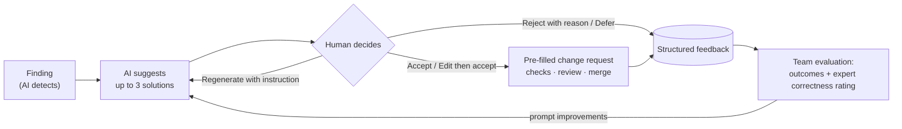

# Scope Extension: From SRS Analyser to Collaborative Requirements Workspace

**IT314 project, Step 7 (revision 5): widen the AI Requirements Conflict Detector into a semester-long product for a 10-member team, and record every decision the widening forces**

| | |
|---|---|
| **Product** | AI Requirements Conflict Detector: a collaborative requirements workspace |
| **Before** | Upload one SRS, extract requirements, classify conflicts, review findings |
| **After** | A workspace that an admin or project manager creates and others **join with a code**. Each member has a **role** (nine defaults plus custom roles) that decides which **requirement actions** they can take. Every add or change is analysed against the agreed requirements, and the **live requirements map** (the graph we used to show at the end of SRS analysis) updates for everyone. When a problem involves two people's requirements, the system works like GitHub: it opens a **requirement issue** assigned to both, and changes go through a **pull-request-style change request** with diff, checks, reviews and merge. For every problem the **AI suggests solutions that people accept, edit or reject**, and every change is shown **on the map and in writing**. Every project starts with **compulsory context** (an initial SRS or a brief) so the AI knows the product, and ends with an **LLM-written, human-approved updated SRS** that can be exported |
| **Team** | 10 members, 14 weeks: Sprint 0, six 2-week sprints, release week (`IT314_RCD_Sprint_Plan_v5.md`) |
| **Size** | **61 user stories in 15 epics: 284 points, 224 scheduled**, 60 deferred (revision 4: 59 stories, 276 points; revision 3: 55 stories, 263 points; revision 2: 54 stories, 258 points; revision 1: 48 stories, 229 points; original: 23 stories, 115 points) |
| **Companions** | `IT314_RCD_Requirements_Spec_v5.md`, `IT314_RCD_Product_Backlog_v5.md`, `IT314_RCD_Epics_v5.md`, `IT314_RCD_Sprint_Plan_v5.md`, `IT314_RCD_Design_Update_v5.md`, **`IT314_RCD_Interface_Design_v5.md` (new)**. `conflict-resolution.md` (Step 6) stays valid except where §8 says otherwise |
| **Status** | Proposed scope. The decisions in §11 need confirming with the stakeholders named there |

---

## 0. What Changed in Revisions 2 to 5

| Topic | Revision 1 | Revision 2 |
|---|---|---|
| Joining | Email invitations (needed SMTP) | **Join code or invite link** generated by an owner, admin or project manager; optional approval of join requests; email is optional (SX-02, SX-14, SX-21) |
| Roles | 6 fixed roles | **9 default roles** (adds Project Manager, Business Analyst, Developer, QA Engineer, Stakeholder) plus **custom roles** built from a permission catalogue (SX-15) |
| What a user can do | Post a requirement, open a change request | **A full action set**: propose, draft, lint, pre-flight check, comment, support or oppose, watch, link, open an issue, request a change, request ownership, ask the AI to improve wording, mark implemented, view on the map (§3.1) |
| Output | Dashboard and a graph, refreshed later | **Live requirements map**: every add or change updates the graph for everyone within 2 seconds of its analysis, with preview of proposed changes and a time slider (SX-16, SX-17) |
| Two users involved | Notifications and approvals | **GitHub-style**: automatic *conflict issues* assigned to both owners; change requests become *pull requests* with diff, checks, auto-requested reviewers, merge and "needs update" (SX-18 to SX-20) |
| Interface | Not specified | **`IT314_RCD_Interface_Design_v5.md`**: layout, EARS-based requirement composer, change editor, change-request page, issue page, live map |
| Future | Not specified | **§12: extensions after this semester** |
| **Solutions (rev. 3)** | Compromise suggestions for conflicts only, Could, stretch | **AI-suggested solutions for every finding**, with accept / edit / reject / regenerate and stored feedback that improves later suggestions; now a Must (§3.6, SX-22, SX-23) |
| **Trust layer (rev. 4)** | AI findings only; implicit approval rules; one generic approval policy; similarity filter as the only gate; SRS export of the baseline | **Human-raised concerns** with visible source (AI · Rule · Person); exact **agreement rules** with approvals tied to proposal revisions; a **findings delta** on every change; **decision owners** per issue type; **rule-based cross-checks** and measured recall; an approved-only export plus an **open-items report**; structured AI feedback without self-learning claims (§3.8) |
| **Positioning (rev. 4)** | Upload-and-analyse and collaboration presented side by side | **Collaborative creation and resolution is the main story; importing an existing SRS is the onboarding path** (§2) |
| **Project context (rev. 5)** | Optional upload; the LLM saw only requirement text | **Compulsory context** before any analysis: an initial SRS, a brief, or both, confirmed by the PM; a bounded **context pack** in every prompt (§3.9, SX-31) |
| **Updated SRS (rev. 5)** | Template export of the baseline | **LLM-generated updated SRS** once things are clarified: requirements inserted verbatim, narrative by the LLM, reviewed section by section, fidelity-checked, published as numbered versions and exported as DOCX, PDF or Markdown (§3.9, SX-32) |
| **Changes in writing (rev. 3)** | Toast messages only | **Changes panel** beside the map: every change as a sentence, plus written summaries since any snapshot, date or last visit (§3.7) |

## 1. Why Widen the Scope

The original product treats requirements as a **document**: someone uploads an SRS, the system analyses it once, and the job is finished. Real requirements work does not behave like that.

| Limitation of the old scope | What happens in practice |
|---|---|
| **One-shot analysis.** Conflicts are found only when a whole SRS is uploaded | Requirements arrive one at a time, in meetings and chats, long after the SRS is signed off |
| **No people model.** One user, one workspace, one role | Many stakeholders contribute, each with a different job and different rights, and each owns different requirements |
| **Edits without consequences.** US-11 previews impact, but nothing routes a change to the people it affects | Most expensive defects come from late changes that nobody affected was told about |
| **A static result.** The graph is produced once, at the end | Teams need to see the current state of their requirements, and what a change would do to it, at any moment |
| **Too small for 10 people.** 94 scheduled points over 5 sprints | A semester project for 10 people needs parallel, separately owned subsystems |

The detection engine (EP-03) is still the core. The widening gives it a **continuous input** (posts and change requests) and a **continuous output** (the live map, issues, consequence checks and decisions).

## 2. The Extended Product

**Positioning (revision 4).** The primary workflow is **collaborative requirement creation and resolution**. Importing an existing SRS is the **onboarding path** for teams that already have requirements: it becomes the first approved baseline. The original conflict detector is not abandoned; its intelligence moves earlier in the requirements lifecycle, to the moment a requirement is written or changed. **Revision 5** frames the lifecycle at both ends: every project starts with compulsory context (an initial SRS or a brief), and finishes with an updated SRS written by the LLM and approved by people (§3.9).

> A project manager creates a **workspace** and a **project**, then shares a **join code**. Developers, QA engineers, analysts and client stakeholders join with the code and get the role the code carries; the manager can change it. A stakeholder writes a new requirement in the **composer**, which guides them with sentence templates and flags vague words as they type. Before submitting, they can run a **pre-flight check** to see likely conflicts. On submit, the requirement is analysed against the agreed **baseline**, and the **live map** updates for everyone: the new node appears, and a red edge shows a conflict with a requirement owned by someone else. Because two people are involved, the system opens **conflict issue ISS-12** assigned to both, with the AI's explanation, a clarification question and **three AI-suggested solutions**. Both owners mark the option they prefer; one edits it slightly and accepts it, which opens a pre-filled **change request RCR-34**, which looks like a pull request: a word-level diff, **checks** (conflicts, duplicates, ambiguity, impact, protected requirements, risk), and reviewers requested automatically. When the approval policy is met, a manager **merges** it. The baseline gets a new version, ISS-12 closes, the map turns the red edge grey, and the **Changes panel** beside the map says all of this in plain sentences. The team's choice is stored, so the next suggestions for this project follow the same style.

| Capability | Old scope | Extended scope |
|---|---|---|
| Joining and roles | Accounts by CLI, one global role | Join code or link; 9 default roles plus custom roles; role per workspace with project override |
| Input | SRS upload | SRS upload, structured requirement posts, change requests, optional chat detection |
| Writing requirements | n/a | EARS templates, live quality lint, similar-requirement hints, pre-flight check, AI wording suggestions |
| Analysis | Whole document, once | Whole document **and** incremental analysis of each add or change |
| Output | Dashboard and graph after analysis | **Live map** updated on every change, preview overlay, time slider; dashboard, analytics, exports |
| Collaboration | None | Channels, threads, mentions, **requirement issues**, **PR-style change requests**, votes, watch, notifications |
| History | Version history | Versions, baseline snapshots (like releases), per-requirement timeline |

## 3. Feature Modules

| # | Module | Epic | What it adds | Stories |
|---|---|---|---|---|
| M1 | **Workspace, joining and roles** | EP-10 | Workspaces, projects, join codes, join approval, roles and custom roles, channels, real-time messaging, search | US-24 to US-29, US-46, US-49 |
| M2 | **Requirement authoring and actions** | EP-11 | EARS composer, live lint, pre-flight check, owners, lifecycle, votes, watch, links, chat detection | US-30, 31, 32, 36, 37, 51, 53 (US-47 deferred) |
| M3 | **Issues and PR-style change requests** | EP-12 | Requirement issues, auto conflict issues, **AI-suggested solutions with human feedback** for every finding, change requests with diff, checks, reviews, merge; work-item links | US-33, 34, 35, 45, 48, 52 (US-54 deferred) |
| M4 | **Live requirements map** | EP-15 | Live-updating graph, layers, preview overlay, time slider, **written change log and summaries** | US-14, US-50, US-55 |
| M5 | **Notifications and activity** | EP-13 | Inbox, mentions, review requests, assignment, activity timeline | US-38, 42 (US-39 deferred) |
| M6 | **Baselines and knowledge** | EP-14 | Snapshots and comparison, SRS export | US-40, 41 (US-43 deferred) |
| M7 | **Insight** | EP-06 | Dashboard, analytics, exports | US-13, 16, 44 |
| — | **Existing core** | EP-01 to EP-09 | Ingestion, detection, review, impact, compliance, validation | US-01 to US-23 |

### 3.1 Requirement Actions

What a member sees depends on their permissions (`IT314_RCD_Requirements_Spec_v5.md` §1.22). Items marked ★ are the innovative ones this revision adds.

| Action | What it does | Default roles allowed | Story |
|---|---|---|---|
| **Propose a requirement** | Composer with EARS templates; creates a Proposed requirement and triggers live analysis | PM, BA, Developer, QA, Stakeholder (and Owner, Admin) | US-30 |
| **Save as draft** | Private draft, not analysed by the team pipeline, finishable later | Same | US-30 |
| ★ **Live quality lint** | Highlights vague words ("fast", "user-friendly", "etc."), passive voice, missing actor or measurable value as you type; deterministic, no AI cost | Everyone who can propose | US-51 |
| ★ **Similar-requirement hints** | Shows the 3 most similar existing requirements while typing (embeddings only), to stop duplicates before they exist | Same | US-51 |
| ★ **Pre-flight check** | A dry run of the full analysis on the draft: likely conflicts, duplicates, a ghost node on the mini-map. Nothing is saved | Same | US-51 |
| ★ **Ask AI to improve wording** | Suggests a clearer EARS rewrite, labelled as AI; accepted only by explicit click | Same | US-51 |
| **Comment** | Discussion on the requirement | All except Viewer | US-53 |
| ★ **Support / oppose** | Advisory vote with an optional reason; reviewers see the tally (DR-17) | All except Viewer and Compliance | US-53 |
| **Watch** | Follow a requirement, issue or change request | Everyone | US-53 |
| **Link** | Assert "depends on", "refines" or "related to"; human links are kept separate from AI-detected ones (DR-19) | PM, BA, Developer, QA | US-53 |
| **Open an issue** | GitHub-style issue on one or more requirements | All except Viewer | US-52 |
| **Request a change** | Opens a PR-style change request: modify or deprecate | PM, BA, Developer, QA, Stakeholder | US-33 |
| **Review a change request** | Approve, request changes or comment inline on the diff | Requested reviewers with the review permission | US-35 |
| **Merge** | Applies an approved change to the baseline | Owner, Admin, PM, BA | US-35 |
| ★ **Accept, edit, reject or regenerate an AI solution** | Respond to the AI's suggested fixes for a finding; accepting opens a pre-filled change request | All who can open change requests (reject and rate: anyone who can comment) | US-45 |
| ★ **Raise a concern** | Flag a problem the AI did not find; becomes a finding with source *Person* and follows the same workflow | All except Viewer | US-56 |
| ★ **Defer a suggestion** | Mark an AI suggestion as "not decided yet" instead of forcing accept or reject | Same as accept | US-45 |
| ★ **Read and summarise changes** | Changes panel beside the map; "Summarise changes since…" | Everyone | US-55 |
| ★ **Request ownership** | Ask to become the owner; the current owner or a PM accepts | All with propose rights | US-36 |
| **Review a finding** | Confirm, dismiss, merge, reclassify | BA, PM (Compliance for protected) | US-10 |
| **Mark implemented** | Move Approved → Implemented, optionally with a work-item link | PM, BA, Developer | US-37 |
| **Protect** | Mark compliance-critical | Owner, Admin, Compliance | US-18 |
| **View on map / timeline** | Jump to the node or the full history | Everyone | US-14, US-42 |
| *Split, merge, counter-propose* | Structural change requests and alternatives inside a request | *Deferred* | US-54 |

### 3.2 The GitHub Model, Mapped

| GitHub | This product | Notes |
|---|---|---|
| Repository | **Project** | |
| `main` branch | **Approved baseline** | Only merged changes reach it (DR-13, DR-14) |
| Commit | **Requirement version** | Immutable; linked to the change request that produced it |
| Issue | **Requirement issue** `ISS-n` | Labels, assignees, linked requirements, open/closed |
| Pull request | **Requirement change request** `RCR-n` | Base version, proposed text, diff, conversation, reviews |
| CI checks | **Consequence checks** | Conflict, duplicate, ambiguity lint, impact, protected, risk (FR-63) |
| CODEOWNERS | **Requirement owners** | Owners of the changed and directly affected requirements are auto-requested as reviewers |
| Branch protection | **Approval policy** | Required approvals, compliance sign-off, no self-approval |
| Merge conflict | **Needs update** | Base version is no longer current; shows a three-way diff (SX-20) |
| `Fixes #12` | `Resolves ISS-12` | Merging closes the issue |
| Release / tag | **Baseline snapshot** | e.g. "v1.0 sign-off" |
| `git log` / blame | **Activity timeline** | Per requirement |

### 3.3 When Two Users Are Involved

| Situation | What the system does |
|---|---|
| A finding (Conflicting or Duplicate, Medium or High severity) involves requirements owned by **different members** | Opens a **conflict issue** assigned to all owners, with both requirements side by side, the AI rationale, the clarification question and **up to three AI-suggested solutions** that each owner can mark as preferred (FR-87, FR-68). One issue per finding; it closes when the finding is resolved or a linked change request merges |
| Someone opens a change request on a requirement **they do not own** | The owner is a **required reviewer** |
| A change request's checks show a **direct conflict** with another member's requirement | That owner becomes a **required reviewer**; owners of transitively affected requirements are **optional** reviewers |
| **Two open change requests** on the same requirement | When one merges, the other becomes **needs update** and its checks re-run after the proposer updates it |
| A change request involves a **protected** requirement | A compliance reviewer is required (CR-19, SX-13) |
| Who has the final say | The **decision owner** from the project's decision rules (security lead, compliance, PM, …), shown on the issue and the change request; never a vote (§3.8) |
| A stakeholder disagrees but the AI found nothing | They **raise a concern**; it is handled like any finding and cannot be closed because the AI saw no conflict (§3.8) |

### 3.4 What "Consequences" Means

A consequence report is shown as the **Checks** tab of a change request. Each check is computed from recorded data; only the summary narrative comes from the LLM, labelled as AI.

| Check | Computed from | Result example |
|---|---|---|
| Conflicts | Incremental classification against the baseline (EP-03 engine) | ✗ "Conflicts with REQ-022 (High, 0.86)" |
| Duplicates | Same | ✓ "No duplicates" |
| Ambiguity lint | Pattern catalogue (DR-07) + single-requirement check | ⚠ "Vague term: *quickly*" |
| Impact | Dependency findings, human links, transitive traversal (US-11) | ⓘ "3 direct, 1 transitive; owners Riya, Arjun" |
| Work touched | Linked work items (US-48, deferred in rev. 5; shown once it ships) | ⓘ "2 items, 8 points recorded" |
| Protected | `is_protected` on any affected requirement | ⚠ "Compliance reviewer required" |
| Risk | Rule-based (ADR-17) | **High** |
| Summary | LLM narrative citing IDs | "Option A: keep 30 min and add re-authentication for payments…" |

The report never invents schedule or cost figures (DR-16).

### 3.5 The Live Requirements Map

- **What it shows:** every requirement in the project as a node (shape = type, border = state) and every relationship as an edge (red for conflict, double line for duplicate, arrow for dependency, grey for human links). Badges show open issues and change requests.
- **When it updates:** whenever an analysis run, merge, review action or link changes the data, the server pushes a **graph delta**; all viewers see it within 2 s (NFR-32). New or changed elements pulse briefly, and a toast says what happened ("REQ-031 added by Riya — 1 conflict").
- **It never re-analyses the whole project to update.** Deltas come from incremental runs (ADR-16), and the layout is stable so the picture does not jump (ADR-21).
- **Layers:** Baseline (solid), Proposed (dashed), Preview (ghost) for a pre-flight or open change request; a **time slider** replays the baseline at any revision or snapshot (US-50).
- **Same data, also as a table**, for accessibility and for very large projects (NFR-29).

- **Also in writing:** every change appears as a sentence in the Changes panel (§3.7).

Full screen design: `IT314_RCD_Interface_Design_v5.md` §9.

### 3.6 AI-Suggested Solutions with Human Feedback *(revision 3)*

Finding a problem is half the job; the other half is fixing it. For **every** finding the AI proposes up to three concrete solutions, and **people decide**. Every decision is recorded and teaches later suggestions.

| Finding | What the AI suggests | Example |
|---|---|---|
| Conflicting | Compromise wordings, or "keep A, change B", each with its trade-off | "Option B: end sessions after 30 min of inactivity, and after 5 min on payment screens. Trade-off: two timeouts to test." |
| Duplicate | One merged wording, and which requirement to keep | "Keep REQ-022, deprecate REQ-041; merged text: …" |
| Ambiguous | A measurable rewrite in EARS form | "*fast*" → "within 2 seconds for 95% of requests" |
| Incomplete | The missing parts, with every invented value marked `[TBD — confirm]` | "…shall lock the account after `[TBD — confirm: 5]` failed attempts" |
| Dependent | The link to record and the implementation order | "Link REQ-040 *depends on* REQ-022; implement REQ-022 first" |

**The human-in-the-loop cycle**



- **Nothing is applied automatically.** Accepting opens a pre-filled change request (or a superseding post for your own Proposed requirement), which still goes through checks, review and merge (DR-04, DR-20).
- **Two owners:** on a conflict issue both owners see the options and each marks a preference ("Riya ✓ B · Arjun ✓ B") before either opens the change request.
- **Structured feedback, honestly used:** each response is one of six outcomes — accepted as suggested, accepted after editing, rejected (changes the intended meaning / infeasible / AI missed context), deferred. The team uses it first to evaluate and improve the prompts. Re-using past decisions as prompt examples is an experiment, off by default and limited to the same project (SX-23, SX-30). The product never claims the AI learns by itself; fine-tuning stays an extension (§12, item 6).
- **Measured honestly:** acceptance is not correctness, so the outcome distribution is reported next to an analyst's correctness rating of a sample (NFR-36).

### 3.7 Changes in Writing, Next to the Graph *(revision 3)*

The map shows changes as pictures; the **Changes panel** shows the same changes as sentences, so nobody has to read a graph to know what happened.

```
CHANGES                                                   Filter: Everyone ▾  All kinds ▾
10:52  Riya merged RCR-34: REQ-014 inactivity limit 30 → 10 min (v3).
       Conflict REQ-031 ↔ REQ-014 resolved. ISS-12 closed.
10:47  Riya and Arjun both preferred AI option B for ISS-12.
10:42  Arjun added REQ-031 "When the user is inactive for 5 minutes…" (Security, Must).
       Analysis: 1 conflict with REQ-014 (High, 0.86). ISS-12 opened for Arjun and Riya.
[ Summarise changes since… ▾ ]   v1.0 · yesterday · my last visit
```

- Each line is generated from the graph delta, so it is exact and costs nothing; clicking it highlights the elements on the map.
- **Summarise changes since…** gives counts computed from data, a list of significant changes and an optional AI paragraph labelled as AI, ready to paste into a status update.
- A focused node's relationships are explained in sentences ("REQ-014 conflicts with REQ-031: different inactivity limits for the same session").
- US-14 ships a one-line feed with the live map in Sprint 3; the full panel and summaries are US-55 in Sprint 6.


### 3.8 The Trust Layer *(revision 4)*

A real team will only rely on this product if it is honest about what it knows. Revision 4 adds six rules that decide whether a project team could trust the system; they matter more than any new screen or AI feature.

**1. AI findings and human concerns, side by side (US-56, FR-97).** Anyone can **raise a concern** the AI could not know about — a contractual promise, an operational limit. It becomes a finding with source **Person** and goes through exactly the same workflow as an AI finding. Every finding shows its source: **AI** (similarity filter + model), **Rule** (deterministic cross-check) or **Person**. A concern is never closed because the AI saw no conflict; only its decision owner can close it, with a reason. Each concern the AI had missed is counted, which measures the AI's limits.

**2. Exactly when something becomes agreed (FR-98).**

| Transition | Allowed only when, for the exact text being decided |
|---|---|
| Proposed → Approved | An analysis run finished on this text; no High-severity finding is open unless the decision owner recorded an accepted risk; the decision owner and required reviewers approved this text |
| Approved v*n* → v*n+1* (merge a change request) | The change request's base version is still the current version; checks re-ran after the last change to the base or the proposal; the decision owner and required reviewers approved **this proposal revision**; no "request changes" is outstanding |
| Approved → Deprecated | Same as a merge |
| Any → Rejected | The decision owner records a reason |

Editing a proposal creates a new **proposal revision** and dismisses earlier approvals, so nobody's approval is ever applied to text they did not see. The merge re-checks every condition inside one database transaction.

**3. What every change does (FR-99).** Each change request opens with a **findings delta**: findings it **resolves**, **new** findings it creates, findings on affected requirements that **remain open**, and checks that **must re-run** before approval. Only the changed requirement and its directly related requirements are re-analysed, never the whole project — but a change is never called safe just because it fixes the issue that prompted it.

**4. Who decides (US-57, FR-100).** Each project has **decision rules**: by finding category, label, stakeholder group, requirement type or the protected flag, a rule names the **decision owner** and the required reviewers. Examples: protected requirements → Compliance Reviewer; Security group → security lead; label *deadline* → Project Manager; Duplicates → Business Analyst. Every issue and change request says who decides and why. There is no majority vote: votes are advisory, and approval counts never replace the decision owner (DR-23).

**5. Conflicts the AI never sees (US-58, FR-101, NFR-37).** The similarity filter only sends similar-looking pairs to the model, so a real conflict worded very differently can slip through. Rule-based cross-checks compare structured attributes — numbers and units, negation ("shall not"), actors, conditions, modality — across every requirement that shares an entity or metric, whatever the wording. Recall is measured on a labelled benchmark that deliberately includes such conflicts, and the report shows what each layer caught and what was missed. Results say **"No issues detected by analysis — analysis can miss conflicts"** and offer *Raise a concern*; nothing is ever labelled verified or conflict-free (DR-21).

**6. An approved baseline that hides nothing (US-59, FR-102, DR-22).** The SRS export contains only approved requirements and states on its first page what it excludes. A separate **open-items report** for the same baseline lists proposed requirements, open findings, open issues with their decision owners, rejected change requests and accepted risks.

**About AI feedback.** Accepting a suggestion does not prove it was right: people accept for convenience and reject good ideas for lack of context. Feedback is therefore captured as one of six structured outcomes — accepted as suggested, accepted after editing, rejected (changes the intended meaning / infeasible / AI missed context), deferred — and used **first to evaluate and improve the prompts**, alongside an analyst's correctness rating of a sample. Re-using past decisions as prompt examples is an experiment, off by default, switched on only if it measurably helps. The product never claims the AI learns or trains itself.

### 3.9 Context First, Updated SRS Last *(revision 5)*

An LLM cannot tell whether "the session shall expire after 30 minutes" conflicts with anything, or is even complete, unless it knows what product this is, who its users are and what the team's words mean. Revision 5 therefore puts **project context at the start** of every project and an **updated SRS at the end**.

```
CREATE PROJECT  ── step 2 of 4: Project context (required) ─────────────────────────────
 ( ) Upload the initial SRS          ( ) Write a brief          (•) Both
 [ Mobile_Banking_SRS_v0.9.docx  ✓ 142 requirements found ]
 Purpose        AI-drafted ▸ "A mobile app that lets retail customers …"   [Confirm] [Edit]
 Scope          In: accounts, transfers, bill pay   Out: loans, trading     [Confirm] [Edit]
 Actors         Customer · Support agent · Fraud analyst                    [Confirm] [Edit]
 Environment    Android 10+, iOS 15+, bank core over REST                   [Confirm] [Edit]
 Glossary (6)   OTP · Beneficiary · Session · …                              [Edit]
 ⚠ Analysis stays off until the four required fields are confirmed.          [ Continue ]
```

**At the start: context is compulsory (US-60, FR-103 to FR-105).**

- A new project is in **Setup** until the Project Manager supplies an **initial SRS**, a **brief**, or both, and confirms the four required fields: purpose, scope (in and out), actors, environment and domain.
- An uploaded SRS does double duty. Its requirements become the first baseline or proposals, and the LLM drafts the brief from its introduction. Each drafted field stays labelled *AI-drafted* until a person confirms it.
- Every LLM call for the project carries a **context pack**: the brief summary, the actors, the glossary terms that appear in the text, and up to three relevant SRS sections, capped at 1,500 tokens. Findings record the context version, so a change of context can be followed by a re-run.
- The benefit is measured: the benchmark is run with and without the context pack at CP1 (NFR-39).

**At the end: the LLM writes the updated SRS, people approve it (US-61, US-41, FR-106, FR-107).**

1. **Readiness.** *Generate updated SRS* first lists what is still unclarified: open questions, open High findings without accepted risk, open change requests and open issues. A PM can override with a reason, and the open-items report is then attached.
2. **Generate.** The system builds an ISO/IEC/IEEE 29148 outline and inserts every Approved requirement **verbatim**. The LLM writes only the narrative: purpose, scope, definitions, product perspective, user classes, assumptions, what changed since the last SRS, and a decisions appendix (each resolved conflict, the option chosen and who decided).
3. **Review.** Each section is accepted, edited or regenerated with an instruction; AI text stays labelled until accepted.
4. **Fidelity check.** Before publishing: every baseline requirement appears exactly once and unchanged, no Proposed text, no "shall" sentence in the narrative that is not a baseline requirement (DR-25).
5. **Publish and export.** SRS v1.0, v1.1 and so on are immutable, linked to a baseline revision, comparable with the previous version, and exported as DOCX, PDF or Markdown with the open-items report alongside.

This keeps the product's promise from the original scope (an SRS goes in) and adds the one it lacked (a better SRS comes out), without letting the LLM rewrite a single requirement.

## 4. Core User Journeys

**J0. Join with a code.** A PM opens *Members → Join codes*, creates a code for the project "Mobile Banking" with default role Developer, 7-day expiry, 20 uses, and "require approval" off. A developer signs up with the code, lands in `#general`, and sees an onboarding checklist (NFR-31: first requirement within 5 minutes).

**J1. Post a requirement and watch the map update (CP1).** A stakeholder writes *"When the user is inactive for 5 minutes, the app shall log the user out."* using the event-driven EARS template. The lint is clean, and the similar-requirements hint shows REQ-014 (30-minute timeout). They submit. Within 60 s (NFR-25) the result card appears in the thread, and every open map shows the new node with a red edge to REQ-014.

**J2. Two owners, one conflict (CP2).** REQ-014 is owned by the security lead, so the system opens **ISS-12 "Conflict: REQ-031 vs REQ-014"** assigned to both, with three AI-suggested solutions. Both owners mark option B ("10 minutes everywhere"); the security lead accepts it, which opens a pre-filled **RCR-34** with "Resolves ISS-12". Checks run: 1 conflict resolved, 3 requirements affected, risk Medium. Reviewers are requested automatically (the owners of REQ-014 and REQ-031 plus one BA). On approval, a PM merges. REQ-014 v3 enters the baseline, ISS-12 closes, the map edge turns grey, the Changes panel records each step in writing, and "Summarise changes since v1.0" produces the text for the weekly status update.

**J3. Bootstrap from an existing SRS.** While creating the project, the PM uploads the signed-off SRS with "import as baseline". The requirements arrive Approved and appear on the map, and the LLM drafts the project brief from the SRS introduction; the PM confirms the four required fields and the project becomes Active. From then on every post and change request is checked against the baseline, with the project context in every prompt.

**J4. Finish with an updated SRS (final demo).** After CP2 the BA opens *Baselines → Updated SRS*. The readiness checklist shows one open clarification; the BA answers it and the list is empty. The draft arrives in 29148 order with all requirements verbatim; the BA edits the scope paragraph, regenerates the change summary "shorter, for the client", accepts every section, passes the fidelity check, publishes **SRS v1.1** and exports it as DOCX, with the open-items report alongside.

## 5. Out of Scope (unchanged unless stated)

- SSO/LDAP, Jira/Confluence/GitHub sync, a public REST API, executive ROI reports: **post-MVP** (EP-09).
- Email digests and email delivery of invitations: **post-MVP** (US-39 deferred; joining uses codes and links).
- Report export (US-16), chat detection (US-32) and extra analytics (US-44): **deferred in revision 4** (§5.1).
- Work-item links (US-48): **deferred in revision 5** to make room for the updated SRS (SX-33).
- Q&A over the baseline (US-43), workspace-wide search (US-46), meeting-notes import (US-47), structural change requests and counter-proposals (US-54): **deferred**, listed in §12.
- Voice or video, direct messages, file sharing other than SRS upload, native mobile apps: **not planned**.
- Automatic edits of requirement text by the AI: **never** (DR-04, DR-14).

### 5.1 Deliberately Not Adding Now *(revision 4)*

| Area | Decision |
|---|---|
| More dashboard charts | Deferred (US-44, US-16). The dashboard and the two trust charts are enough for the MVP |
| More built-in roles | None. The nine defaults stay; custom roles cover special cases |
| More AI suggestion types | None. Accuracy and explainability of the five existing categories come first |
| Automatic approval or merging | Never. Human decision authority is preserved (DR-04, DR-23) |
| More real-time collaboration features | None beyond shared state, comments, review status and the live map; chat detection is deferred (US-32) |
| Automatic model training from clicks | Deferred until labelled feedback exists and an improvement is measured (FR-94) |

## 6. Why This Suits a 10-Person Semester

| Course topic | Where the project exercises it |
|---|---|
| Requirements engineering | The product *is* an RE tool: EARS templates, ambiguity patterns, baselines, change control, traceability. The team also runs its own elicitation and conflict reviews (Steps 6 and 7) |
| Architecture and design | Modular monolith, async pipeline, real-time fan-out, graph deltas, multi-tenancy, permission-based RBAC, adapters |
| Workflow and state machines | Requirement, change request, issue, finding, join request lifecycles |
| Security | Join codes, tenant isolation over REST and WebSocket, permission checks, rate limits, prompt-injection containment |
| Data management | Versioning, immutable audit, baselines, vector and full-text search, graph data |
| AI engineering | Retrieval plus classification, structured output, evaluation (precision, recall, F1), cost control |
| HCI | Composer design, live lint, map visualisation, accessibility, usability sessions |
| Testing | Unit, database, API, WebSocket, E2E, load, accuracy benchmark, usability |
| Process | Scrum, two checkpoints, cut order, Definitions of Ready and Done |

## 7. Scope-Extension Conflict Review

The widening was reviewed with the six passes of Step 6. It created **33 conflicts**, SX-01 to SX-33. SX-02 and SX-05 were revised in revision 2; SX-14 to SX-21 came with revision 2, SX-22 to SX-23 with revision 3 SX-24 to SX-30 with the revision 4 trust review, and SX-31 to SX-33 with revision 5.

| ID | Conflict | Type | Resolution | Items |
|---|---|---|---|---|
| **SX-01** | CR-22 decided "project is not modelled"; channels and multiple baselines need a container below the workspace | Contradiction | Modify: reintroduce **Project** under Workspace | FR-38, FR-47 |
| **SX-02** *(revised)* | "No public sign-up, accounts by CLI" versus letting members join | Contradiction | Modify: an account can be created **only with a valid join code or invite link**; the CLI only creates the first platform admin | FR-37, FR-44, US-19, US-25 |
| **SX-03** | US-11 edits requirements directly; the new workflow says changes go through change requests | Overlap | Modify: **every edit to an Approved requirement is a change request**; US-11 becomes the impact engine | FR-06, FR-24, FR-25, US-11, US-33, DR-14 |
| **SX-04** | Chat messages sent to a third-party LLM versus confidentiality | Stakeholder | Modify: chat detection is **opt-in per project** | NFR-30, US-32 |
| **SX-05** *(revised)* | CR-10 deferred the email digest; members need to be told about decisions | Feasibility | Modify: **in-app notifications are Must**; email digest stays **deferred** (no SMTP needed for the MVP, SX-21) | FR-30, FR-69 to FR-71 |
| **SX-06** | `User.role` gives one role in one workspace | Contradiction (code) | Modify: **Membership** table with a role per workspace | NFR-11, FR-46 |
| **SX-07** | ADR-04 says clients poll; chat and the live map need push | Contradiction | Modify: **WebSocket push**, REST the only write path, polling as fallback | NFR-24, ADR-15 |
| **SX-08** | Which requirements form the baseline: uploaded or posted? | Gap | Add: **import as baseline** or **import as proposals** | FR-01, FR-61, DR-13 |
| **SX-09** | `findings.document_id` is required; a finding from a post has no document | Contradiction (data) | Modify: findings belong to a **project** and an **analysis run** | Data model |
| **SX-10** | Every post triggers LLM calls, against NFR-05 | Feasibility | Modify: per-project **LLM budget**, cache, debounce, rate limits | NFR-28 |
| **SX-11** | Removing a member versus audit references to them | Contradiction | Clarify: membership ends, content stays as "former member", open items flagged for reassignment | FR-45 |
| **SX-12** | "Consequences" could promise schedule or cost impact | Feasibility | Clarify: requirements, owners and linked work items only | FR-63, DR-16 |
| **SX-13** | Self-approval contradicts DR-04 | Contradiction | Modify: **a proposer never approves their own change**; protected needs a compliance reviewer | FR-65 |
| **SX-14** *(new)* | Join codes are shareable and can leak, versus invite-only security | Stakeholder (security) | Modify: codes are random, **expire** (default 7 days), have a **use limit**, can **require approval**, are **revocable**, are rate-limited on attempts, and **can never grant Owner or Admin** | FR-44, FR-77, NFR-35 |
| **SX-15** *(new)* | "Many roles" versus a fixed role matrix that tests and code depend on | Contradiction | Modify: authorisation checks **permissions, never role names**; roles are named permission sets; 9 defaults are seeded; custom roles are built from the same catalogue | FR-48, FR-78, ADR-20 |
| **SX-16** *(new)* | "Update the whole graph on every change" versus LLM cost and NFR-01 | Feasibility | Modify: the map is rebuilt from **stored results**, not by re-analysing the project; each change triggers only an incremental run (ADR-16); the server sends **graph deltas** (ADR-21) | FR-84, NFR-32 |
| **SX-17** *(new)* | Showing every proposal on the map versus the map meaning "what we agreed" | Stakeholder | Modify: **layers**: Baseline (solid), Proposed (dashed, on by default), Preview (ghost); viewers can switch layers off | FR-85 |
| **SX-18** *(new)* | Finding, clarification question and issue overlap: three objects for one problem | Overlap | Clarify: **finding** = what the AI detected (immutable record); **issue** = the human work item; the clarification question is the issue's first comment. Closing an issue never changes a finding by itself; a review action does | FR-86, FR-87, US-09, US-10 |
| **SX-19** *(new)* | PR-style "merge" versus the approval policy of US-35 | Overlap | Clarify: **approval** is the reviewers' decision; **merge** is a separate action by someone with the merge permission, allowed only when the policy is satisfied and the checks are current | FR-65, FR-66, FR-88, FR-89 |
| **SX-20** *(new)* | Several open change requests on one requirement versus FR-64 staleness | Overlap | Modify: every change request records its **base version**; if the requirement's current version differs, it is **needs update** (FR-64 is now a case of this) | FR-64, FR-89 |
| **SX-21** *(new)* | Email invitations needed SMTP, versus codes | Simplification | Modify: SMTP **leaves the MVP**; email invitations and digests are post-MVP | FR-44, FR-71, US-39 |
| **SX-22** *(rev. 3)* | AI-proposed solutions for every finding versus DR-04 (AI never changes requirements) | Contradiction risk | Modify: suggestions are proposals only; accepting opens a pre-filled change request that still needs checks, review and merge; every human response is recorded with the suggestion | FR-68, FR-94, DR-20, US-45 |
| **SX-23** *(rev. 3)* | Reusing feedback as prompt examples versus confidentiality across projects and workspaces | Stakeholder (privacy) | Modify: examples are drawn **only from the same project**; no cross-project or cross-workspace learning in the MVP | FR-94 |
| **SX-24** *(rev. 4)* | Only AI findings exist, but stakeholders know things the model cannot infer | Gap | Add: **human-raised concerns** with the same workflow; source always visible; AI "no conflict" never closes them | FR-97, US-56 |
| **SX-25** *(rev. 4)* | Approvals could apply to an older proposal or an older base version | Contradiction | Modify: **agreement rules**; approvals bind to one proposal revision; base version and checks re-verified at merge | FR-98 |
| **SX-26** *(rev. 4)* | "Resolves its issue" was shown as if the change were safe | Gap | Add: **findings delta** (resolved, new, still open, must re-run) | FR-99 |
| **SX-27** *(rev. 4)* | One generic approval count versus domain authority (security, compliance, deadlines) | Contradiction | Modify: **decision rules** naming a decision owner per issue type; no voting | FR-65, FR-100, DR-23, US-57 |
| **SX-28** *(rev. 4)* | Similarity pre-filter can hide differently worded conflicts while "no issue" reads as "safe" | Feasibility | Add: **rule-based cross-checks**, recall measured below the threshold, honest wording of clean results | FR-101, NFR-37, DR-21, US-58 |
| **SX-29** *(rev. 4)* | A polished SRS export could hide open disagreements or mix in unapproved text | Contradiction | Modify: **approved-only export** plus a separate **open-items report** | FR-74, FR-102, DR-22, US-59 |
| **SX-30** *(rev. 4)* | "Your choices teach the AI" versus acceptance not being correctness | Contradiction (claim) | Modify: six structured outcomes; evaluation first; example re-use only as a measured experiment; no self-learning claim | FR-94, NFR-36 |
| **SX-31** *(rev. 5)* | Classifying short posts without knowing the product leads to wrong types and missed conflicts, yet context was optional | Gap | Add: **project context is compulsory** (initial SRS or brief, four required fields confirmed by the PM); a **context pack** of at most 1,500 tokens goes with every prompt; findings record the context version | FR-47, FR-103–FR-105, NFR-39, DR-24, US-60 |
| **SX-32** *(rev. 5)* | An LLM-written SRS versus DR-04 and DR-14 (the AI never changes requirement text) | Contradiction risk | Modify: the **system** inserts requirement text verbatim; the LLM writes only narrative; every section is accepted by a person; a fidelity check blocks publishing | FR-74, FR-106, FR-107, NFR-38, DR-25, US-61, US-41 |
| **SX-33** *(rev. 5)* | Two new Must stories versus fixed sprint capacity | Feasibility | Modify: defer **US-48** work-item links; consequence reports omit work items until it ships | FR-67, US-48 |

## 8. Effect on Step 6 Decisions

| Step 6 item | Status after Step 7 |
|---|---|
| CR-10 (no email digest in the MVP) | **Kept** (SX-05 revised); in-app notifications are added as a Must |
| CR-20 (US-11 owns the edit flow) | **Superseded** (SX-03): change requests own the edit flow |
| CR-22 ("project" is not modelled) | **Reversed** (SX-01) |
| CR-18 (review-state vocabulary) | Kept; issues and change requests have their own states (SX-18) |
| CR-19 (protection guard inside US-10) | Kept, and **extended** to change requests (SX-13) |
| G-1 (stakeholder provenance) | **Resolved**: posts carry their author's group; uploads take an optional group |
| Epics D1, D2, D5 | **Resolved** (see `IT314_RCD_Epics_v5.md` §6) |
| Follow-up actions A1 to A7 | Still open; A1 and A2 go into the Sprint 0 migration |
| Every other CR-xx, SC-x, G-x | Unchanged |

## 9. Proposed Architecture Decisions (ADR-14 to ADR-29)

| # | Decision | Why | Consequence |
|---|---|---|---|
| **ADR-14** | Tenancy: Workspace → Project → Channel, with a **Membership** table | Multi-workspace membership | Sprint 0 migration |
| **ADR-15** | Real-time: WebSocket in the API process, fan-out via **Redis pub/sub**, REST the only write path | One validated write path | No sticky sessions |
| **ADR-16** | **Incremental analysis runs** per new or changed requirement | Live feedback at bounded cost | `analysis_runs` table |
| **ADR-17** | Requirements change **only through change requests**; risk level is **rule-based** | Trust, DR-04 | Risk rules tested by a case table |
| **ADR-18** | Notifications are rows plus a WebSocket push | No mail service needed | Email deferred |
| **ADR-19** | Chat detection is **opt-in per project** | Privacy, cost | Off by default |
| **ADR-20** *(new)* | **Permission-based RBAC**: code checks permissions; roles are named permission sets, seeded with 9 defaults; project-level role override | "Many roles" without code changes | `roles`, `role_permissions` tables; tests iterate the permission catalogue |
| **ADR-21** *(new)* | **Graph deltas**: the server derives `graph.delta` events (nodes and edges added, changed, removed) from committed data; the client keeps a graph store; node positions are persisted per project so the layout stays stable | Live map without re-analysis or a jumping layout | Graph API `GET /projects/{p}/graph?revision=` plus delta events |
| **ADR-22** *(new)* | **GitHub-style collaboration objects**: Issue and Change Request (with base version, reviews, checks, merge) are first-class entities | Familiar workflow; clean two-owner handling | `issues`, `change_requests.base_version`, `reviews`, `review_comments` |
| **ADR-23** *(new)* | **EARS templates and a deterministic lint** in the composer; the LLM is used only for pre-flight and wording suggestions | Better requirements at the source; no cost per keystroke | Pattern catalogue shared by the lint and DR-07 |
| **ADR-24** *(rev. 3)* | **Suggestions as a separate asynchronous step** after a finding is stored, with a `suggestions` and `suggestion_feedback` store; prompts include up to 5 recent accepted or edited examples from the same project; **change sentences are templated from graph deltas**, and only the optional summary paragraph uses the LLM | Findings never wait for suggestions; feedback improves results without fine-tuning; written changes are exact and free | Two tables and a `SuggestionService`; NFR-36 measured |
| **ADR-25** *(rev. 4)* | **One finding model, three sources**: `findings.source` = ai, rule or person; one review workflow, one issue model | Human concerns and rule hits are first-class; AI misses become measurable | `source`, `raised_by`, `external_ref`, `rule_id` columns |
| **ADR-26** *(rev. 4)* | **Decision rules engine**: rules per project keyed on category, label, group, type, protected; most specific wins; the merge transaction checks the decision owner's approval on the current proposal revision | Explicit authority; no voting; no stale approvals | `decision_rules` table; `proposal_revision` on change requests and reviews |
| **ADR-27** *(rev. 4)* | **Rule-based cross-checks outside the similarity filter** on extracted attributes (entity, metric, value, unit, comparison, actor, condition, negation, modality), indexed by entity and metric | Catches differently worded conflicts deterministically and cheaply | `requirement_attributes` table; one rule module per check |
| **ADR-28** *(rev. 5)* | **Versioned project context and a context-pack builder** shared by every LLM call: `project_contexts` (one row per version) and `ContextPackBuilder` that selects brief summary, actors, matched glossary terms and top-3 SRS sections by embedding similarity under a token cap | Correct classification needs the product's context; one builder keeps prompts consistent and cost bounded | `project_contexts` table, `projects.status`, `context_version` on findings and suggestions |
| **ADR-29** *(rev. 5)* | **Updated SRS as a stored, sectioned document**: `srs_documents` and `srs_sections`; requirement sections are rendered by the system from baseline items, narrative sections by the LLM one call per section; a `FidelityChecker` gates publishing | Keeps the LLM away from requirement text; section review and regeneration are cheap | Migration `0012_srs_documents`; export reads the published version |

**Risk-level rule (ADR-17, tune at CP2):** **High** if any new High-severity Conflicting finding, a protected requirement affected, or more than 10 requirements affected; **Medium** if any Medium-severity finding or 3 to 10 affected; **Low** otherwise.

## 10. Risks Introduced by the Widening

| Risk | Likelihood | Impact | Mitigation | Owner |
|---|---|---|---|---|
| Real-time layer harder than expected | Medium | High | Sprint 0 spike; REST-first so everything works by polling | Dhavni didi |
| **Map slow or unreadable above a few hundred nodes** | Medium | High | Sprint 0 library spike (Cytoscape.js vs React Flow) with 500 nodes; clustering, focus mode, table view | Dhavni didi, Abhijeet |
| Tenancy and permission refactor breaks Sprint 0–1 code | Medium | High | Done first, behind the existing RBAC and isolation tests | Parth |
| **Join code leaked** | Medium | Medium | Expiry, use limit, approval option, revoke, lowest-needed default role | Parth, Madhav |
| LLM cost grows with every post and pre-flight | High | Medium | Budget cap, cache, debounce, deterministic lint before any LLM call | Keval, Heet |
| **Conflicts missed because wording differs** | High | High | Rule-based cross-checks; recall measured below the similarity threshold; human-raised concerns; honest wording of clean results | Heet, Keval, Abhyudit |
| **Decision rules misconfigured** | Medium | High | Seeded defaults; a default rule always exists; rule shown on every item; audited changes | Parth |
| **AI suggestions are poor or change the meaning** | Medium | High | Never applied automatically; rejection reasons collected; per-project examples; acceptance study in Sprint 5; `[TBD — confirm]` markers for invented values | Madhav, Keval |
| Short posts give the model less context | Medium | High | Benchmark includes post-style items | Abhyudit |
| **Two frontend developers for many screens** | High | Medium | Shared component kit from Sprint 0; Bansil and Madhav take some UI wiring in Sprints 5–6 | Pranshu |
| Scope creep in a large team | High | High | MoSCoW, written cut order, no mid-sprint additions, two checkpoints | Scrum Master |
| Integration across 10 owners | Medium | High | Interface contracts in Sprint 0 | Parth, Affan |
| **PM skips real context** (fills the brief with filler) | Medium | Medium | Required fields have minimum lengths; AI-drafted fields need confirmation; ablation at CP1 shows the value of context | Bansil, Keval |
| **Generated SRS reads well but misstates the baseline** | Medium | High | Requirement text inserted by the system; fidelity check; every section accepted by a person; decisions appendix built from recorded data | Bansil, Abhyudit |

## 11. Decisions to Confirm With Stakeholders

| Decision | Confirm with | Why it matters |
|---|---|---|
| SX-02, SX-14: join by code; codes cannot grant Owner or Admin | IT/DevOps, Product Owner | Replaces email invitations |
| SX-15: 9 default roles and custom roles | Product Owner, Project Managers | Decides who can do what by default |
| SX-17: proposals shown on the map by default | Product Owner, Business Analysts | Map meaning |
| SX-19: separate merge permission (Owner, Admin, PM, BA) | Project Managers | Who finally changes the baseline |
| SX-13: proposers never approve their own changes | Product Owner, BAs | Slows small fixes |
| SX-04: chat detection off by default | Legal/Compliance | Whether chat text leaves the system |
| SX-22, SX-23: AI suggestions never applied automatically; feedback reused only within its project | Product Owner, Legal/Compliance | Defines how far the AI can go and where its data stays |
| SX-27: default decision rules (protected → compliance, Security → security lead, deadline → PM) | Project Managers, Legal/Compliance | Sets who has the final say |
| SX-28: recall targets, including differently worded conflicts | Product Owner, QA | Defines what "good enough detection" means |
| Positioning: collaboration first, SRS import as onboarding | Product Owner | The product's main story |
| ADR-17: risk thresholds | Project Managers | They will act on "High" |
| SX-10: analysis waits when the budget is spent | Executive Sponsor | Cost versus responsiveness |
| SX-31: no analysis until the PM confirms project context | Project Managers, Product Owner | Adds a setup step before the team can start |
| SX-32: the updated SRS is generated by the LLM but published only by a person, after a fidelity check | Business Analysts, Client / Product Owner | Defines what the final deliverable is and who signs it |

## 12. Extensions After This Semester

Ordered from "builds directly on what exists" to "research-level". Effort is a rough guide for a team of this size.

### A. Close the loop with engineering (highest value next)

| # | Extension | What it adds | Builds on | Effort |
|---|---|---|---|---|
| 1 | **Two-way Jira / GitHub sync** (US-21) | A merged change request updates linked tickets; GitHub PRs that mention `REQ-014` appear on the requirement's timeline: traceability from requirement to code | Work-item links, timeline | 1 sprint |
| 2 | **Test generation and coverage** | Given/When/Then acceptance criteria become test skeletons; the map shows which requirements have passing tests | Acceptance criteria in the composer | 1–2 sprints |
| 3 | **Requirement checks as plugins** ("GitHub Actions for requirements") | Organisations add their own checks to every change request (e.g. "every security requirement needs a measurable value") | Checks tab | 1 sprint |
| 4 | **Public API and webhooks** (US-20) and a **Slack / Teams bot** | Post `/req` from Slack and get the result card back | REST API, events | 1 sprint |
| 5 | **Structural change requests** (US-54) | Split, merge and counter-proposals inside a change request | RCR model | ½ sprint |

### B. Deeper AI

| # | Extension | What it adds | Effort |
|---|---|---|---|
| 6 | **Learning from reviewers, beyond prompts** | The MVP already reuses accepted suggestions as per-project examples (§3.6). Next: calibrate confidence from dismissals, fine-tune a small classifier and a suggestion model on the accumulated feedback (active learning), and opt-in cross-project learning for organisations that allow it | 1–2 sprints |
| 7 | **Local / self-hosted model option** | Run classification on an open model (e.g. via Ollama) so regulated teams keep text in-house (NFR-14) | 1 sprint |
| 8 | **Ask the baseline** (US-43) | Q&A over agreed requirements with cited IDs | ½ sprint |
| 9 | **Meeting and interview import** (US-47) | Transcripts become candidate requirements for confirmation | 1 sprint |
| 10 | **Multilingual requirements** | Cross-lingual embeddings; detect a conflict between an English and a Hindi requirement | 1 sprint |
| 11 | **Regulatory packs** | GDPR, HIPAA, PCI DSS checklists as protected requirement templates and extra checks | 1 sprint per pack |

### C. Decision support for managers

| # | Extension | What it adds | Effort |
|---|---|---|---|
| 12 | **Prioritisation** | Stakeholder votes feed weighted scoring or AHP; cost-value charts | 1 sprint |
| 13 | **Release planning** | Choose which requirements fit the next release under a capacity limit (the "next release problem") | 1–2 sprints |
| 14 | **Negotiation support** | Structured WinWin-style negotiation on conflict issues: positions, options, agreements | 1 sprint |
| 15 | **Branches and scenarios** | "What-if" branches of the baseline, or product-line variants, merged back like Git branches | 2 sprints |

### D. Platform

| # | Extension | What it adds |
|---|---|---|
| 16 | SSO / SCIM provisioning, audit export to a SIEM, data-residency options |
| 21 | **Workspace-wide search** (US-46): messages, issues, change requests and findings in one search box |
| 17 | Executive summary reports (US-17) and email digests (US-39) |
| 18 | ReqIF import/export and a traceability matrix export for formal audits |
| 19 | Mobile web app for reviewing and approving on the go |
| 20 | A VS Code extension: hover a `REQ-` ID in code to see the requirement and its state |

## 13. What Changed, by Document

| Document | Changes in revisions 2 to 5 |
|---|---|
| `IT314_RCD_Requirements_Spec_v5.md` | FR-44, FR-48, FR-29, FR-62 to FR-66, FR-69 amended; **FR-77 to FR-93** new (joining, custom roles, action set, composer, lint, pre-flight, live map, issues, PR-style change requests, votes, links); **NFR-32 to NFR-35**; **DR-17 to DR-19**; permission matrix rewritten for 9 roles. **Rev. 3:** FR-68 widened to suggestions for every finding; **FR-94** feedback, **FR-95–FR-96** written changes, **NFR-36**, **DR-20** **Rev. 4:** **FR-97–FR-102** (human concerns, agreement rules, findings delta, decision rules, rule-based cross-checks, open-items report), **NFR-37**, **DR-21–DR-23**; FR-65, FR-74, FR-94, NFR-36 amended **Rev. 5:** **FR-103–FR-107** (compulsory context, context pack, updated SRS generation, review and export), **NFR-38–NFR-39**, **DR-24–DR-25**; FR-47, FR-74 amended; FR-67 post-MVP |
| `IT314_RCD_Product_Backlog_v5.md` | 6 new stories (**US-49 to US-54**); US-14 becomes the Must "Live Requirements Map"; US-25 becomes join by code; US-30, 33, 34, 35 reworded for the composer and PR model; sprint moves for US-08, 32, 42, 46; US-39 and US-43 deferred. **Rev. 3:** US-45 becomes the Must "AI Resolution Suggestions with Human Feedback"; **US-55** written change log; US-48 → S6; US-46 deferred **Rev. 4:** **US-56–US-59**; US-33/34/35/37/41/45 tightened; US-16, US-32, US-44 deferred **Rev. 5:** **US-60** project context (S1), **US-61** updated SRS (S6); US-24, US-05, US-31, US-41 amended; US-48 deferred |
| `IT314_RCD_Epics_v5.md` | New **EP-15 Live Requirements Map**; EP-11 and EP-12 widened; new matrix, cut order and gaps. **Rev. 3:** EP-12 includes AI suggestions; EP-15 includes written changes **Rev. 4:** trust stories added to EP-03, EP-04, EP-12, EP-14; new cut order with a protected trust layer **Rev. 5:** US-60 in EP-10, US-61 in EP-14; both on the never-cut document path |
| `IT314_RCD_Sprint_Plan_v5.md` | Re-planned: 34 · 38 · 37 · 37 · 38 · 37 points; the map is part of CP1; issues, AI suggestions and PR-style change requests part of CP2 **Rev. 4:** 34 · 38 · 37 · 37 · 38 · 35; CP2 adds the recall report and suggestion correctness study **Rev. 5:** 37 · 38 · 37 · 37 · 38 · 37; CP1 adds the context ablation; the final demo ends with a published SRS |
| `IT314_RCD_Design_Update_v5.md` | Join codes, roles and permissions, issues, reviews, base versions, votes, watches, links, graph API and delta events, new state machines and endpoints. **Rev. 3:** suggestion and feedback tables, `SuggestionService`, change-sentence templates and summaries **Rev. 4:** finding source, decision rules, proposal revisions, requirement attributes and rule checks, findings delta, open-items export **Rev. 5:** project contexts, context pack, SRS documents and sections, fidelity check, migrations `0011` and `0012` |
| `IT314_RCD_Interface_Design_v5.md` | **New**: the complete interface for joining, writing, changing, reviewing and the live map. **Rev. 3:** AI suggestion panel and Changes panel **Rev. 4:** source badges, Raise a concern, decision owner, findings delta, honest clean results, open-items export, decision-rules settings **Rev. 5:** project setup wizard with the context step, Setup banner, Updated SRS screen (readiness, section review, publish, export) |
